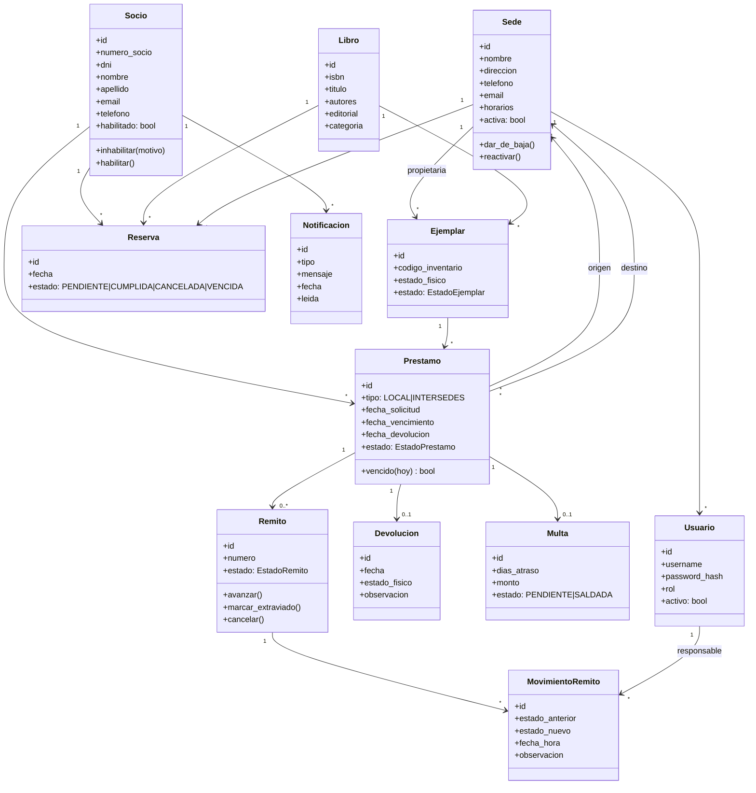
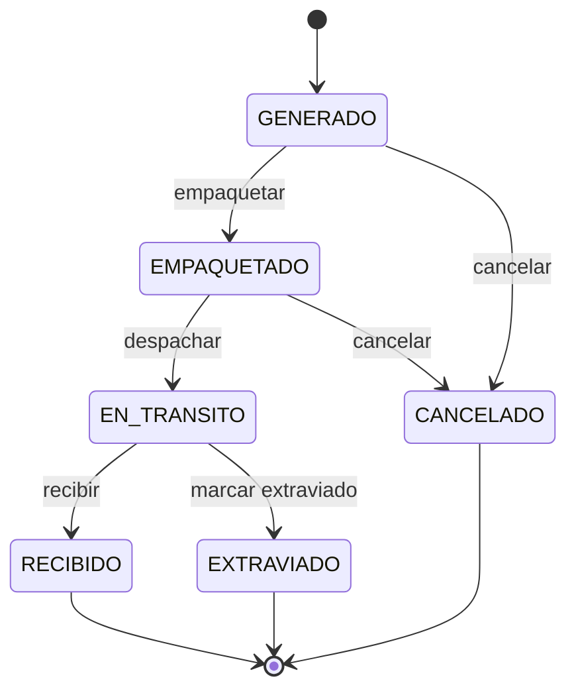
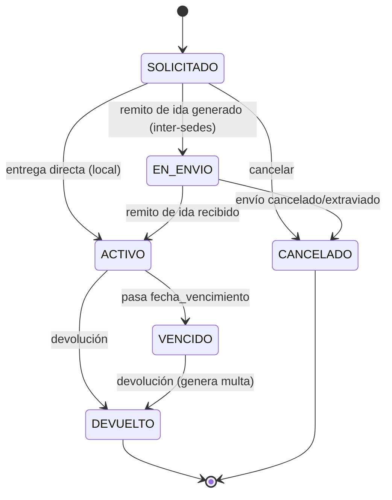
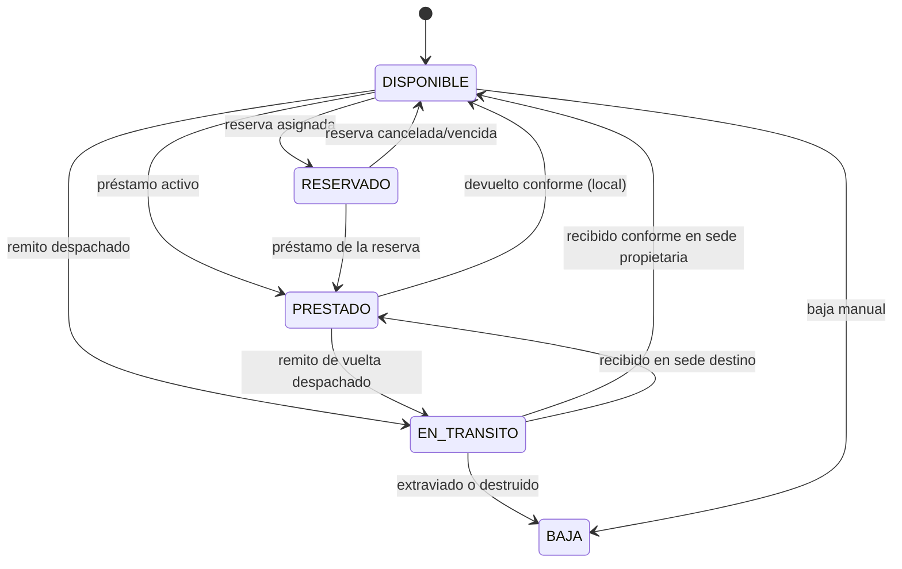
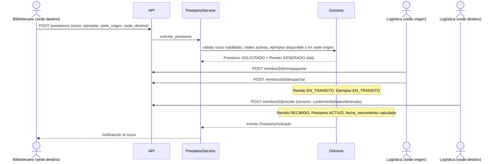

# ARCHITECTURE — Sistema de Préstamos Interbibliotecarios

> Estado: **borrador v1**. Lo marcado como `[PENDIENTE-n]` está sin resolver y se detalla en [pendientes.md](pendientes.md).
> Contexto del dominio: [analisis-enunciado.md](analisis-enunciado.md) y [enunciado.md](enunciado.md).

## 1. Stack tecnológico

| Capa | Tecnología | Motivo |
|---|---|---|
| Backend | **Python 3.12+**, **FastAPI** | Requisito del TPI (Python); `Depends` encaja con autorización por rol; Swagger automático |
| Validación / esquemas | **Pydantic v2** | DTOs de entrada/salida de la API |
| Persistencia | **SQLite** + **SQLAlchemy 2.x** | Sin instalación, apto para entrega académica; migrable a PostgreSQL cambiando la URL |
| Migraciones | **Alembic** | Versionado del esquema |
| Autenticación | **PyJWT** + **argon2** (`pwdlib` o `argon2-cffi`) | JWT de vida corta; hash seguro de contraseñas |
| Frontend | **React 18 + Vite + TypeScript** | SPA que consume la API REST |
| Estilos | **CSS puro con tokens (custom properties) + CSS Modules** | Ver [DESIGN-SYSTEM.md](DESIGN-SYSTEM.md) |
| Estado servidor (front) | **TanStack Query** | Caché y sincronización con la API |
| Routing (front) | **React Router** | |
| Testing backend | **pytest**, `httpx` (TestClient) | |
| Testing frontend | **Vitest** + Testing Library | |
| Calidad | **ruff** (lint+format), **mypy**, **ESLint**, **Prettier** | |

Las versiones exactas se fijan al crear el proyecto (`pyproject.toml`, `package.json`); no se asumen aquí.

## 2. Estructura y organización de carpetas

Monorepo con dos aplicaciones.

```
TPI-DAO/
├── ARCHITECTURE.md
├── DESIGN-SYSTEM.md
├── pendientes.md
├── enunciado.md
├── analisis-enunciado.md
├── backend/
│   ├── pyproject.toml
│   ├── alembic.ini
│   ├── migrations/
│   ├── src/biblioteca/
│   │   ├── domain/                # Núcleo: sin dependencias de FastAPI ni SQLAlchemy
│   │   │   ├── entities/          # Sede, Socio, Libro, Ejemplar, Prestamo, Remito, ...
│   │   │   ├── states/            # Patrón State: estados de Remito, Prestamo, Ejemplar
│   │   │   ├── policies/          # Patrón Strategy: cálculo de multa, plazos
│   │   │   ├── events/            # Eventos de dominio (para Observer)
│   │   │   ├── repositories.py    # Interfaces (puertos) de repositorio
│   │   │   └── errors.py          # Excepciones de dominio
│   │   ├── application/           # Casos de uso / servicios de aplicación
│   │   │   ├── services/          # PrestamoService, EnvioService, ReservaService, ...
│   │   │   ├── reports/           # Consultas de reportes
│   │   │   └── security/          # Autorización por rol y sede
│   │   ├── infrastructure/
│   │   │   ├── db/                # Modelos ORM, sesión, mapeo dominio<->ORM
│   │   │   ├── repositories/      # Implementaciones SQLAlchemy
│   │   │   └── notifications/     # Observers concretos (log/email simulado)
│   │   ├── api/
│   │   │   ├── routers/           # sedes, socios, libros, ejemplares, prestamos, remitos, ...
│   │   │   ├── schemas/           # DTOs Pydantic
│   │   │   ├── deps.py            # Dependencias: sesión, usuario actual, requiere_rol
│   │   │   └── errors.py          # Traducción excepción de dominio -> HTTP
│   │   ├── config.py
│   │   └── main.py
│   └── tests/
│       ├── unit/                  # Dominio y servicios (sin BD ni HTTP)
│       ├── integration/           # Repositorios con SQLite en memoria
│       └── api/                   # Endpoints con TestClient
└── frontend/
    ├── package.json
    ├── vite.config.ts
    └── src/
        ├── styles/                # tokens.css, base.css (ver DESIGN-SYSTEM.md)
        ├── components/            # Core components reutilizables
        ├── features/              # Un módulo por proceso: sedes, socios, prestamos, envios, ...
        ├── api/                   # Cliente HTTP y tipos generados/espejo de los DTOs
        ├── auth/                  # Contexto de sesión, rutas protegidas
        ├── routes/
        └── main.tsx
```

## 3. Separación de responsabilidades

### Base de datos
- Almacena estado y garantiza integridad **estructural**: claves foráneas, `UNIQUE` (ISBN, DNI, código de ejemplar, número de remito), `NOT NULL`, `CHECK` simples.
- Guarda el historial de estados del remito (tabla `movimiento_remito`, solo inserciones).
- **No** contiene reglas de negocio (sin triggers ni procedimientos).
- Esquema versionado con Alembic.

### Backend
Cuatro capas con dependencias hacia adentro (`api → application → domain ← infrastructure`):

| Capa | Responsabilidad | No debe |
|---|---|---|
| `domain` | Entidades con comportamiento, reglas de negocio, transiciones de estado, excepciones de dominio, interfaces de repositorio | Importar FastAPI, SQLAlchemy ni Pydantic |
| `application` | Orquestar casos de uso, transacciones, autorización por sede, publicar eventos | Contener reglas que pertenezcan a una entidad |
| `infrastructure` | Implementar repositorios, mapear dominio↔ORM, observers concretos | Decidir reglas de negocio |
| `api` | HTTP: validar forma, autenticar, exigir rol, traducir errores | Contener lógica de negocio |

Principio rector (exigido por la materia): **la lógica vive en el dominio**, no en los routers ni en la UI.

### Frontend
- Presentación y experiencia de usuario; consume la API REST.
- Valida solo por usabilidad (campos requeridos, formato). **La validación de negocio es siempre del backend**; el frontend muestra los errores que este devuelve.
- Oculta acciones según el rol, pero eso es cosmético: la autorización real ocurre en el backend.

### Patrones de diseño (mínimo exigido: 2)

| Patrón | Dónde | Estado |
|---|---|---|
| **State** | Ciclo de vida de `Remito` (y `Prestamo`/`Ejemplar`); cada estado define transiciones válidas | Núcleo |
| **Strategy** | `PoliticaMulta`, `PoliticaPlazo` intercambiables | Núcleo |
| **Repository** | Acceso a datos tras interfaces del dominio | Núcleo |
| **Factory** | Creación de `Prestamo` local vs. interbibliotecario | Núcleo |
| **Observer** | Eventos de dominio → notificaciones (opcional elegido) | Núcleo |

## 4. Modelado de datos y entidades

### 4.1 Diagrama de clases



### 4.2 Decisiones de modelado

- **Libro ≠ Ejemplar.** Catálogo (título) y copia física separados. La disponibilidad, sede y estado físico son del ejemplar.
- **Unicidad (anti-duplicados):** `Socio.dni` y `Socio.numero_socio`; `Libro.isbn`; `Ejemplar.codigo_inventario`; `Remito.numero`. Se valida en el dominio/servicio **y** se respalda con `UNIQUE` en BD.
- **Un remito por viaje.** Un préstamo interbibliotecario genera un remito de ida y otro de vuelta (`Remito.sentido: IDA|VUELTA`). `[PENDIENTE-1]`, `[PENDIENTE-2]`
- **Reserva sobre Libro** (cualquier ejemplar disponible en la sede indicada) con cola FIFO. `[PENDIENTE-5]`
- **Historial inmutable:** `MovimientoRemito` solo se inserta; nunca se modifica ni se borra. El estado actual de `Remito` es derivable de él, y se guarda además por eficiencia.
- **Baja lógica** en `Sede` y `Usuario` (campo `activa`/`activo`); no se borran registros con historial.
- **Usuario ≠ Socio.** `Usuario` pertenece a una `Sede` (salvo Administrador) y tiene un `rol`. En esta versión el Socio no tiene acceso. `[PENDIENTE-3]`

### 4.3 Máquinas de estado

**Remito**



- Sin retrocesos ni saltos. Cada transición inserta un `MovimientoRemito` con fecha/hora y usuario responsable.
- Al **recibir** se registra la revisión: `CONFORME`, `DANADO` o `DESTRUIDO` (opcional elegido: revisión de recepción). `[PENDIENTE-6]`
- Se unifica "despachado" y "en tránsito" en `EN_TRANSITO` (despachar es la acción; en tránsito, el estado). `[PENDIENTE-7]`

**Préstamo**



**Ejemplar**



(Un ejemplar `DANADO` al devolverse pasa a `EN_REVISION`/`BAJA` según política. `[PENDIENTE-6]`)

### 4.4 Roles y autorización

| Rol | Alcance |
|---|---|
| **ADMIN** | Toda la red; ABM de sedes; gestión de usuarios; reportes de red; parámetros |
| **BIBLIOTECARIO** | Socios, préstamos, reservas, devoluciones de **su sede**; catálogo |
| **LOGISTICA** | Empaquetar, despachar y recibir remitos de **su sede** (origen o destino) |

Autorización en dos niveles:
1. **API:** dependencia `requiere_rol(...)` rechaza con 403 si el rol no corresponde.
2. **Servicio de aplicación:** regla de sede (`usuario.sede == sede del recurso`), excepto ADMIN. Es una validación más, testeable sin HTTP.

Autenticación: login usuario/contraseña → JWT de acceso de vida corta. Contraseñas con argon2.

## 5. Flujos de negocio y validaciones

### 5.1 Validaciones (de la consigna) y dónde se aplican

| Regla | Capa responsable | Error |
|---|---|---|
| No prestar ejemplares no disponibles | `Ejemplar` (estado) + `PrestamoService` | `EjemplarNoDisponible` |
| No prestar a socios inhabilitados | `Socio.puede_pedir_prestamo()` | `SocioInhabilitado` |
| Controlar vencimientos | `Prestamo.vencido(hoy)` + tarea que marca `VENCIDO` | – |
| Trazabilidad del remito | `Remito` (State) + `MovimientoRemito` | `TransicionInvalida` |
| Evitar duplicados | Servicio (consulta previa) + `UNIQUE` en BD | `DuplicadoError` |
| Ejemplar pertenece a la sede origen | `Prestamo` (factory/constructor) | `EjemplarFueraDeSedeOrigen` |
| Sede de baja bloquea préstamos, reservas y envíos | `Sede.activa` verificada en servicios | `SedeDadaDeBaja` |
| Usuario opera solo en su sede | `application/security` | `AccesoDenegado` |

Los errores de dominio se traducen en `api/errors.py` a respuestas HTTP (`409` conflicto de estado/duplicado, `422` validación, `403` permisos, `404` no encontrado) con un cuerpo uniforme `{codigo, mensaje}`.

### 5.2 Flujo: préstamo interbibliotecario



### 5.3 Flujo: devolución

1. Bibliotecario registra devolución con `estado_fisico`.
2. Si `hoy > fecha_vencimiento`, `PoliticaMulta` calcula la multa (Strategy).
3. Local: ejemplar vuelve a `DISPONIBLE` (o se atiende la primera reserva de la cola).
4. Inter-sedes: se genera remito de vuelta hacia la sede propietaria; el ejemplar queda `EN_TRANSITO` hasta su recepción.

### 5.4 Flujo: reservas

- Se crea sobre un libro **sin ejemplar disponible** en la sede indicada. Cola FIFO por libro y sede.
- Al liberarse un ejemplar, se asigna a la primera reserva `PENDIENTE` (`RESERVADO`) y se notifica al socio.
- Una reserva vence si no se concreta el préstamo en el plazo definido. `[PENDIENTE-8]`

### 5.5 Reportes (mínimo exigido: 4 no triviales)

| # | Reporte | Fuente principal |
|---|---|---|
| R1 | Movimiento entre sedes: envíos por origen/destino y **tiempo promedio de tránsito** | `Remito` + `MovimientoRemito` |
| R2 | **Tasa de envíos exitosos** e incidencias | `Remito` (estados finales) + revisión |
| R3 | Libros más solicitados en préstamos inter-sedes | `Prestamo` agrupado por libro |
| R4 | Préstamos vencidos y multas acumuladas | `Prestamo` + `Multa` |
| R5 | Disponibilidad de catálogo por sede | `Ejemplar` agrupado |
| R6 | Préstamos activos y material en tránsito | `Prestamo` + `Remito` |

Se implementan R1–R4 como mínimo; R5 y R6 son alimentación natural de la pantalla de disponibilidad y el tablero. Las consultas viven en `application/reports/` (agregaciones SQL), no en las entidades.

## 6. Convenciones de desarrollo

### Generales
- Idioma del **dominio y la UI: español** (`Prestamo`, `Ejemplar`, `Remito`). Identificadores de infraestructura y código técnico genérico en inglés cuando sea idiomático (`Repository`, `Session`). No mezclar dentro de un mismo concepto.
- Todo cambio funcional incluye tests.

### Backend (Python)
- Estilo: **PEP 8** vía `ruff format`; `ruff check` y `mypy` sin errores. Type hints obligatorios en código nuevo.
- Nombres: módulos y funciones `snake_case`; clases `PascalCase`; constantes `MAYUS_SNAKE`; enums de estado en `MAYUS`.
- Excepciones de dominio propias (`domain/errors.py`), nunca `Exception` genérica.
- Las entidades de dominio **no** heredan del ORM; hay un mapeo explícito en `infrastructure/db`.
- Fechas en UTC; `fecha_vencimiento` como `date`, eventos como `datetime` con zona horaria.
- Los routers son delgados: validar, llamar al servicio, devolver el DTO.
- Contraseñas y secretos solo por variables de entorno (`.env` fuera de git).

### API REST
- Recursos en plural y minúsculas: `/sedes`, `/socios`, `/prestamos`, `/remitos`.
- Acciones de ciclo de vida como subrecursos `POST`: `/remitos/{id}/despachar`.
- Prefijo `/api/v1`. Paginación con `limit`/`offset` en listados.
- Formato de error uniforme `{codigo, mensaje, detalle?}`.

### Frontend (TypeScript)
- `strict: true`. Componentes funcionales con hooks. Archivos de componente en `PascalCase.tsx`, utilidades en `camelCase.ts`.
- Un módulo por proceso en `features/`; los componentes de `components/` no conocen el dominio.
- **Sin colores, tamaños ni espaciados hardcodeados**: solo tokens CSS ([DESIGN-SYSTEM.md](DESIGN-SYSTEM.md)).
- Accesibilidad: HTML semántico, foco visible, contraste AA.

### Git
- Rama `main` estable; trabajo en ramas `feature/<tema>`, `fix/<tema>`.
- Commits en español, imperativo, una idea por commit (`Agregar validación de sede de baja`). Prefijo opcional estilo Conventional Commits.
- No se commitean `.env`, `*.db`, `node_modules/`, `.venv/`.

### Testing
- Pirámide: muchos tests unitarios de dominio (reglas, transiciones de estado), algunos de integración (repositorios con SQLite en memoria), pocos de API.
- Cada validación de la consigna tiene al menos un test que la prueba y otro que verifica el caso válido.
