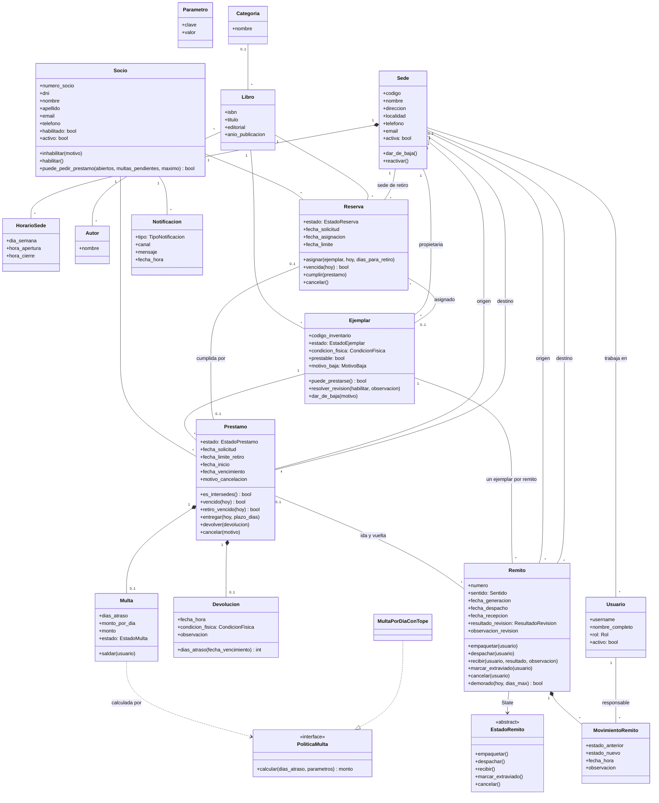
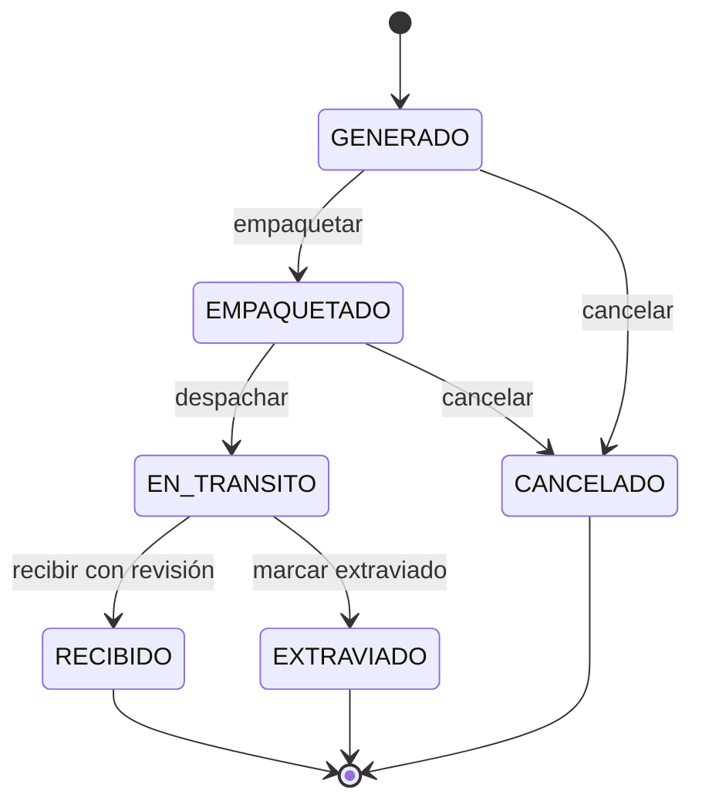
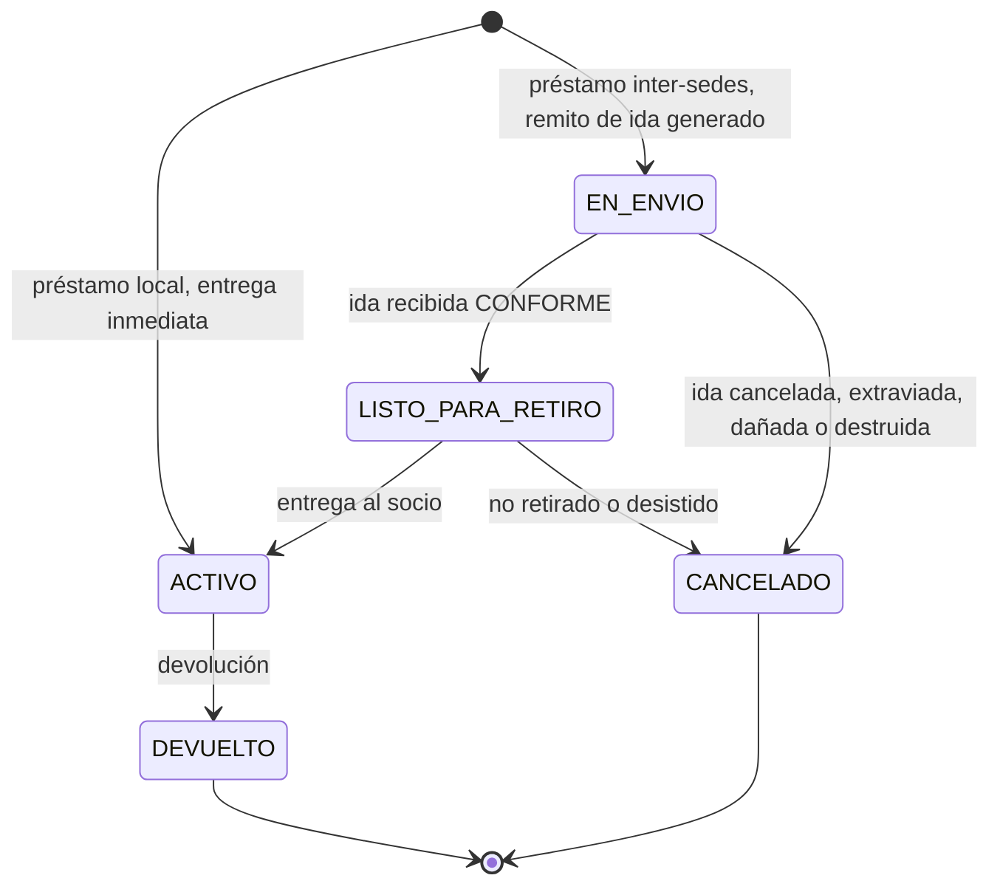
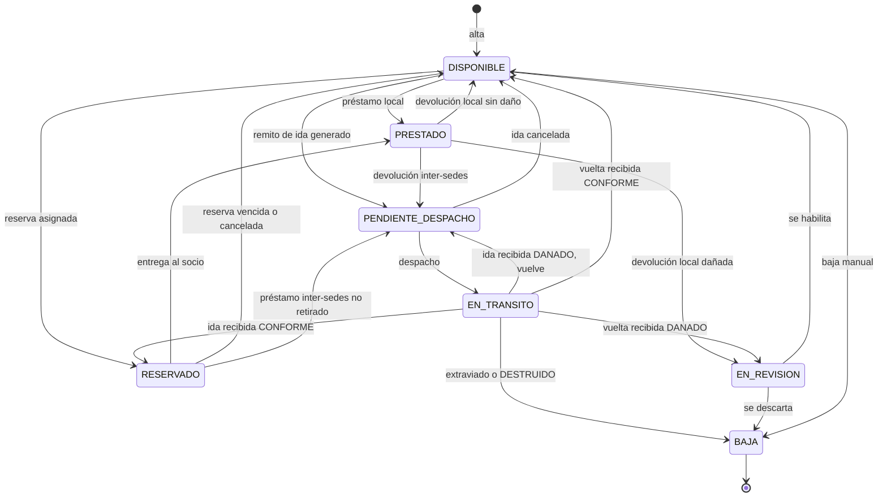
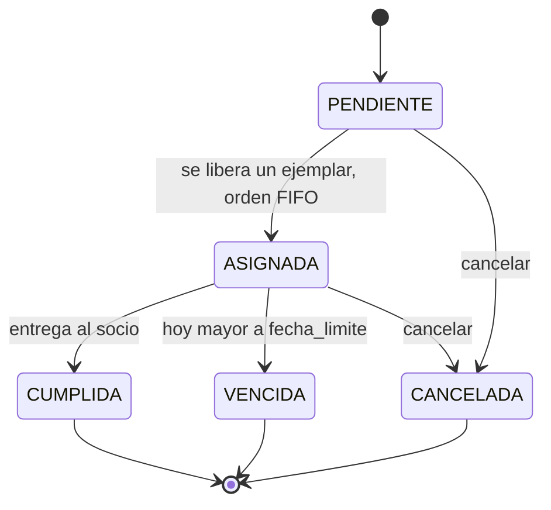
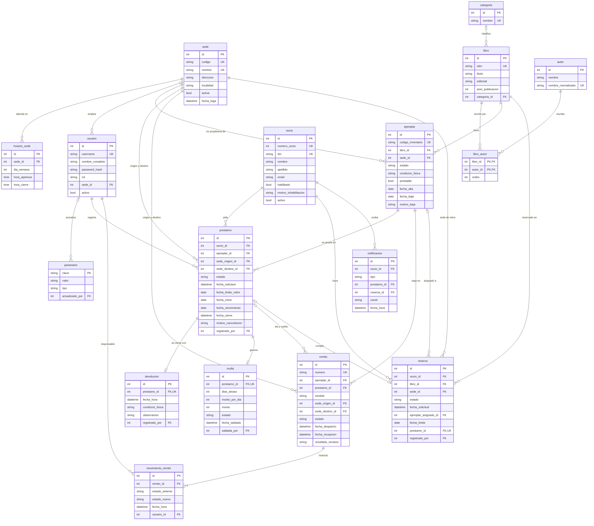
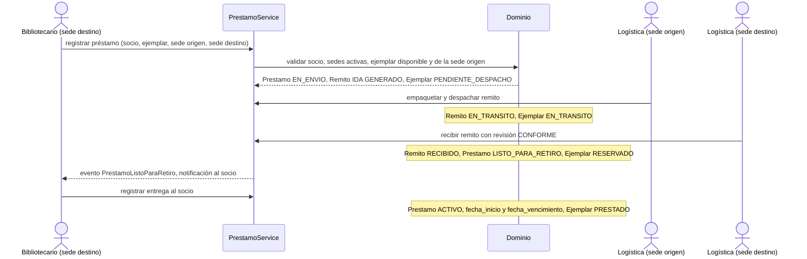

# ARCHITECTURE — Sistema de Préstamos Interbibliotecarios

> Estado: **borrador v2**. Lo marcado como `[PENDIENTE-n]` sigue abierto y se detalla en [pendientes.md](pendientes.md). Las decisiones ya tomadas están en el [registro de decisiones](#10-registro-de-decisiones).
> Contexto del dominio: [analisis-enunciado.md](analisis-enunciado.md) y [enunciado.md](enunciado.md).

## 1. Stack tecnológico

| Capa | Tecnología | Motivo |
|---|---|---|
| Backend | **Python 3.12+**, **FastAPI** | Requisito del TPI (Python); `Depends` encaja con autorización por rol; Swagger automático |
| Validación / esquemas | **Pydantic v2** | DTOs de entrada/salida de la API |
| Persistencia | **SQLite** + **SQLAlchemy 2.1** (Core + mapeo imperativo) | Sin instalación, apto para entrega académica; migrable a PostgreSQL cambiando la URL |
| Migraciones | **Alembic** (`render_as_batch=True`) | Versionado del esquema; el modo batch es necesario porque SQLite no soporta la mayoría de los `ALTER TABLE` |
| Autenticación | **PyJWT** + **argon2** (`pwdlib` o `argon2-cffi`) | JWT firmado; hash seguro de contraseñas |
| Frontend | **React 19 + Vite + TypeScript** | SPA que consume la API REST |
| Estilos | **CSS puro con tokens (custom properties) + CSS Modules** | Ver [DESIGN-SYSTEM.md](DESIGN-SYSTEM.md) |
| Estado servidor (front) | **TanStack Query** | Caché y sincronización con la API |
| Routing (front) | **React Router 7** | |
| Testing backend | **pytest**, `httpx` (TestClient) | |
| Testing frontend | **Vitest** + Testing Library | |
| Calidad | Backend: **ruff** (lint y formato), **mypy** estricto. Frontend: **oxlint** | |

Las versiones exactas están fijadas en `backend/pyproject.toml` + `backend/uv.lock` y en `frontend/package.json` + `frontend/package-lock.json`. El backend usa **uv** para el entorno y las dependencias.

## 2. Estructura y organización de carpetas

Monorepo con dos aplicaciones.

```
TPI-DAO/
├── ARCHITECTURE.md
├── DESIGN-SYSTEM.md
├── pendientes.md
├── enunciado.md
├── analisis-enunciado.md
├── backend/
│   ├── pyproject.toml
│   ├── alembic.ini
│   ├── migrations/
│   ├── src/biblioteca/
│   │   ├── domain/                # Núcleo: sin dependencias de FastAPI ni SQLAlchemy
│   │   │   ├── entities/          # Sede, Socio, Libro, Ejemplar, Prestamo, Remito, Reserva, ...
│   │   │   ├── states/            # Patrón State: estados de Remito (una clase por estado)
│   │   │   ├── policies/          # Patrón Strategy: PoliticaMulta
│   │   │   ├── events/            # Eventos de dominio (para Observer)
│   │   │   ├── enums.py           # EstadoEjemplar, EstadoPrestamo, CondicionFisica, Rol, ...
│   │   │   ├── clock.py           # Puerto Reloj: "hoy" y "ahora" inyectables (tests)
│   │   │   ├── repositories.py    # Interfaces (puertos) de repositorio
│   │   │   └── errors.py          # Excepciones de dominio
│   │   ├── application/           # Casos de uso / servicios de aplicación
│   │   │   ├── services/          # PrestamoService, EnvioService, ReservaService, ...
│   │   │   ├── unit_of_work.py    # Transacción por caso de uso
│   │   │   ├── reports/           # Consultas de reportes
│   │   │   └── security/          # Autorización por rol y sede
│   │   ├── infrastructure/
│   │   │   ├── db/
│   │   │   │   ├── tables.py      # Esquema: tablas, CHECK e índices (SQLAlchemy Core)
│   │   │   │   ├── tipos.py       # Tipos propios (FechaHoraUTC)
│   │   │   │   ├── session.py     # Engine, PRAGMAs de SQLite, sesión
│   │   │   │   ├── migraciones.py # Ejecutar Alembic desde código (CLI y tests)
│   │   │   │   ├── secuencias.py  # Numeración de socios, inventario y remitos
│   │   │   │   ├── insercion.py   # Helper de inserción que devuelve el id
│   │   │   │   ├── seed.py        # Parámetros, categorías y datos de demo
│   │   │   │   └── mappers.py     # (próximo) Mapeo imperativo tablas <-> entidades
│   │   │   ├── repositories/      # Implementaciones SQLAlchemy
│   │   │   └── notifications/     # Observers concretos (email simulado)
│   │   ├── api/
│   │   │   ├── routers/           # sedes, socios, libros, ejemplares, prestamos, remitos, ...
│   │   │   ├── schemas/           # DTOs Pydantic
│   │   │   ├── deps.py            # Dependencias: UoW, usuario actual, requiere_rol
│   │   │   └── errors.py          # Traducción excepción de dominio -> HTTP
│   │   ├── cli.py                 # Comandos: crear-base, seed, reset-base (ver §5.6)
│   │   ├── config.py
│   │   └── main.py
│   └── tests/
│       ├── unit/                  # Dominio y servicios (sin BD ni HTTP)
│       ├── integration/           # Esquema, restricciones, seed y repositorios (SQLite temporal)
│       └── api/                   # Endpoints con TestClient
└── frontend/
    ├── package.json
    ├── vite.config.ts
    └── src/
        ├── styles/                # tokens.css, base.css (ver DESIGN-SYSTEM.md)
        ├── components/            # Core components reutilizables
        ├── features/              # Un módulo por proceso: sedes, socios, prestamos, envios, ...
        ├── api/                   # Cliente HTTP y tipos espejo de los DTOs
        ├── auth/                  # Contexto de sesión, rutas protegidas
        ├── routes/
        └── main.tsx
```

## 3. Separación de responsabilidades

### Base de datos
- Almacena estado y garantiza integridad **estructural**: claves foráneas, `UNIQUE`, `NOT NULL`, `CHECK` e índices únicos parciales (ver §5.2).
- Guarda el historial de estados del remito (`movimiento_remito`, solo inserciones).
- **No** contiene reglas de negocio (sin triggers ni procedimientos).
- Esquema versionado con Alembic; datos iniciales con `seed.py` (ver §5.6).

### Backend
Cuatro capas con dependencias hacia adentro (`api → application → domain ← infrastructure`):

| Capa | Responsabilidad | No debe |
|---|---|---|
| `domain` | Entidades con comportamiento, reglas de negocio, transiciones de estado, excepciones de dominio, interfaces de repositorio | Importar FastAPI, SQLAlchemy ni Pydantic |
| `application` | Orquestar casos de uso dentro de una transacción (Unit of Work), autorización por sede, publicar eventos | Contener reglas que pertenezcan a una entidad |
| `infrastructure` | Tablas, mapeo, repositorios, observers concretos | Decidir reglas de negocio |
| `api` | HTTP: validar forma, autenticar, exigir rol, traducir errores | Contener lógica de negocio |

Principio rector (exigido por la materia): **la lógica vive en el dominio**, no en los routers ni en la UI.

### Frontend
- Presentación y experiencia de usuario; consume la API REST.
- Valida solo por usabilidad (campos requeridos, formato). **La validación de negocio es siempre del backend**; el frontend muestra los errores que este devuelve.
- Oculta acciones según el rol, pero eso es cosmético: la autorización real ocurre en el backend.

### Patrones de diseño (mínimo exigido: 2)

| Patrón | Dónde | Cómo |
|---|---|---|
| **State** (GoF) | Ciclo de vida de `Remito` | Clase abstracta `EstadoRemito` con `empaquetar()`, `despachar()`, `recibir()`, `marcar_extraviado()`, `cancelar()`; por defecto lanzan `TransicionInvalida` y cada estado concreto redefine solo las válidas. Es el núcleo evaluado por la cátedra |
| **Strategy** | Cálculo de multas | Interfaz `PoliticaMulta.calcular(dias_atraso, parametros)`; implementación `MultaPorDiaConTope` |
| **Factory** | Creación de préstamos | `PrestamoFactory` crea un préstamo local (`ACTIVO`) o inter-sedes (`EN_ENVIO` + remito de ida) según las sedes |
| **Observer** | Notificaciones | Los servicios publican eventos de dominio; `NotificadorSocio` se suscribe y registra la notificación |
| **Repository** + **Unit of Work** | Persistencia | Interfaces en el dominio; un UoW por caso de uso garantiza que todos los cambios de un evento (§4.5) se confirmen juntos |

`Prestamo`, `Ejemplar` y `Reserva` también tienen máquinas de estado, pero con menos comportamiento por estado: se implementan con una **tabla de transiciones válidas** (enum + diccionario), no con una clase por estado.

## 4. Modelo de dominio

### 4.1 Agrupación de entidades

| Grupo | Entidades | Responsabilidad |
|---|---|---|
| Organización | `Sede`, `HorarioSede`, `Usuario`, `Parametro` | Red de sedes, personal y configuración |
| Catálogo | `Libro`, `Autor`, `Categoria`, `Ejemplar` | Obras y copias físicas |
| Socios | `Socio`, `Multa`, `Notificacion` | Lectores, sanciones y avisos |
| Circulación | `Prestamo`, `Devolucion`, `Reserva` | Préstamos locales e inter-sedes, devoluciones y colas de espera |
| Logística | `Remito`, `MovimientoRemito` | Traslados físicos entre sedes y su trazabilidad |
| Soporte | `Secuencia` | Numeración de socios, inventario y remitos (solo infraestructura) |

### 4.2 Diagrama de clases



Los valores de cada enumeración están en el diccionario de datos (§5.1).

### 4.3 Decisiones de modelado

**Catálogo**
- **Libro ≠ Ejemplar.** El libro es la obra (catálogo compartido por toda la red); el ejemplar es la copia física, pertenece a una sede y es lo que se presta.
- **ISBN obligatorio**, normalizado a ISBN-13 (los ISBN-10 se convierten) y validado por dígito verificador. Es la clave anti-duplicados del catálogo. Los libros sin ISBN quedan fuera del alcance.
- **Autores y categorías como entidades.** `Autor` (N:M con `Libro`, con orden de autoría) y `Categoria` (1:N) evitan variantes del mismo nombre y permiten filtrar.
- **Material de consulta.** Un ejemplar con `prestable = false` es de **consulta en sala**: aparece en el catálogo y en la disponibilidad, pero no puede prestarse ni reservarse. Otros tipos de material (revistas, audiovisuales) quedan fuera del alcance; la entidad se llama `Libro`.
- **Dos atributos distintos en el ejemplar.** `estado` es la **situación** (dónde está o para qué está comprometido); `condicion_fisica` es su **estado material** (`BUENA`, `REGULAR`, `DANADA`). `Devolucion.condicion_fisica` usa la misma escala y actualiza la del ejemplar.
- **La ubicación del ejemplar no se guarda.** Está en su sede propietaria salvo que tenga un remito abierto (está en tránsito o esperando despacho en la sede origen del remito) o un préstamo inter-sedes abierto (está en la sede destino). Se deriva con una consulta para no mantener un dato redundante.
- **Baja del ejemplar con motivo.** `motivo_baja` (`EXTRAVIO`, `DESTRUCCION`, `DANO`, `DESCARTE`) es obligatorio si `estado = BAJA`; alimenta el reporte de incidencias.

**Socios**
- **Socio de la red**, no de una sede: puede pedir préstamos en cualquier sede activa.
- **`habilitado` es solo la sanción manual** (con motivo y fecha). La capacidad real es `puede_pedir_prestamo()` = `activo` **y** `habilitado` **y** sin multas `PENDIENTE` **y** préstamos abiertos (`EN_ENVIO`, `LISTO_PARA_RETIRO`, `ACTIVO`) < `max_prestamos_simultaneos`. Al saldar una multa no hay nada que "reactivar".
- **`activo` es la baja lógica** del socio. No se puede dar de baja a un socio con préstamos abiertos, reservas abiertas o multas pendientes.

**Préstamos**
- **Un préstamo, un ejemplar.** Local si `sede_origen = sede_destino`; inter-sedes si son distintas. El tipo se **deriva** (`es_intersedes()`), no se guarda.
- **La sede origen debe ser la propietaria del ejemplar** (validación del enunciado). Se guarda igual porque el enunciado pide registrarla y deja el préstamo autocontenido.
- **Sin aprobación de la sede origen:** si el ejemplar está disponible, el préstamo inter-sedes se registra y el remito de ida se genera en el acto. `[PENDIENTE-38]`
- **Retiro por el socio.** Al recibirse la ida conforme, el préstamo queda `LISTO_PARA_RETIRO` y el ejemplar `RESERVADO` en la sede destino, con `fecha_limite_retiro = hoy + dias_para_retiro`. El préstamo pasa a `ACTIVO` recién cuando el bibliotecario registra la **entrega**. Si el socio no lo retira a tiempo, `retiro_vencido(hoy)` lo marca en los listados y el bibliotecario cancela el préstamo, lo que genera el remito de vuelta.
- **El vencimiento corre desde la entrega al socio** (`fecha_inicio`), en préstamos locales e inter-sedes. Así ni las demoras logísticas ni la espera del retiro consumen el plazo del socio.
- **`VENCIDO` no es un estado guardado.** Es derivado: `ACTIVO` y `hoy > fecha_vencimiento`. No hay tarea programada.
- **El préstamo se cierra (`DEVUELTO`) cuando el socio devuelve**, no cuando el ejemplar regresa a su sede: la multa y la situación del socio no dependen de la logística.
- **Se devuelve en la sede destino** (donde se retiró). Para un préstamo local es la misma sede.
- **Sin renovaciones** en v1.
- **Un socio no puede tener dos préstamos abiertos del mismo libro** (validación de servicio).

**Multas**
- **Solo por atraso.** Se generan al registrar una devolución con `hoy > fecha_vencimiento`, en **días corridos**. Una multa por préstamo como máximo.
- **Monto calculado por Strategy** (`MultaPorDiaConTope`: `min(dias_atraso, multa_tope_dias) × multa_por_dia`). El monto por día se **copia** a la multa al generarla, para que un cambio posterior del parámetro no altere multas emitidas.
- **Importes en centavos** (enteros), nunca en coma flotante.
- **Saldar** = marcar `SALDADA` a mano (los pagos están fuera de alcance), con usuario y fecha.
- **El daño no genera multa** en v1: queda en `Devolucion.condicion_fisica` y la observación; si corresponde, el bibliotecario inhabilita al socio manualmente.

**Reservas**
- **Sobre el libro, en la sede de retiro.** Solo se cumple con ejemplares **propietarios de esa sede**. No hay reservas que disparen préstamos inter-sedes.
- **Se admite si** la sede de retiro tiene al menos un ejemplar prestable que no esté de baja, y **ninguno está `DISPONIBLE`** (si hay uno disponible, se presta directamente). Un socio no puede tener dos reservas abiertas del mismo libro.
- **Cola FIFO** por libro y sede (orden de `fecha_solicitud`). Cada vez que un ejemplar de esa sede queda `DISPONIBLE`, se asigna a la primera reserva `PENDIENTE`: la reserva pasa a `ASIGNADA` y el ejemplar a `RESERVADO`, con `fecha_limite = hoy + dias_para_retiro`.
- **Vencimiento perezoso.** Antes de consultar disponibilidad, registrar un préstamo o asignar reservas de un libro y sede, el servicio ejecuta `liberar_reservas_vencidas(libro, sede)`, que pasa a `VENCIDA` las asignadas con `hoy > fecha_limite`, libera el ejemplar y asigna la siguiente. Sin tarea programada.

**Logística**
- **Un remito por ejemplar y por viaje.** Un préstamo inter-sedes genera un remito de ida y, al terminar, uno de vuelta (`sentido: IDA | VUELTA`), cada uno con su propio ciclo de vida. Razones: el libro no está "en tránsito" mientras lo tiene el socio; no hay retrocesos de estado; la responsabilidad de un extravío o daño queda atribuida a un viaje concreto; el tiempo de tránsito se mide por viaje. `[PENDIENTE-1]`
- **Toda vuelta va a la sede propietaria.** Hay remito de vuelta tras una devolución inter-sedes, un préstamo no retirado o una ida recibida dañada.
- **`Remito.prestamo_id` es opcional** para habilitar a futuro traslados sin préstamo. En v1 no se implementan, y ninguna regla asume que todo remito tiene préstamo. `[PENDIENTE-29]`
- **El ejemplar queda comprometido desde que se genera el remito** (`PENDIENTE_DESPACHO`), en la ida y en la vuelta: no puede prestarse ni reservarse a otro socio.
- **Revisión obligatoria al recibir:** `resultado_revision` (`CONFORME`, `DANADO`, `DESTRUIDO`) y `observacion_revision`.
- **Fechas de despacho y recepción desnormalizadas** en el remito. La fuente de verdad es `MovimientoRemito`; las columnas se escriben en la misma transacción y simplifican el reporte de tiempo de tránsito.
- **Remitos demorados.** `demorado(hoy, dias_max_transito)` es verdadero si lleva más de ese plazo en `EN_TRANSITO`. Se calcula al consultar; **Logística confirma el extravío manualmente** porque `EXTRAVIADO` es final e irreversible.
- **Cancelación.** Un remito solo se cancela antes de despacharse. Cancelar una ida cancela el préstamo y el ejemplar vuelve a `DISPONIBLE`. Cancelar una vuelta (corrección de un error) genera otra vuelta: el ejemplar sigue `PENDIENTE_DESPACHO` porque no está en su sede. `[PENDIENTE-7]`
- **Historial inmutable:** `MovimientoRemito` solo se inserta, con usuario responsable, fecha/hora y observación.

**Organización**
- **Baja de sede impedida con actividad abierta:** préstamos abiertos, remitos no finales o reservas abiertas que involucren a la sede como origen, destino o sede de retiro. Con la sede de baja se bloquean préstamos, reservas y envíos nuevos, y sus ejemplares no pueden prestarse. `reactivar()` revierte la baja.
- **`Sede.codigo`** (2 a 5 letras mayúsculas, único) identifica la sede en los códigos de inventario.
- **Horarios como tabla hija** (`HorarioSede`): varias franjas por día (horario cortado), sin superposición dentro del mismo día.
- **Parámetros del sistema** en la entidad `Parametro`, editables por ADMIN (§5.5).
- **Usuario ≠ Socio.** El socio no ingresa al sistema en v1. `[PENDIENTE-3]`
- **Bajas lógicas** en `Sede`, `Socio`, `Usuario` y `Ejemplar`. No se borran físicamente registros con historial.
- **Auditoría mínima:** `registrado_por` en préstamos, devoluciones y reservas; `saldada_por` en multas; usuario en cada `MovimientoRemito`; `creado_en`/`actualizado_en` en todas las tablas. Sin tabla de auditoría genérica.

### 4.4 Máquinas de estado

**Remito** (patrón State)



- Sin retrocesos ni saltos. Cada transición inserta un `MovimientoRemito`.
- Empaquetar, despachar y cancelar los hace la sede origen; recibir, la sede destino; marcar extraviado, cualquiera de las dos.

**Préstamo**



- `VENCIDO` es derivado (`ACTIVO` con `hoy > fecha_vencimiento`); `retiro_vencido` también (`LISTO_PARA_RETIRO` con `hoy > fecha_limite_retiro`).
- `motivo_cancelacion`: `ENVIO_CANCELADO`, `ENVIO_EXTRAVIADO`, `ENVIO_DANADO`, `ENVIO_DESTRUIDO`, `NO_RETIRADO`, `DESISTIDO`. En las cancelaciones por envío el socio no es penalizado.

**Ejemplar**



- `RESERVADO` significa **apartado para un socio, esperando retiro**: por una reserva asignada (en la sede propietaria) o por un préstamo inter-sedes listo para retiro (en la sede destino).
- `EN_REVISION` siempre ocurre en la sede propietaria: un ejemplar dañado en otra sede primero vuelve. Lo resuelve un BIBLIOTECARIO de la sede propietaria (o ADMIN), con observación obligatoria.
- Cada vez que el ejemplar queda `DISPONIBLE`, se intenta asignar la cola de reservas de su libro en su sede.

**Reserva**



### 4.5 Matriz de efectos de cada evento

Cada evento cambia varias entidades **en una misma transacción** (Unit of Work). Esta tabla es la especificación de los servicios y de sus tests. "Cola" significa: asignar el ejemplar liberado a la primera reserva `PENDIENTE` de su libro y sede.

| Evento | Remito | Préstamo | Ejemplar | Otros |
|---|---|---|---|---|
| Préstamo local | – | Se crea `ACTIVO` (`fecha_inicio`, `fecha_vencimiento`) | `DISPONIBLE` o `RESERVADO` → `PRESTADO` | Reserva del socio, si la había: `ASIGNADA` → `CUMPLIDA` |
| Préstamo inter-sedes | Se crea la **ida** `GENERADO` | Se crea `EN_ENVIO` | `DISPONIBLE` → `PENDIENTE_DESPACHO` | – |
| Empaquetar | `GENERADO` → `EMPAQUETADO` | – | – | – |
| Despachar (ida o vuelta) | `EMPAQUETADO` → `EN_TRANSITO`; `fecha_despacho` | – | `PENDIENTE_DESPACHO` → `EN_TRANSITO` | – |
| Cancelar ida | → `CANCELADO` | → `CANCELADO` (`ENVIO_CANCELADO`) | → `DISPONIBLE`; cola | – |
| Recibir ida `CONFORME` | → `RECIBIDO`; `fecha_recepcion` | `EN_ENVIO` → `LISTO_PARA_RETIRO`; `fecha_limite_retiro` | `EN_TRANSITO` → `RESERVADO` | Notificación `LISTO_PARA_RETIRO` |
| Recibir ida `DANADO` | → `RECIBIDO`; se crea la **vuelta** | → `CANCELADO` (`ENVIO_DANADO`) | → `PENDIENTE_DESPACHO`; condición `DANADA` | Notificación `PRESTAMO_CANCELADO` |
| Recibir ida `DESTRUIDO` | → `RECIBIDO` | → `CANCELADO` (`ENVIO_DESTRUIDO`) | → `BAJA` (`DESTRUCCION`) | Notificación `PRESTAMO_CANCELADO` |
| Marcar ida extraviada | → `EXTRAVIADO` | → `CANCELADO` (`ENVIO_EXTRAVIADO`) | → `BAJA` (`EXTRAVIO`) | Notificación `PRESTAMO_CANCELADO` |
| Entregar al socio (inter-sedes) | – | `LISTO_PARA_RETIRO` → `ACTIVO` (`fecha_inicio`, `fecha_vencimiento`) | `RESERVADO` → `PRESTADO` | – |
| Cancelar préstamo no retirado | Se crea la **vuelta** | `LISTO_PARA_RETIRO` → `CANCELADO` (`NO_RETIRADO` o `DESISTIDO`) | `RESERVADO` → `PENDIENTE_DESPACHO` | – |
| Devolución local | – | `ACTIVO` → `DEVUELTO` | → `DISPONIBLE` (cola) o `EN_REVISION` si `DANADA` | `Devolucion`; `Multa` si hay atraso (notificación `MULTA_GENERADA`) |
| Devolución inter-sedes | Se crea la **vuelta** | `ACTIVO` → `DEVUELTO` | `PRESTADO` → `PENDIENTE_DESPACHO`; condición actualizada | `Devolucion`; `Multa` si hay atraso |
| Recibir vuelta `CONFORME` | → `RECIBIDO` | – | → `DISPONIBLE`; cola | – |
| Recibir vuelta `DANADO` | → `RECIBIDO` | – | → `EN_REVISION`; condición `DANADA` | – |
| Recibir vuelta `DESTRUIDO` | → `RECIBIDO` | – | → `BAJA` (`DESTRUCCION`) | El socio no es penalizado |
| Marcar vuelta extraviada | → `EXTRAVIADO` | – | → `BAJA` (`EXTRAVIO`) | El socio no es penalizado |
| Cancelar vuelta | → `CANCELADO`; se crea otra vuelta | – | Sigue `PENDIENTE_DESPACHO` | – |
| Resolver revisión | – | – | `EN_REVISION` → `DISPONIBLE` (cola) o `BAJA` (`DANO`) | – |
| Asignar reserva (cola) | – | – | `DISPONIBLE` → `RESERVADO` | Reserva `PENDIENTE` → `ASIGNADA`; notificación `RESERVA_ASIGNADA` |
| Vencer reserva (perezoso) | – | – | `RESERVADO` → `DISPONIBLE`; cola | Reserva `ASIGNADA` → `VENCIDA` |
| Cancelar reserva | – | – | Si estaba asignada: → `DISPONIBLE`; cola | Reserva → `CANCELADA` |
| Saldar multa | – | – | – | Multa `PENDIENTE` → `SALDADA` |
| Dar de baja una sede | – | – | – | Falla con `SedeConActividadAbierta` si hay actividad abierta |

## 5. Base de datos

### Diagrama entidad-relación

Columnas principales de cada tabla (las marcas de tiempo `creado_en` y `actualizado_en` se omiten). El detalle completo está en el diccionario (§5.1) y en `backend/src/biblioteca/infrastructure/db/tables.py`.



La tabla `secuencia` (numeración) no tiene relaciones y no se dibuja.

### 5.1 Diccionario de datos

Convenciones: tablas en singular y `snake_case` sin tildes; PK `id INTEGER` autoincremental; FK `<entidad>_id` con `ON DELETE RESTRICT`; enumeraciones como `TEXT` en MAYÚSCULA con `CHECK`; importes en centavos (`INTEGER`); todas las tablas mutables tienen `creado_en` y `actualizado_en` (`DATETIME`, UTC), omitidos abajo.

**sede**

| Columna | Tipo | Restricciones |
|---|---|---|
| codigo | TEXT | `NOT NULL`, `UNIQUE`, `CHECK` largo 2–5; que sean letras mayúsculas lo valida el dominio |
| nombre | TEXT | `NOT NULL`, `UNIQUE` |
| direccion, localidad | TEXT | `NOT NULL` |
| telefono, email | TEXT | |
| activa | BOOLEAN | `NOT NULL`, por defecto verdadero |
| fecha_baja | DATETIME | `CHECK (activa = (fecha_baja IS NULL))` |

**horario_sede**

| Columna | Tipo | Restricciones |
|---|---|---|
| sede_id | FK sede | `NOT NULL` |
| dia_semana | INTEGER | `CHECK 1..7` (1 = lunes) |
| hora_apertura, hora_cierre | TIME | `CHECK (hora_apertura < hora_cierre)` |
| | | `UNIQUE (sede_id, dia_semana, hora_apertura)`; la no superposición se valida en el dominio |

**usuario**

| Columna | Tipo | Restricciones |
|---|---|---|
| username | TEXT | `NOT NULL`, `UNIQUE` |
| nombre_completo | TEXT | `NOT NULL` |
| password_hash | TEXT | `NOT NULL` (argon2) |
| rol | TEXT | `ADMIN`, `BIBLIOTECARIO`, `LOGISTICA` |
| sede_id | FK sede | `CHECK ((rol = 'ADMIN') = (sede_id IS NULL))` |
| activo | BOOLEAN | `NOT NULL` |

**parametro**

| Columna | Tipo | Restricciones |
|---|---|---|
| clave | TEXT | PK |
| valor | TEXT | `NOT NULL` (se interpreta según `tipo`) |
| tipo | TEXT | `ENTERO` (único tipo en v1) |
| descripcion | TEXT | |
| actualizado_por | FK usuario | |

**secuencia** (infraestructura)

| Columna | Tipo | Restricciones |
|---|---|---|
| nombre | TEXT | PK (`socio`, `inventario:CEN`, `remito:2026`, ...) |
| ultimo_valor | INTEGER | `NOT NULL` |

**categoria**: `nombre TEXT NOT NULL UNIQUE`.
**autor**: `nombre TEXT NOT NULL`, `nombre_normalizado TEXT NOT NULL UNIQUE` (minúsculas, sin tildes ni espacios dobles).
**libro_autor**: `libro_id`, `autor_id`, `orden INTEGER` (`>= 1`); PK `(libro_id, autor_id)`, `UNIQUE (libro_id, orden)`.

**libro**

| Columna | Tipo | Restricciones |
|---|---|---|
| isbn | TEXT | `NOT NULL`, `UNIQUE`, `CHECK (length(isbn) = 13)`; dígito verificador validado en el dominio |
| titulo | TEXT | `NOT NULL` |
| editorial | TEXT | |
| anio_publicacion | INTEGER | |
| categoria_id | FK categoria | |

**ejemplar**

| Columna | Tipo | Restricciones |
|---|---|---|
| codigo_inventario | TEXT | `NOT NULL`, `UNIQUE`, formato `<sede.codigo>-<nnnnnn>` |
| libro_id | FK libro | `NOT NULL` |
| sede_id | FK sede | `NOT NULL` (propietaria) |
| estado | TEXT | `DISPONIBLE`, `RESERVADO`, `PENDIENTE_DESPACHO`, `EN_TRANSITO`, `PRESTADO`, `EN_REVISION`, `BAJA` |
| condicion_fisica | TEXT | `BUENA`, `REGULAR`, `DANADA` |
| prestable | BOOLEAN | `NOT NULL`; falso = consulta en sala |
| fecha_alta | DATE | `NOT NULL` |
| fecha_baja | DATE | `CHECK ((estado = 'BAJA') = (fecha_baja IS NOT NULL))` |
| motivo_baja | TEXT | `EXTRAVIO`, `DESTRUCCION`, `DANO`, `DESCARTE`; `CHECK ((estado = 'BAJA') = (motivo_baja IS NOT NULL))` |

**socio**

| Columna | Tipo | Restricciones |
|---|---|---|
| numero_socio | INTEGER | `NOT NULL`, `UNIQUE` (secuencia) |
| dni | TEXT | `NOT NULL`, `UNIQUE`, solo dígitos |
| nombre, apellido | TEXT | `NOT NULL` |
| email, telefono, direccion | TEXT | |
| fecha_alta | DATE | `NOT NULL` |
| habilitado | BOOLEAN | `NOT NULL` |
| motivo_inhabilitacion | TEXT | `CHECK (habilitado = (motivo_inhabilitacion IS NULL))` |
| fecha_inhabilitacion | DATETIME | |
| activo | BOOLEAN | `NOT NULL` (baja lógica) |

**prestamo**

| Columna | Tipo | Restricciones |
|---|---|---|
| socio_id | FK socio | `NOT NULL` |
| ejemplar_id | FK ejemplar | `NOT NULL` |
| sede_origen_id, sede_destino_id | FK sede | `NOT NULL`; distintas si el estado es `EN_ENVIO` o `LISTO_PARA_RETIRO` |
| estado | TEXT | `EN_ENVIO`, `LISTO_PARA_RETIRO`, `ACTIVO`, `DEVUELTO`, `CANCELADO` |
| fecha_solicitud | DATETIME | `NOT NULL` |
| fecha_limite_retiro | DATE | Obligatoria en `LISTO_PARA_RETIRO` |
| fecha_inicio | DATE | Entrega al socio |
| fecha_vencimiento | DATE | Obligatoria con `fecha_inicio` en `ACTIVO` y `DEVUELTO`; `>= fecha_inicio` |
| fecha_cierre | DATETIME | `CHECK ((estado IN ('DEVUELTO','CANCELADO')) = (fecha_cierre IS NOT NULL))` |
| motivo_cancelacion | TEXT | `CHECK ((estado = 'CANCELADO') = (motivo_cancelacion IS NOT NULL))` |
| registrado_por | FK usuario | `NOT NULL` |

**devolucion**

| Columna | Tipo | Restricciones |
|---|---|---|
| prestamo_id | FK prestamo | `NOT NULL`, `UNIQUE` |
| fecha_hora | DATETIME | `NOT NULL` |
| condicion_fisica | TEXT | `BUENA`, `REGULAR`, `DANADA` |
| observacion | TEXT | Obligatoria si `DANADA` (dominio) |
| registrado_por | FK usuario | `NOT NULL` |

**multa**

| Columna | Tipo | Restricciones |
|---|---|---|
| prestamo_id | FK prestamo | `NOT NULL`, `UNIQUE` |
| dias_atraso | INTEGER | `CHECK (dias_atraso > 0)` |
| monto_por_dia | INTEGER | Centavos, copia del parámetro |
| monto | INTEGER | Centavos, `CHECK (monto > 0)` |
| estado | TEXT | `PENDIENTE`, `SALDADA` |
| fecha_generacion | DATETIME | `NOT NULL` |
| fecha_saldada, saldada_por | DATETIME, FK usuario | Obligatorios si `SALDADA` |

**reserva**

| Columna | Tipo | Restricciones |
|---|---|---|
| socio_id, libro_id | FK | `NOT NULL` |
| sede_id | FK sede | `NOT NULL` (sede de retiro) |
| estado | TEXT | `PENDIENTE`, `ASIGNADA`, `CUMPLIDA`, `CANCELADA`, `VENCIDA` |
| fecha_solicitud | DATETIME | `NOT NULL` (orden FIFO) |
| ejemplar_asignado_id | FK ejemplar | Obligatorio en `ASIGNADA` y `CUMPLIDA` |
| fecha_asignacion | DATETIME | |
| fecha_limite | DATE | Obligatoria en `ASIGNADA` |
| prestamo_id | FK prestamo | `UNIQUE`; obligatorio en `CUMPLIDA` |
| fecha_cierre | DATETIME | Obligatoria si y solo si está `CUMPLIDA`, `CANCELADA` o `VENCIDA` |
| registrado_por | FK usuario | `NOT NULL` |

**remito**

| Columna | Tipo | Restricciones |
|---|---|---|
| numero | TEXT | `NOT NULL`, `UNIQUE`, formato `R-<aaaa>-<nnnnnn>` |
| ejemplar_id | FK ejemplar | `NOT NULL` |
| prestamo_id | FK prestamo | Opcional |
| sentido | TEXT | `IDA`, `VUELTA` |
| sede_origen_id, sede_destino_id | FK sede | `NOT NULL`, `CHECK (sede_origen_id <> sede_destino_id)` |
| estado | TEXT | `GENERADO`, `EMPAQUETADO`, `EN_TRANSITO`, `RECIBIDO`, `EXTRAVIADO`, `CANCELADO` |
| fecha_generacion | DATETIME | `NOT NULL` |
| fecha_despacho | DATETIME | Obligatoria si y solo si fue despachado (`EN_TRANSITO`, `RECIBIDO`, `EXTRAVIADO`) |
| fecha_recepcion | DATETIME | Obligatoria si y solo si está `RECIBIDO` |
| resultado_revision | TEXT | `CONFORME`, `DANADO`, `DESTRUIDO`; `CHECK ((estado = 'RECIBIDO') = (resultado_revision IS NOT NULL))` |
| observacion_revision | TEXT | Obligatoria si no es `CONFORME` (dominio) |

**movimiento_remito**

| Columna | Tipo | Restricciones |
|---|---|---|
| remito_id | FK remito | `NOT NULL` |
| estado_anterior | TEXT | Nulo solo en la creación |
| estado_nuevo | TEXT | `NOT NULL` |
| fecha_hora | DATETIME | `NOT NULL` |
| usuario_id | FK usuario | `NOT NULL` |
| observacion | TEXT | |

**notificacion**

| Columna | Tipo | Restricciones |
|---|---|---|
| socio_id | FK socio | `NOT NULL` |
| tipo | TEXT | `LISTO_PARA_RETIRO`, `RESERVA_ASIGNADA`, `VENCIMIENTO_PROXIMO`, `PRESTAMO_VENCIDO`, `MULTA_GENERADA`, `PRESTAMO_CANCELADO` |
| prestamo_id, reserva_id | FK | `prestamo_id` obligatorio salvo en `RESERVA_ASIGNADA`; `reserva_id` obligatorio en `RESERVA_ASIGNADA` |
| canal | TEXT | `EMAIL_SIMULADO` |
| mensaje | TEXT | `NOT NULL` |
| fecha_hora | DATETIME | `NOT NULL` |

### 5.2 Invariantes de integridad

Red de seguridad cuando el dominio falle. SQLite soporta índices únicos parciales (`CREATE UNIQUE INDEX ... WHERE ...`).

| Invariante | Mecanismo |
|---|---|
| Sin duplicados de sede, socio, libro, ejemplar, remito y usuario | `UNIQUE` en `sede.codigo`, `sede.nombre`, `socio.dni`, `socio.numero_socio`, `libro.isbn`, `ejemplar.codigo_inventario`, `remito.numero`, `usuario.username` |
| Un solo préstamo abierto por ejemplar | Índice único parcial `prestamo(ejemplar_id)` donde `estado IN ('EN_ENVIO','LISTO_PARA_RETIRO','ACTIVO')` |
| Un solo remito no final por ejemplar | Índice único parcial `remito(ejemplar_id)` donde `estado IN ('GENERADO','EMPAQUETADO','EN_TRANSITO')` |
| A lo sumo una ida y una vuelta vigentes por préstamo | Índice único parcial `remito(prestamo_id, sentido)` donde `estado <> 'CANCELADO'` (una vuelta cancelada se reemplaza) |
| Un ejemplar apartado para una sola reserva | Índice único parcial `reserva(ejemplar_asignado_id)` donde `estado = 'ASIGNADA'` |
| Una reserva abierta por socio y libro | Índice único parcial `reserva(socio_id, libro_id)` donde `estado IN ('PENDIENTE','ASIGNADA')` |
| Un aviso de vencimiento por préstamo y tipo | Índice único parcial `notificacion(prestamo_id, tipo)` donde `tipo IN ('VENCIMIENTO_PROXIMO','PRESTAMO_VENCIDO')` |
| Coherencia entre estado y datos obligatorios | `CHECK` indicados en §5.1 (baja con motivo, recibido con revisión, cancelado con motivo, ADMIN sin sede) |
| Valores válidos de las enumeraciones | `CHECK` generado por SQLAlchemy (`Enum(..., native_enum=False, create_constraint=True)`) |
| Historial de remitos inmutable | El repositorio de `movimiento_remito` solo expone inserción |
| Integridad referencial | `PRAGMA foreign_keys = ON` en cada conexión (SQLite lo trae desactivado) |

### 5.3 Índices para consultas y reportes

| Índice | Uso |
|---|---|
| `ejemplar(libro_id, sede_id, estado)` | Disponibilidad por sede (R5), asignación de cola |
| `prestamo(socio_id, estado)` | `puede_pedir_prestamo()`, préstamos del socio |
| `prestamo(estado, fecha_vencimiento)` | Vencidos (R4), avisos de vencimiento |
| `remito(estado, fecha_despacho)` | Material en tránsito y demorados (R6) |
| `remito(sede_origen_id, sede_destino_id)` | Movimiento entre sedes (R1) |
| `reserva(libro_id, sede_id, estado, fecha_solicitud)` | Cola FIFO |
| `multa(estado)` | Multas pendientes (R4, habilitación) |
| `movimiento_remito(remito_id, fecha_hora)` | Trazabilidad de un remito |

### 5.4 Implementación en SQLite

- **PRAGMAs por conexión** (evento `connect` del engine): `foreign_keys = ON`, `journal_mode = WAL` (lecturas concurrentes con una escritura), `busy_timeout = 5000`.
- **Concurrencia.** SQLite serializa las escrituras, así que el riesgo real es la carrera "leer disponible → prestar" entre dos usuarios. Se resuelve con **actualización condicional**: `UPDATE ejemplar SET estado = :nuevo WHERE id = :id AND estado = :esperado`; si afecta 0 filas, el servicio lanza `ConflictoDeConcurrencia` (HTTP 409). Los índices únicos parciales son la segunda barrera. Con eso, la concurrencia de SQLite alcanza para la demo; para producción se migraría a PostgreSQL.
- **Mapeo imperativo** (`registry.map_imperatively`): las tablas se definen con SQLAlchemy Core y se mapean sobre las clases del dominio, que **no heredan del ORM**. El estado del remito se persiste como texto (`_estado`) y la entidad expone el objeto `EstadoRemito` correspondiente.
- **Fechas.** Los instantes (`fecha_hora`, `fecha_solicitud`, ...) se guardan en UTC con el tipo `FechaHoraUTC`, que rechaza datetimes sin zona horaria y devuelve los valores con zona UTC. Las fechas de negocio (`fecha_vencimiento`, `fecha_limite`, `fecha_limite_retiro`) son `DATE` en la zona horaria de la red (`America/Argentina/Buenos_Aires`). "Hoy" lo provee el puerto `Reloj`, inyectable en tests.
- **Importes** en centavos (`INTEGER`). La conversión a pesos ocurre solo en la presentación.
- **Numeración** con la tabla `secuencia`, incrementada dentro de la misma transacción que crea el registro: número de socio (`socio`), código de inventario por sede (`inventario:<codigo>`) y número de remito por año (`remito:<aaaa>`).
- **Borrado físico** solo en tablas sin historial propio (`horario_sede`, `libro_autor`). El resto usa bajas lógicas y `ON DELETE RESTRICT`.

### 5.5 Parámetros del sistema

Se cargan con el seed y los edita el ADMIN. Los valores iniciales son de referencia.

| Clave | Valor inicial | Uso |
|---|---|---|
| `plazo_prestamo_dias` | 14 | `fecha_vencimiento = fecha_inicio + plazo` |
| `max_prestamos_simultaneos` | 3 | `puede_pedir_prestamo()` |
| `multa_por_dia` | 50000 (centavos) | `MultaPorDiaConTope` |
| `multa_tope_dias` | 30 | Tope de días cobrados por multa |
| `dias_para_retiro` | 3 | Reserva asignada y préstamo inter-sedes listo para retiro |
| `dias_max_transito` | 7 | `Remito.demorado()` |
| `dias_aviso_vencimiento` | 2 | Avisos `VENCIMIENTO_PROXIMO` |

Los parámetros que fijan una fecha se **aplican al momento del evento** y el resultado se guarda (`fecha_vencimiento`, `fecha_limite`, `monto_por_dia`), por lo que cambiarlos no altera préstamos, reservas ni multas ya existentes. `dias_max_transito` y `dias_aviso_vencimiento` se leen al consultar.

### 5.6 Esquema, migraciones y datos iniciales

- **Esquema** en `infrastructure/db/tables.py` (SQLAlchemy Core). Es la única fuente de verdad: las migraciones se generan desde ahí.
- **Alembic** con `render_as_batch=True` (SQLite recrea la tabla para los `ALTER` que no soporta) y una **convención de nombres** de restricciones en el `MetaData` (`pk_`, `fk_`, `uq_`, `ck_`, `ix_`), necesaria para que el modo batch pueda identificarlas. Los tipos propios se escriben en las migraciones como su tipo SQL base (`render_item` en `migrations/env.py`), para que una migración no dependa de código que puede cambiar.
- **Migración inicial:** `migrations/versions/a7d690d41038_esquema_inicial.py`. Un test (`alembic check`) falla si `tables.py` cambia sin su migración, y otro verifica que la migración se puede revertir y reaplicar.
- **`seed.py`** carga parámetros (§5.5) y categorías básicas de forma idempotente (no pisa valores que el ADMIN cambió). Con `--demo` carga 3 sedes con horarios, 8 libros con ISBN ficticios válidos, 15 ejemplares (uno de consulta en sala) y 5 socios (uno inhabilitado), solo si la base no tiene sedes.
- **Primer ADMIN:** se creará con el comando `crear-admin` (desde las variables `ADMIN_USERNAME` y `ADMIN_PASSWORD`) cuando exista el módulo de autenticación, que aporta el hash argon2.
- **CLI** (`backend/src/biblioteca/cli.py`), desde `backend/`:

| Comando | Qué hace |
|---|---|
| `uv run biblioteca crear-base [--demo]` | Aplica las migraciones y carga los datos iniciales |
| `uv run biblioteca seed [--demo]` | Carga los datos iniciales sobre una base ya migrada |
| `uv run biblioteca reset-base --confirmar [--demo]` | Solo desarrollo: borra la base SQLite y la vuelve a crear |
| `uv run alembic revision --autogenerate -m "..."` | Nueva migración tras cambiar `tables.py` (revisarla a mano) |

- La URL de la base se configura con `BIBLIOTECA_DATABASE_URL` (por defecto `sqlite:///./biblioteca.db`). Los archivos `*.db`, `*.db-wal` y `*.db-shm` no se versionan.

## 6. Seguridad: roles, autenticación y autorización

### 6.1 Roles

Un usuario tiene **un solo rol** y, salvo ADMIN, **una sola sede**.

| Acción | ADMIN | BIBLIOTECARIO | LOGISTICA |
|---|---|---|---|
| ABM de sedes y horarios | ✅ | – | – |
| ABM de usuarios, reseteo de contraseñas | ✅ | – | – |
| Editar parámetros | ✅ | – | – |
| ABM de libros, autores y categorías (catálogo de red) | ✅ | ✅ | – |
| Alta, baja y revisión de ejemplares | ✅ | ✅ su sede | – |
| ABM de socios, inhabilitar y habilitar | ✅ | ✅ | – |
| Registrar préstamos, entregas y cancelaciones | ✅ | ✅ sede destino | – |
| Registrar devoluciones | ✅ | ✅ sede destino | – |
| Reservas | ✅ | ✅ sede de retiro | – |
| Saldar multas | ✅ | ✅ | – |
| Empaquetar, despachar, cancelar remitos | ✅ | ✅ sede origen | ✅ sede origen |
| Recibir remitos | ✅ | ✅ sede destino | ✅ sede destino |
| Marcar remito extraviado | ✅ | ✅ origen o destino | ✅ origen o destino |
| Consultar catálogo y disponibilidad | ✅ | ✅ | ✅ |
| Reportes | ✅ toda la red | ✅ su sede | ✅ su sede (logísticos) |
| Generar avisos de vencimiento | ✅ | ✅ su sede | – |

El BIBLIOTECARIO también puede operar remitos para que una sede chica funcione con una sola persona; LOGISTICA queda para personal dedicado solo a envíos.

### 6.2 Autenticación

- Login con usuario y contraseña → **JWT** firmado (HS256, secreto por variable de entorno) con `sub`, `rol` y `sede_id`.
- Expiración configurable (`JWT_EXPIRA_MINUTOS`, por defecto 480: una jornada). Sin refresh token: al expirar, se vuelve a iniciar sesión.
- En cada request el backend carga el usuario y **rechaza el token si el usuario fue desactivado**, lo que permite revocar el acceso sin lista negra de tokens. El cierre de sesión descarta el token en el cliente.
- Contraseñas con argon2, mínimo 8 caracteres. Sin recuperación por email: el ADMIN resetea la contraseña.

### 6.3 Autorización

1. **API:** dependencia `requiere_rol(...)`; 403 si el rol no corresponde.
2. **Servicio de aplicación:** regla de sede según la tabla de §6.1 (`usuario.sede_id` contra la sede del recurso), excepto ADMIN. Es una validación más, testeable sin HTTP.

## 7. Flujos de negocio y validaciones

### 7.1 Validaciones y dónde se aplican

| Regla | Capa responsable | Error |
|---|---|---|
| No prestar ejemplares no disponibles (incluye apartados para otro socio, comprometidos en un remito, en revisión o de consulta en sala) | `Ejemplar.puede_prestarse()` + actualización condicional + índice único parcial | `EjemplarNoDisponible` |
| No prestar a socios inhabilitados (se valida al registrar y al entregar) | `Socio.puede_pedir_prestamo()` | `SocioInhabilitado` |
| Máximo de préstamos simultáneos | `Socio.puede_pedir_prestamo()` | `LimitePrestamosAlcanzado` |
| Un préstamo abierto por socio y libro | `PrestamoService` | `PrestamoDuplicado` |
| Controlar vencimientos | `Prestamo.vencido(hoy)` y multa al devolver | – |
| Trazabilidad del remito | `Remito` (State) + `MovimientoRemito` | `TransicionInvalida` |
| Revisión obligatoria al recibir | `Remito.recibir()` | `RevisionRequerida` |
| Evitar duplicados | Servicio (consulta previa) + `UNIQUE` | `DuplicadoError` |
| ISBN válido | `Isbn` (objeto valor) | `IsbnInvalido` |
| Ejemplar pertenece a la sede origen | `PrestamoFactory` | `EjemplarFueraDeSedeOrigen` |
| Sede de baja bloquea préstamos, reservas y envíos | Servicios (`Sede.activa`) | `SedeDadaDeBaja` |
| No dar de baja una sede con actividad abierta | `Sede.dar_de_baja()` | `SedeConActividadAbierta` |
| Devolución en la sede destino del préstamo | `PrestamoService` | `DevolucionFueraDeSede` |
| Reserva: sede con ejemplares prestables, ninguno disponible, sin reserva abierta del mismo libro | `ReservaService` | `ReservaNoAdmitida` |
| No dar de baja socios con préstamos, reservas o multas abiertos | `SocioService` | `SocioConActividadAbierta` |
| Usuario opera solo en su sede | `application/security` | `AccesoDenegado` |
| Cambio de estado concurrente | Repositorio (actualización condicional) | `ConflictoDeConcurrencia` |

Los errores de dominio se traducen en `api/errors.py` a HTTP (`409` conflicto de estado, duplicado o concurrencia; `422` validación; `403` permisos; `404` no encontrado) con un cuerpo uniforme `{codigo, mensaje, detalle?}`.

### 7.2 Flujo: préstamo inter-sedes



Si la revisión de la ida es `DANADO` o `DESTRUIDO`, o el remito se extravía, el préstamo se cancela sin penalizar al socio y, si el ejemplar sigue existiendo, vuelve a su sede (§4.5).

### 7.3 Flujo: préstamo local

1. El bibliotecario registra el préstamo con el socio presente: `sede_origen = sede_destino = su sede`.
2. Se ejecuta `liberar_reservas_vencidas` para el libro y la sede.
3. El ejemplar debe estar `DISPONIBLE`, o `RESERVADO` para una reserva `ASIGNADA` de ese mismo socio.
4. El préstamo se crea `ACTIVO` con `fecha_inicio = hoy`; si venía de una reserva, esta pasa a `CUMPLIDA`.

### 7.4 Flujo: devolución

1. El bibliotecario de la sede destino registra la devolución con `condicion_fisica` y observación (obligatoria si está dañado).
2. Si `hoy > fecha_vencimiento`, `PoliticaMulta` calcula la multa y se genera `Multa` `PENDIENTE`.
3. **Local:** el ejemplar pasa a `DISPONIBLE` (y se asigna la cola) o a `EN_REVISION` si está dañado.
4. **Inter-sedes:** se genera el remito de vuelta (origen = sede destino del préstamo, destino = sede propietaria) y el ejemplar pasa a `PENDIENTE_DESPACHO`. La revisión de recepción puede compararse con la condición registrada en la devolución para atribuir daños. Si el ejemplar se extravía o llega destruido en la vuelta, el socio no es penalizado.

### 7.5 Flujo: reservas

1. El bibliotecario registra la reserva (socio, libro, sede de retiro) si se cumplen las condiciones de §4.3.
2. Cuando un ejemplar de esa sede queda `DISPONIBLE`, se asigna a la primera reserva `PENDIENTE`: reserva `ASIGNADA`, ejemplar `RESERVADO`, notificación `RESERVA_ASIGNADA`.
3. Si el socio retira el ejemplar antes de `fecha_limite`, se registra un préstamo local y la reserva pasa a `CUMPLIDA`.
4. Si no lo retira, la reserva vence de forma perezosa y el ejemplar pasa a la siguiente.

### 7.6 Notificaciones

- **Canal simulado:** el observer `NotificadorSocio` guarda la notificación en la tabla `notificacion` (canal `EMAIL_SIMULADO`) y la escribe en el log. No hay envío real.
- **Destinatario:** solo socios. Las alertas para el personal (remitos demorados, retiros vencidos, vencidos) no son notificaciones: se calculan y se muestran en el tablero.
- **Eventos que notifican:** préstamo listo para retiro, reserva asignada, multa generada, préstamo cancelado.
- **Avisos de vencimiento** (`VENCIMIENTO_PROXIMO`, `PRESTAMO_VENCIDO`): sin tarea programada, se generan con la acción "Generar avisos de vencimiento" del tablero. Es idempotente gracias al índice único parcial de §5.2.

## 8. Reportes (mínimo exigido: 4 no triviales)

| # | Reporte | Cálculo |
|---|---|---|
| R1 | Movimiento entre sedes: envíos por origen/destino y **tiempo promedio de tránsito** | Remitos agrupados por `(sede_origen, sede_destino)`; promedio de `fecha_recepcion - fecha_despacho` en los `RECIBIDO`; filtro por período |
| R2 | **Tasa de envíos exitosos** e incidencias | Sobre remitos finalizados no cancelados: `RECIBIDO` + `CONFORME` / total; incidencias por tipo (`DANADO`, `DESTRUIDO`, `EXTRAVIADO`) y por sede |
| R3 | Libros más solicitados en préstamos inter-sedes | Préstamos con `sede_origen <> sede_destino` agrupados por libro (vía ejemplar), ordenados por cantidad, en un período |
| R4 | Préstamos vencidos y multas acumuladas | Préstamos `ACTIVO` con `fecha_vencimiento < hoy` (días de atraso actuales); suma de multas `PENDIENTE` y `SALDADA` por socio y por sede |
| R5 | Disponibilidad de catálogo por sede | Ejemplares por libro y sede agrupados por estado; prestables vs. consulta en sala |
| R6 | Préstamos activos y material en tránsito | Préstamos `ACTIVO` y `LISTO_PARA_RETIRO`; remitos `EN_TRANSITO`, marcando los **demorados** |

Se implementan R1–R4 como mínimo; R5 y R6 alimentan la pantalla de disponibilidad y el tablero. Las consultas viven en `application/reports/` como consultas SQL de solo lectura, no en las entidades.

## 9. Convenciones de desarrollo

### Generales
- Idioma del **dominio, la base de datos, la API y la UI: español**, sin tildes en identificadores (`prestamo`, `devolucion`, `fecha_vencimiento`). Código técnico genérico en inglés cuando sea idiomático (`Repository`, `Session`, `UnitOfWork`). No mezclar dentro de un mismo concepto.
- Todo cambio funcional incluye tests.

### Backend (Python)
- Estilo: **PEP 8** vía `ruff format`; `ruff check` y `mypy` sin errores. Type hints obligatorios en código nuevo.
- Nombres: módulos y funciones `snake_case`; clases `PascalCase`; constantes `MAYUS_SNAKE`; valores de enums en `MAYUS`.
- Excepciones de dominio propias (`domain/errors.py`), nunca `Exception` genérica.
- Las entidades de dominio **no** heredan del ORM (mapeo imperativo, §5.4).
- Nunca usar `date.today()` ni `datetime.now()` en el dominio: usar el puerto `Reloj`.
- Importes siempre en centavos (`int`).
- Los routers son delgados: validar, llamar al servicio, devolver el DTO.
- Contraseñas y secretos solo por variables de entorno (`.env` fuera de git).

### Base de datos
- Tablas en singular, `snake_case`, sin tildes. FK `<entidad>_id`. Restricciones con la convención de nombres de §5.6.
- Enumeraciones como texto en MAYÚSCULA con `CHECK`. Booleanos sin prefijo `es_` (`activa`, `prestable`).
- Todo cambio de esquema se hace en `tables.py` y va en una migración de Alembic revisada a mano (el autogenerado es un punto de partida).
- Las restricciones `CHECK` llevan nombre (`name=`) para que los errores sean identificables (`ck_<tabla>_<nombre>`).

### API REST
- Recursos en plural y minúsculas: `/sedes`, `/socios`, `/prestamos`, `/remitos`.
- Acciones de ciclo de vida como subrecursos `POST`: `/remitos/{id}/despachar`, `/prestamos/{id}/entregar`.
- Prefijo `/api/v1`. Paginación con `limit`/`offset` en listados.
- JSON en `snake_case`, con los mismos nombres que el dominio.
- Formato de error uniforme `{codigo, mensaje, detalle?}`.

### Frontend (TypeScript)
- `strict: true`. Componentes funcionales con hooks. Archivos de componente en `PascalCase.tsx`, utilidades en `camelCase.ts`.
- Un módulo por proceso en `features/`; los componentes de `components/` no conocen el dominio.
- **Sin colores, tamaños ni espaciados hardcodeados**: solo tokens CSS ([DESIGN-SYSTEM.md](DESIGN-SYSTEM.md)).
- Accesibilidad: HTML semántico, foco visible, contraste AA.

### Git
- Rama `main` estable; trabajo en ramas `feature/<tema>`, `fix/<tema>`.
- Commits en español, imperativo, una idea por commit (`Agregar validación de sede de baja`). Prefijo opcional estilo Conventional Commits.
- No se commitean `.env`, `*.db`, `node_modules/`, `.venv/`.

### Testing
- Pirámide: muchos tests unitarios de dominio (reglas, transiciones de estado), algunos de integración, pocos de API.
- Los tests de integración usan una base creada **con las migraciones** una vez por sesión y copiada para cada test, así cada uno arranca limpio y el esquema probado es el mismo que el de producción. `tests/integration/datos.py` tiene inserciones mínimas válidas para armar escenarios.
- Cada validación de §7.1 tiene al menos un test que la prueba y otro que verifica el caso válido.
- Cada fila de la matriz de §4.5 tiene un test de servicio que verifica todos sus efectos.

## 10. Registro de decisiones

Decisiones ya tomadas. Entre paréntesis, el pendiente que resolvieron.

| Tema | Decisión |
|---|---|
| Stack | FastAPI, React + Vite + TypeScript, SQLite + SQLAlchemy + Alembic, CSS con tokens |
| Arquitectura | Capas con dominio puro (domain / application / infrastructure / api) y mapeo imperativo |
| Usuarios | Solo personal; un rol y una sede por usuario; BIBLIOTECARIO también opera remitos (PENDIENTE-16, PENDIENTE-33) |
| Alta de usuarios | Los crea el ADMIN; el primero lo crea el seed desde variables de entorno (PENDIENTE-14) |
| Sesión | JWT de una jornada, sin refresh; revocación al desactivar el usuario; reseteo por ADMIN (PENDIENTE-15) |
| Auditoría | `registrado_por` y marcas de tiempo; sin tabla de auditoría genérica (PENDIENTE-17, PENDIENTE-37) |
| Alcance | Obligatorios + notificaciones + revisión de recepción; 4+ reportes; sin renovaciones (PENDIENTE-12) |
| Material de consulta | `Ejemplar.prestable`; solo libros (PENDIENTE-11) |
| Catálogo | ISBN-13 obligatorio y único; `Autor` N:M y `Categoria` (PENDIENTE-35) |
| Sedes | `codigo` único; horarios en tabla hija (PENDIENTE-34); baja impedida con actividad abierta (PENDIENTE-4, PENDIENTE-28) |
| Inventario | `codigo_inventario` `<sede>-<nnnnnn>` en texto, sin códigos de barra (PENDIENTE-24) |
| Parámetros | Tabla `parametro` editable por ADMIN con valores iniciales de §5.5 (PENDIENTE-9) |
| Remito | Uno por ejemplar y por viaje, IDA y VUELTA (PENDIENTE-2); `prestamo_id` opcional, traslados fuera de v1 (PENDIENTE-27) |
| Remitos demorados | `demorado()` derivado + confirmación manual del extravío (PENDIENTE-25) |
| Ejemplar comprometido | Estado `PENDIENTE_DESPACHO` desde que se genera el remito |
| Revisión de recepción | `resultado_revision`; dañado vuelve a su sede y queda `EN_REVISION`, que resuelve el BIBLIOTECARIO de la sede propietaria (PENDIENTE-6, PENDIENTE-30) |
| Retiro | Estado `LISTO_PARA_RETIRO`; el vencimiento corre desde la entrega al socio (PENDIENTE-26, PENDIENTE-31) |
| Vencimientos | `VENCIDO` derivado, sin tarea programada (PENDIENTE-13) |
| Multas | Solo por atraso, días corridos, en centavos, con tope y monto por día copiado (PENDIENTE-6, PENDIENTE-9) |
| Habilitación del socio | `habilitado` manual + `puede_pedir_prestamo()` derivado (PENDIENTE-10) |
| Reservas | Por libro y sede de retiro, solo con ejemplares de esa sede, FIFO, vencimiento perezoso (PENDIENTE-5, PENDIENTE-8, PENDIENTE-32) |
| Notificaciones | Solo a socios, canal simulado, avisos de vencimiento por acción idempotente (PENDIENTE-18, PENDIENTE-36) |
| Concurrencia | WAL + actualización condicional + índices únicos parciales (PENDIENTE-21) |
| Nombres | Español sin tildes en dominio, BD y API (PENDIENTE-22) |
| Versiones | Fijadas en los lockfiles del esqueleto: `uv.lock` y `package-lock.json` (PENDIENTE-23) |
| Esquema | SQLAlchemy Core como fuente de verdad; migraciones de Alembic sin dependencias del código; tipo `FechaHoraUTC` |
