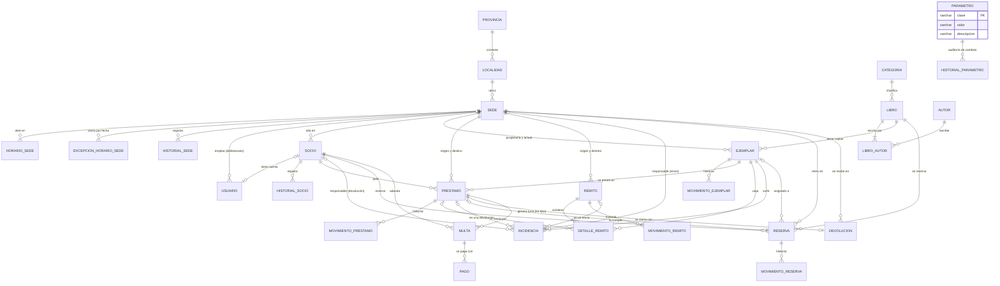

# Base de datos

Documentación de la base **PostgreSQL 16** del Sistema de Préstamos Interbibliotecarios: modelo entidad-relación, tablas, integridad, migraciones, datos de demostración y operación.

| Documento | Contenido |
|-----------|-----------|
| Este archivo | Diagrama entidad-relación conceptual, módulos, convenciones, integridad, migraciones, seed y operación |
| [Diccionario de datos](diccionario-de-datos.md) | Generado desde la base: diagramas por módulo con todas las columnas, y por tabla sus columnas, claves, restricciones, índices y disparadores |
| [docs/tecnica/04-modelo-de-datos.md](../docs/tecnica/04-modelo-de-datos.md) | Diseño: por qué cada tabla y cada restricción, qué regla de negocio garantiza y en qué migración nació |

El esquema lo versiona **Alembic** (`backend/alembic/versions/`) a partir de los modelos del ORM (`backend/app/db/models/`). Esta carpeta guarda solo lo que no es código de la aplicación:

| Carpeta o archivo | Contenido |
|-------------------|-----------|
| `init/01-extensiones.sql` | Script que Docker ejecuta una sola vez, al crear el volumen: habilita `btree_gist` (la primera migración también lo hace, para CI y bases vacías) |
| `diccionario-de-datos.md` | Diccionario generado por `backend/scripts/generar_diccionario_datos.py` |

Los datos de demostración no son SQL: los carga el comando `python -m app.db.seed` usando los casos de uso reales (ver [Datos de demostración](#datos-de-demostración)).

## Diagrama entidad-relación

Vista conceptual de las 28 tablas y sus relaciones de dominio. Las columnas de cada tabla están en los diagramas por módulo del [diccionario de datos](diccionario-de-datos.md).



Cómo leer las cardinalidades: `||` exactamente uno, `|o` cero o uno, `|{` uno o muchos, `o{` cero o muchos. Ejemplos:

- Un **préstamo** tiene a lo sumo una **devolución** y a lo sumo una **multa de cada tipo** (atraso, daño, extravío); cada multa puede tener varios **pagos** (intentos rechazados o cancelados), pero solo uno aprobado y uno pendiente.
- Un **socio** tiene a lo sumo una **cuenta de usuario**; el administrador y los bibliotecarios son usuarios sin socio, y cada bibliotecario pertenece a una **sede**.
- Una **incidencia** es de un envío (con remito y sede responsable) o de una devolución (con préstamo y socio responsable), nunca de los dos.
- **`parametro`** guarda los valores configurables (plazos, límites, montos) que leen los procesos; cada cambio queda en **`historial_parametro`** (quién, cuándo, valor anterior y nuevo).

Además, casi todas las tablas registran **quién** hizo cada cosa con claves hacia `usuario` (`creado_por_id`, `actualizado_por_id`, `registrado_por_id`, `saldada_por_id`, `usuario_id` de los historiales). Se omiten del diagrama para que se lea.

## Módulos y tablas

| Módulo | Tablas | Qué guardan |
|--------|--------|-------------|
| Sedes y acceso | `provincia`, `localidad`, `sede`, `horario_sede`, `excepcion_horario_sede`, `historial_sede`, `usuario` | Sedes con domicilio, horario semanal y cierres por fecha; usuarios con su rol |
| Socios | `socio`, `historial_socio` | Datos del socio, estado (habilitado, inhabilitado, baja), causas de inhabilitación y su historial |
| Catálogo | `categoria`, `autor`, `libro`, `libro_autor`, `ejemplar`, `movimiento_ejemplar` | El libro (título) separado del ejemplar (copia física con sede propietaria, sede actual y estados) |
| Préstamos y remitos | `prestamo`, `movimiento_prestamo`, `remito`, `detalle_remito`, `movimiento_remito`, `incidencia` | Préstamos locales e interbibliotecarios, envíos entre sedes con su ciclo de vida y las incidencias |
| Reservas | `reserva`, `movimiento_reserva` | Cola FIFO por libro y sede de retiro |
| Devoluciones y multas | `devolucion`, `multa`, `pago`, `parametro`, `historial_parametro` | Cierre del préstamo, multas por atraso, daño o extravío, sus pagos, los parámetros y su auditoría |

## Convenciones

- **Nombres** en español, minúsculas y con guion bajo (`detalle_remito`, `fecha_vencimiento`). Las restricciones siguen una convención fija (`backend/app/db/base.py`): `pk_<tabla>`, `fk_<tabla>_<columna>_<tabla_referida>`, `uq_<tabla>_<columnas>`, `ck_<tabla>_<nombre>`, e índices `ix_…` y exclusiones `ex_…`.
- **Clave primaria** `id BIGINT` generada, salvo `parametro` (por `clave`) y `libro_autor` (compuesta). Todas las tablas tienen `creado_en` y `actualizado_en` (`TIMESTAMPTZ`, por defecto `now()`).
- **Estados y tipos** como `VARCHAR` con una restricción `CHECK` que enumera los valores válidos (más fácil de migrar que un enumerado de PostgreSQL).
- **Montos** en `NUMERIC(10,2)`; nunca `float`.
- **Fechas y horas:** los instantes son `TIMESTAMPTZ` (se guardan en UTC); los días de negocio (vencimientos, días de atraso) son `DATE` y se calculan en la zona `America/Argentina/Cordoba` (`TZ_NEGOCIO`). Por eso las consultas no comparan `current_date` de la base contra el día de negocio.
- **Números visibles** (préstamo `P-2026-000118`, remito `R-2026-000052`, reserva `RS-2026-000007`, número de socio) salen de secuencias propias, no del `id`.
- **Concurrencia:** las operaciones que cambian estado bloquean la fila (`SELECT … FOR UPDATE`) dentro de una transacción por caso de uso (Unit of Work); `sede`, `ejemplar`, `libro` y `remito` tienen además `version` para la concurrencia optimista de las ediciones.
- **Texto normalizado** (`nombre_normalizado`, `titulo_normalizado`, `direccion_normalizada`): sin mayúsculas ni tildes, calculado por el dominio, para detectar duplicados y buscar.

## Integridad garantizada por la base

Las reglas de negocio se validan en el dominio y, las que se pueden expresar, también en la base, para que ningún camino (otro servicio, un script, una carrera entre dos solicitudes) deje datos inválidos:

| Mecanismo | Ejemplos |
|-----------|----------|
| `CHECK` por estado | Datos de baja si y solo si la sede o el ejemplar están en baja; fechas del préstamo y del remito coherentes con su estado; datos de la reserva según su estado; días de atraso solo en la multa de atraso; forma de pago y tarjeta solo en el pago en línea |
| Índices únicos parciales | Un solo préstamo abierto por ejemplar (`uq_prestamo_abierto_por_ejemplar`); una sola reserva activa por socio y libro (`uq_reserva_activa`); un solo pago aprobado y uno pendiente por multa |
| Unicidad compuesta | Una multa de cada tipo por préstamo (`uq_multa_prestamo_id_tipo`); un ejemplar una sola vez por remito |
| Restricciones de exclusión (`btree_gist`) | Franjas horarias de una sede que no se solapan; cierres por fecha que no se superponen |
| Disparadores de solo inserción | `historial_sede`, `historial_socio`, `historial_parametro` y los cuatro `movimiento_*` rechazan `UPDATE` y `DELETE`: el historial es inalterable |
| Claves foráneas sin borrado en cascada | Nada se borra físicamente salvo los autores de un libro sin ejemplares (`libro_autor`, `ON DELETE CASCADE`); el resto usa baja lógica |

El detalle de cada restricción, con su definición SQL, está en el [diccionario de datos](diccionario-de-datos.md).

## Migraciones

Se aplican con `alembic upgrade head` (desde `backend/`). Cada cambio de modelo es una migración nueva, revisada en su PR; nunca se edita una migración mergeada. Las que transforman datos existentes se prueban antes sobre una copia sembrada con el código de `main`.

| Versión | Contenido |
|---------|-----------|
| `0000` | Revisión base vacía |
| `0001` | `btree_gist`, `provincia` y `localidad` |
| `0002` | `usuario`, `socio` (estructura), `sede`, `horario_sede`, `excepcion_horario_sede`, `historial_sede` |
| `0003` | Datos: provincia de Córdoba y sus localidades |
| `0004` | Socios: estados, causas de inhabilitación, baja lógica, auditoría y numeración |
| `0005` | Catálogo: categorías, autores, libros, ejemplares e historial del ejemplar |
| `0006` | Préstamos y remitos: parámetros, préstamos, remitos con su detalle, historiales e incidencias |
| `0007` | Reservas: cola de espera por libro |
| `0008` | Devoluciones y multas |
| `0009` | Socios: todas las causas automáticas de inhabilitación |
| `0010` | Socios: tipos de baja, solicitud de reactivación e historial |
| `0011` | Catálogo: cambios en el historial del ejemplar y versión del libro |
| `0012` | Préstamos: plazo de retiro y coherencia de fechas |
| `0013` | Remitos: responsable de las incidencias, faltantes, plazo de despacho y recuperación |
| `0014` | Reservas: historial de estados y datos coherentes con el estado |
| `0015` | Devoluciones: fecha retroactiva con motivo, tope de multa y coherencia de la multa |
| `0016` | Pagos de multas: en el mostrador o en línea (simulado) |
| `0017` | Multas por daño y por extravío del ejemplar |
| `0018` | Auditoría de los parámetros de negocio (`historial_parametro`) |

El detalle de qué agrega cada una está en [técnica/04](../docs/tecnica/04-modelo-de-datos.md#historial-de-migraciones).

## Datos de demostración

`python -m app.db.seed` (desde `backend/`) carga la red con **90 días de historia** contados con los casos de uso reales: todas las tablas tienen datos, cada entidad pasa por todos sus estados y los historiales y la auditoría quedan completos. Es **idempotente** (solo carga si no hay sedes) y solo corre con `ENTORNO=desarrollo` o `test`. La contraseña de los usuarios de demostración es `SEED_PASSWORD` del `.env` (de 10 a 128 caracteres, con letras y números). Contenido detallado en [técnica/04](../docs/tecnica/04-modelo-de-datos.md#seed-de-demostración).

## Operación

### Levantar la base

```bash
cp .env.example .env        # y definir POSTGRES_PASSWORD
docker compose up -d db
docker compose ps           # esperar estado "healthy"
cd backend
.venv/bin/alembic upgrade head        # crear o actualizar el esquema
.venv/bin/python -m app.db.seed       # datos de demostración (opcional)
```

Con el sistema completo en contenedores (`docker compose up -d --build`), el backend aplica `alembic upgrade head` al arrancar y, con `CARGAR_SEED=1`, carga el seed; se conecta a la base por el nombre de servicio `db` (no `localhost`). Para cargar el seed después: `docker compose exec backend python -m app.db.seed`.

Conexión: `localhost:5432` (o `POSTGRES_PORT`), base `tpi_dao`, usuario `tpi_dao`. Las pruebas usan otra base, `tpi_dao_test` (o `DATABASE_URL_TEST`), que crean y migran ellas mismas.

### Comandos útiles

```bash
docker compose exec db psql -U tpi_dao -d tpi_dao        # consola SQL
.venv/bin/alembic current                                 # versión aplicada
.venv/bin/alembic downgrade -1                            # deshacer la última migración
docker compose exec db pg_dump -U tpi_dao -Fc tpi_dao > respaldo.dump              # respaldo
docker compose exec -T db pg_restore -U tpi_dao -d tpi_dao --clean < respaldo.dump  # restaurar
docker compose down                                        # apagar conservando los datos
docker compose down -v                                     # apagar y borrar los datos
```

### Regenerar el diccionario de datos

Después de cada migración, con la base de desarrollo en la última versión:

```bash
cd backend
.venv/bin/python scripts/generar_diccionario_datos.py              # escribe database/diccionario-de-datos.md
.venv/bin/python scripts/generar_diccionario_datos.py --verificar  # error si quedó desactualizado
```
