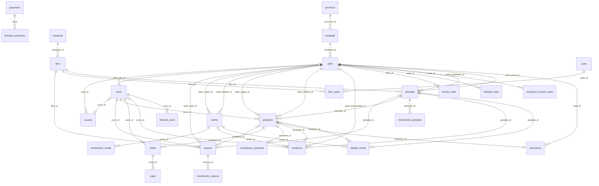
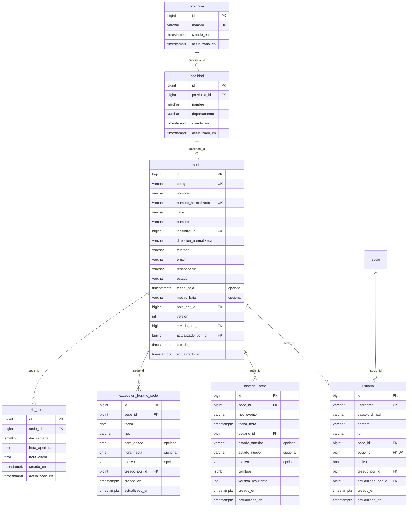
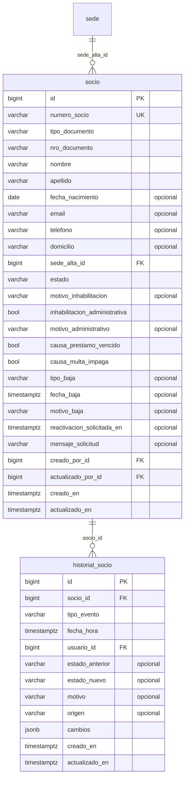
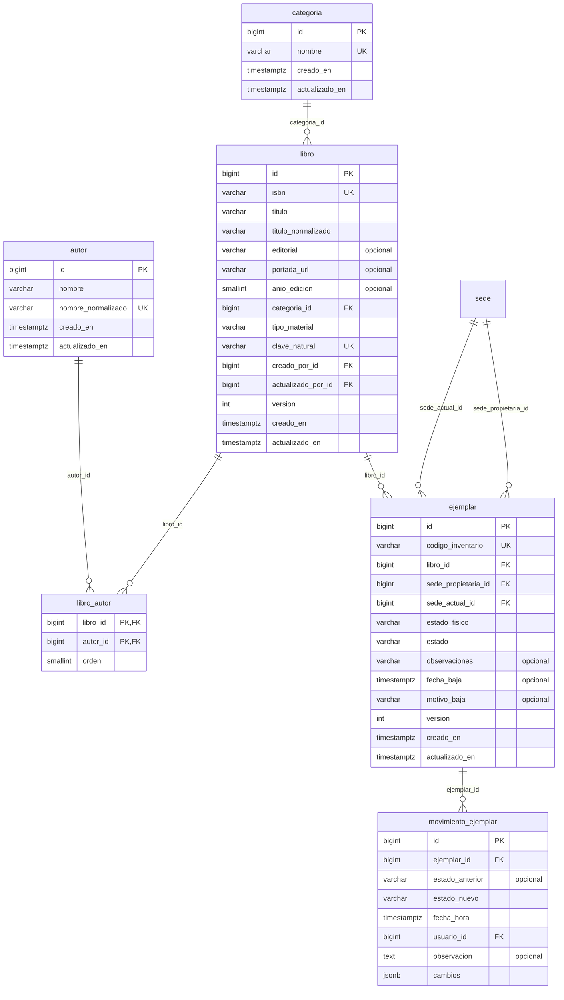
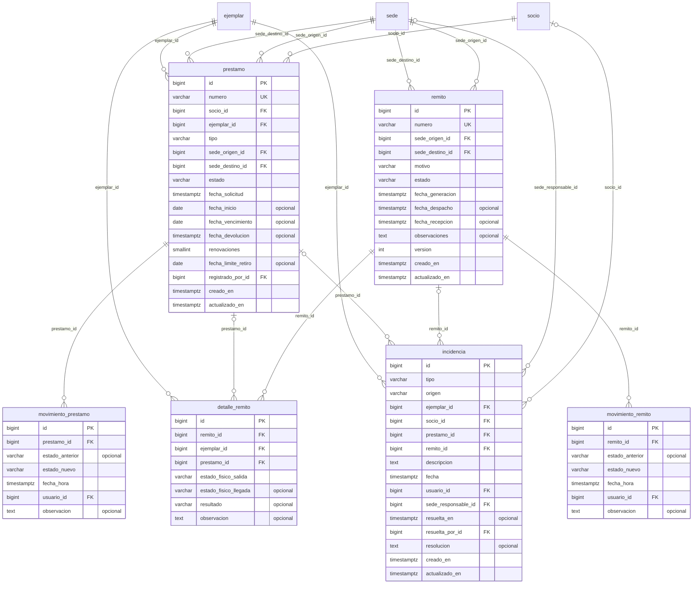
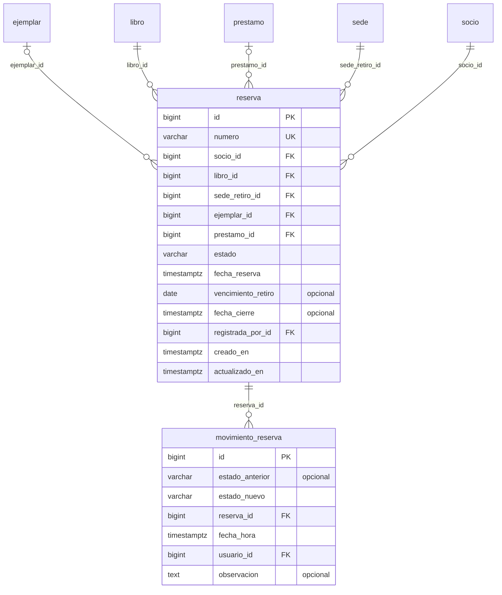
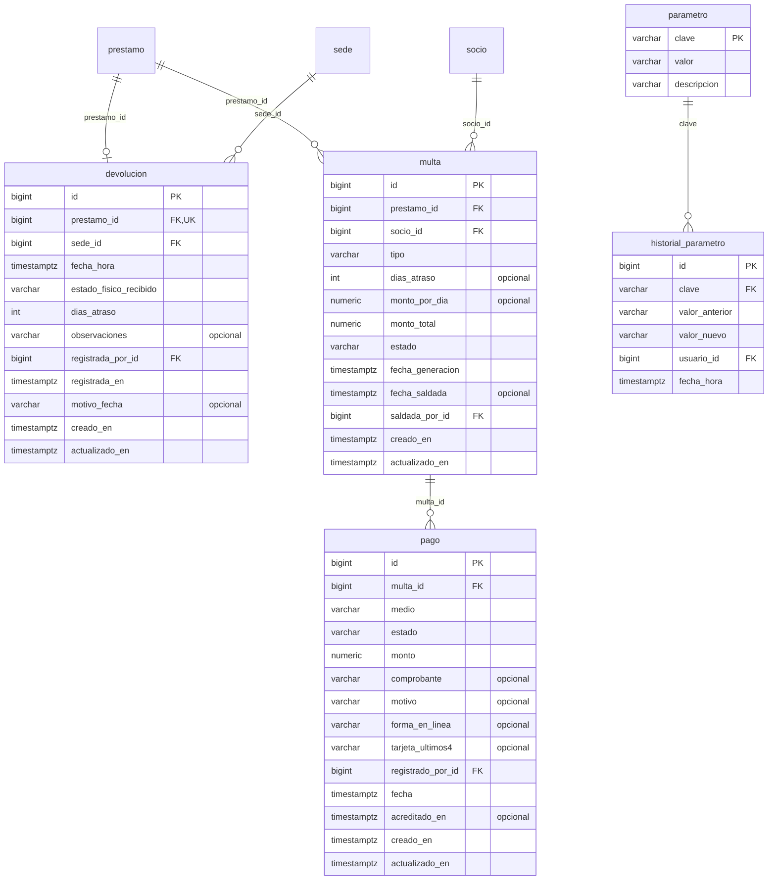

# Diccionario de datos

<!-- Generado con backend/scripts/generar_diccionario_datos.py: no editar a mano. -->

Esquema real de la base (PostgreSQL 16) en la última migración de Alembic: tablas, columnas, claves, restricciones, índices y disparadores. El diseño y el porqué de cada decisión están en [docs/tecnica/04-modelo-de-datos.md](../docs/tecnica/04-modelo-de-datos.md).

Para regenerarlo después de una migración (desde `backend/`, con la base migrada):

```bash
.venv/bin/python scripts/generar_diccionario_datos.py
```

**Cómo leer los diagramas.** Cada caja es una tabla con sus columnas (`PK` clave primaria, `FK` clave foránea, `UK` única; «opcional» admite `NULL`). Las líneas son claves foráneas, rotuladas con la columna: `||` exactamente uno, `|o` cero o uno, `o{` cero o muchos. Las claves de auditoría hacia `usuario` (quién creó, modificó o registró) no se dibujan para que el diagrama se lea; figuran en cada tabla.

## Índice

- [Sedes y acceso](#sedes-y-acceso): [`provincia`](#provincia), [`localidad`](#localidad), [`sede`](#sede), [`horario_sede`](#horario_sede), [`excepcion_horario_sede`](#excepcion_horario_sede), [`historial_sede`](#historial_sede), [`usuario`](#usuario)
- [Socios](#socios): [`socio`](#socio), [`historial_socio`](#historial_socio)
- [Catálogo](#catálogo): [`categoria`](#categoria), [`autor`](#autor), [`libro`](#libro), [`libro_autor`](#libro_autor), [`ejemplar`](#ejemplar), [`movimiento_ejemplar`](#movimiento_ejemplar)
- [Préstamos, remitos e incidencias](#préstamos-remitos-e-incidencias): [`prestamo`](#prestamo), [`movimiento_prestamo`](#movimiento_prestamo), [`remito`](#remito), [`detalle_remito`](#detalle_remito), [`movimiento_remito`](#movimiento_remito), [`incidencia`](#incidencia)
- [Reservas](#reservas): [`reserva`](#reserva), [`movimiento_reserva`](#movimiento_reserva)
- [Devoluciones, multas, pagos y parámetros](#devoluciones-multas-pagos-y-parámetros): [`devolucion`](#devolucion), [`multa`](#multa), [`pago`](#pago), [`parametro`](#parametro), [`historial_parametro`](#historial_parametro)

## Vista general

Todas las tablas y sus relaciones de dominio.



## Sedes y acceso

Ubicación de las sedes, sus horarios y cierres, el historial de cambios y los usuarios del sistema (administrador, bibliotecario y socio con cuenta).



### provincia

| Columna | Tipo | Nulo | Por defecto | Clave |
|---|---|---|---|---|
| `id` | BIGINT | no | secuencia | PK |
| `nombre` | VARCHAR(60) | no |  | UNIQUE |
| `creado_en` | TIMESTAMPTZ | no | now() |  |
| `actualizado_en` | TIMESTAMPTZ | no | now() |  |

### localidad

| Columna | Tipo | Nulo | Por defecto | Clave |
|---|---|---|---|---|
| `id` | BIGINT | no | secuencia | PK |
| `provincia_id` | BIGINT | no |  | FK → `provincia` |
| `nombre` | VARCHAR(100) | no |  |  |
| `departamento` | VARCHAR(60) | no |  |  |
| `creado_en` | TIMESTAMPTZ | no | now() |  |
| `actualizado_en` | TIMESTAMPTZ | no | now() |  |

Restricciones:

- `uq_localidad_provincia_id_nombre_departamento`: `UNIQUE (provincia_id, nombre, departamento)`

### sede

| Columna | Tipo | Nulo | Por defecto | Clave |
|---|---|---|---|---|
| `id` | BIGINT | no | secuencia | PK |
| `codigo` | VARCHAR(15) | no |  | UNIQUE |
| `nombre` | VARCHAR(100) | no |  |  |
| `nombre_normalizado` | VARCHAR(100) | no |  | UNIQUE |
| `calle` | VARCHAR(100) | no |  |  |
| `numero` | VARCHAR(10) | no |  |  |
| `localidad_id` | BIGINT | no |  | FK → `localidad` |
| `direccion_normalizada` | VARCHAR(200) | no |  |  |
| `telefono` | VARCHAR(16) | no |  |  |
| `email` | VARCHAR(120) | no |  |  |
| `responsable` | VARCHAR(100) | no |  |  |
| `estado` | VARCHAR(10) | no | 'ACTIVA' |  |
| `fecha_baja` | TIMESTAMPTZ | sí |  |  |
| `motivo_baja` | VARCHAR(300) | sí |  |  |
| `baja_por_id` | BIGINT | sí |  | FK → `usuario` |
| `version` | INTEGER | no | 1 |  |
| `creado_por_id` | BIGINT | no |  | FK → `usuario` |
| `actualizado_por_id` | BIGINT | no |  | FK → `usuario` |
| `creado_en` | TIMESTAMPTZ | no | now() |  |
| `actualizado_en` | TIMESTAMPTZ | no | now() |  |

Restricciones:

- `ck_sede_codigo_formato`: `CHECK (codigo ~ '^[A-Z0-9_]{3,15}$')`
- `ck_sede_datos_de_baja_coherentes`: `CHECK ((estado = 'BAJA' AND fecha_baja IS NOT NULL AND motivo_baja IS NOT NULL AND baja_por_id IS NOT NULL) OR (estado = 'ACTIVA' AND fecha_baja IS NULL AND motivo_baja IS NULL AND baja_por_id IS NULL))`
- `ck_sede_estado_valido`: `CHECK (estado IN ('ACTIVA','BAJA'))`
- `ck_sede_telefono_e164`: `CHECK (telefono ~ '^\+[1-9][0-9]{7,14}$')`

Índices:

- `ix_sede_direccion_normalizada`: `btree (direccion_normalizada)`
- `ix_sede_estado_nombre`: `btree (estado, nombre)`

### horario_sede

| Columna | Tipo | Nulo | Por defecto | Clave |
|---|---|---|---|---|
| `id` | BIGINT | no | secuencia | PK |
| `sede_id` | BIGINT | no |  | FK → `sede` |
| `dia_semana` | SMALLINT | no |  |  |
| `hora_apertura` | TIME | no |  |  |
| `hora_cierre` | TIME | no |  |  |
| `creado_en` | TIMESTAMPTZ | no | now() |  |
| `actualizado_en` | TIMESTAMPTZ | no | now() |  |

Restricciones:

- `ck_horario_sede_cierre_posterior`: `CHECK (hora_cierre > hora_apertura)`
- `ck_horario_sede_dia_valido`: `CHECK (dia_semana BETWEEN 1 AND 7)`
- `ex_horario_sede_sin_solapamiento`: `EXCLUDE USING gist (sede_id WITH =, dia_semana WITH =, tsrange(('2000-01-01' + hora_apertura), ('2000-01-01' + hora_cierre), '[)') WITH &&)`

Índices:

- `ix_horario_sede_sede_id_dia_semana`: `btree (sede_id, dia_semana)`

### excepcion_horario_sede

| Columna | Tipo | Nulo | Por defecto | Clave |
|---|---|---|---|---|
| `id` | BIGINT | no | secuencia | PK |
| `sede_id` | BIGINT | no |  | FK → `sede` |
| `fecha` | DATE | no |  |  |
| `tipo` | VARCHAR(15) | no |  |  |
| `hora_desde` | TIME | sí |  |  |
| `hora_hasta` | TIME | sí |  |  |
| `motivo` | VARCHAR(150) | sí |  |  |
| `creado_por_id` | BIGINT | no |  | FK → `usuario` |
| `creado_en` | TIMESTAMPTZ | no | now() |  |
| `actualizado_en` | TIMESTAMPTZ | no | now() |  |

Restricciones:

- `ck_excepcion_horario_sede_tipo_coherente`: `CHECK ((tipo = 'CIERRE_TOTAL' AND hora_desde IS NULL AND hora_hasta IS NULL) OR (tipo = 'CIERRE_PARCIAL' AND hora_desde IS NOT NULL AND hora_hasta IS NOT NULL AND hora_desde < hora_hasta))`
- `ex_excepcion_horario_sin_solapamiento`: `EXCLUDE USING gist (sede_id WITH =, tsrange((fecha + COALESCE(hora_desde, '00:00:00')), CASE     WHEN (tipo = 'CIERRE_TOTAL') THEN ((fecha + 1))::timestamp without time zone     ELSE (fecha + hora_hasta) END, '[)') WITH &&)`

Índices:

- `ix_excepcion_horario_sede_sede_id_fecha`: `btree (sede_id, fecha)`

### historial_sede

Auditoría de solo inserción de las sedes (un disparador impide UPDATE y DELETE).

| Columna | Tipo | Nulo | Por defecto | Clave |
|---|---|---|---|---|
| `id` | BIGINT | no | secuencia | PK |
| `sede_id` | BIGINT | no |  | FK → `sede` |
| `tipo_evento` | VARCHAR(25) | no |  |  |
| `fecha_hora` | TIMESTAMPTZ | no | now() |  |
| `usuario_id` | BIGINT | no |  | FK → `usuario` |
| `estado_anterior` | VARCHAR(10) | sí |  |  |
| `estado_nuevo` | VARCHAR(10) | sí |  |  |
| `motivo` | VARCHAR(300) | sí |  |  |
| `cambios` | JSONB | no |  |  |
| `version_resultante` | INTEGER | no |  |  |
| `creado_en` | TIMESTAMPTZ | no | now() |  |
| `actualizado_en` | TIMESTAMPTZ | no | now() |  |

Restricciones:

- `ck_historial_sede_tipo_evento_valido`: `CHECK (tipo_evento IN ('ALTA','MODIFICACION','BAJA','REACTIVACION','EXCEPCION_AGREGADA','EXCEPCION_ELIMINADA'))`

Índices:

- `ix_historial_sede_sede_id_fecha_hora`: `btree (sede_id, fecha_hora DESC)`

Disparadores:

- `trg_historial_sede_solo_insercion`: BEFORE DELETE o UPDATE: EXECUTE FUNCTION historial_sede_solo_insercion()

### usuario

| Columna | Tipo | Nulo | Por defecto | Clave |
|---|---|---|---|---|
| `id` | BIGINT | no | secuencia | PK |
| `username` | VARCHAR(50) | no |  | UNIQUE |
| `password_hash` | VARCHAR | no |  |  |
| `nombre` | VARCHAR(100) | no |  |  |
| `rol` | VARCHAR(15) | no |  |  |
| `sede_id` | BIGINT | sí |  | FK → `sede` |
| `socio_id` | BIGINT | sí |  | FK → `socio`, UNIQUE |
| `activo` | BOOLEAN | no | true |  |
| `creado_por_id` | BIGINT | sí |  | FK → `usuario` |
| `actualizado_por_id` | BIGINT | sí |  | FK → `usuario` |
| `creado_en` | TIMESTAMPTZ | no | now() |  |
| `actualizado_en` | TIMESTAMPTZ | no | now() |  |

Restricciones:

- `ck_usuario_admin_sin_sede`: `CHECK (rol <> 'ADMIN' OR sede_id IS NULL)`
- `ck_usuario_bibliotecario_con_sede`: `CHECK (rol <> 'BIBLIOTECARIO' OR sede_id IS NOT NULL)`
- `ck_usuario_rol_valido`: `CHECK (rol IN ('ADMIN','BIBLIOTECARIO','SOCIO'))`
- `ck_usuario_socio_con_ficha`: `CHECK ((rol = 'SOCIO') = (socio_id IS NOT NULL))`
- `ck_usuario_username_formato`: `CHECK (username ~ '^[a-z0-9._-]{3,50}$')`

Índices:

- `ix_usuario_bibliotecarios_activos_por_sede`: `btree (sede_id) WHERE ((rol = 'BIBLIOTECARIO') AND activo)`

## Socios

Socios de la red, su estado (habilitado, inhabilitado, baja) y su historial.



### socio

Socio. La baja es lógica: ``estado = 'BAJA'`` con fecha y motivo.

| Columna | Tipo | Nulo | Por defecto | Clave |
|---|---|---|---|---|
| `id` | BIGINT | no | secuencia | PK |
| `numero_socio` | VARCHAR(15) | no |  | UNIQUE |
| `tipo_documento` | VARCHAR(10) | no |  |  |
| `nro_documento` | VARCHAR(20) | no |  |  |
| `nombre` | VARCHAR(100) | no |  |  |
| `apellido` | VARCHAR(100) | no |  |  |
| `fecha_nacimiento` | DATE | sí |  |  |
| `email` | VARCHAR(120) | sí |  |  |
| `telefono` | VARCHAR(20) | sí |  |  |
| `domicilio` | VARCHAR(200) | sí |  |  |
| `sede_alta_id` | BIGINT | no |  | FK → `sede` |
| `estado` | VARCHAR(15) | no |  |  |
| `motivo_inhabilitacion` | VARCHAR(30) | sí |  |  |
| `inhabilitacion_administrativa` | BOOLEAN | no | false |  |
| `motivo_administrativo` | VARCHAR(300) | sí |  |  |
| `causa_prestamo_vencido` | BOOLEAN | no | false |  |
| `causa_multa_impaga` | BOOLEAN | no | false |  |
| `tipo_baja` | VARCHAR(15) | sí |  |  |
| `fecha_baja` | TIMESTAMPTZ | sí |  |  |
| `motivo_baja` | VARCHAR(300) | sí |  |  |
| `reactivacion_solicitada_en` | TIMESTAMPTZ | sí |  |  |
| `mensaje_solicitud` | VARCHAR(300) | sí |  |  |
| `creado_por_id` | BIGINT | sí |  | FK → `usuario` |
| `actualizado_por_id` | BIGINT | sí |  | FK → `usuario` |
| `creado_en` | TIMESTAMPTZ | no | now() |  |
| `actualizado_en` | TIMESTAMPTZ | no | now() |  |

Restricciones:

- `uq_socio_tipo_documento_nro_documento`: `UNIQUE (tipo_documento, nro_documento)`
- `ck_socio_administrativa_con_motivo`: `CHECK (inhabilitacion_administrativa = (motivo_administrativo IS NOT NULL))`
- `ck_socio_administrativa_prioritaria`: `CHECK (NOT inhabilitacion_administrativa OR motivo_inhabilitacion = 'ADMINISTRATIVA')`
- `ck_socio_baja_con_datos`: `CHECK ((estado = 'BAJA' AND fecha_baja IS NOT NULL AND motivo_baja IS NOT NULL AND tipo_baja IS NOT NULL) OR (estado <> 'BAJA' AND fecha_baja IS NULL AND motivo_baja IS NULL AND tipo_baja IS NULL))`
- `ck_socio_causas_coherentes`: `CHECK (CASE estado WHEN 'HABILITADO' THEN NOT (inhabilitacion_administrativa OR causa_prestamo_vencido OR causa_multa_impaga) WHEN 'INHABILITADO' THEN (inhabilitacion_administrativa OR causa_prestamo_vencido OR causa_multa_impaga) ELSE NOT (causa_prestamo_vencido OR causa_multa_impaga) END)`
- `ck_socio_estado_valido`: `CHECK (estado IN ('HABILITADO','INHABILITADO','BAJA'))`
- `ck_socio_motivo_con_causas`: `CHECK ((motivo_inhabilitacion IS NOT NULL) = (inhabilitacion_administrativa OR causa_prestamo_vencido OR causa_multa_impaga))`
- `ck_socio_motivo_valido`: `CHECK (motivo_inhabilitacion IS NULL OR motivo_inhabilitacion IN ('ADMINISTRATIVA','PRESTAMO_VENCIDO','MULTA_IMPAGA'))`
- `ck_socio_solicitud_coherente`: `CHECK ((reactivacion_solicitada_en IS NULL OR (estado = 'BAJA' AND tipo_baja <> 'FALLECIMIENTO')) AND (mensaje_solicitud IS NULL OR reactivacion_solicitada_en IS NOT NULL))`
- `ck_socio_tipo_baja_valido`: `CHECK (tipo_baja IS NULL OR tipo_baja IN ('FALLECIMIENTO','ADMINISTRATIVA','A_PEDIDO'))`
- `ck_socio_tipo_documento_valido`: `CHECK (tipo_documento IN ('DNI','LE','LC','PASAPORTE'))`

Índices:

- `ix_socio_apellido_nombre`: `btree (apellido, nombre)`

### historial_socio

Historial de solo inserción del socio (un disparador impide UPDATE y DELETE).

| Columna | Tipo | Nulo | Por defecto | Clave |
|---|---|---|---|---|
| `id` | BIGINT | no | secuencia | PK |
| `socio_id` | BIGINT | no |  | FK → `socio` |
| `tipo_evento` | VARCHAR(25) | no |  |  |
| `fecha_hora` | TIMESTAMPTZ | no | now() |  |
| `usuario_id` | BIGINT | sí |  | FK → `usuario` |
| `estado_anterior` | VARCHAR(15) | sí |  |  |
| `estado_nuevo` | VARCHAR(15) | sí |  |  |
| `motivo` | VARCHAR(300) | sí |  |  |
| `origen` | VARCHAR(200) | sí |  |  |
| `cambios` | JSONB | no |  |  |
| `creado_en` | TIMESTAMPTZ | no | now() |  |
| `actualizado_en` | TIMESTAMPTZ | no | now() |  |

Restricciones:

- `ck_historial_socio_tipo_evento_valido`: `CHECK (tipo_evento IN ('ALTA','MODIFICACION','INHABILITACION','REHABILITACION','CAMBIO_AUTOMATICO','BAJA','SOLICITUD_REACTIVACION','SOLICITUD_RECHAZADA','REACTIVACION','CUENTA_CREADA'))`

Índices:

- `ix_historial_socio_socio_id_fecha_hora`: `btree (socio_id, fecha_hora DESC)`

Disparadores:

- `trg_historial_socio_solo_insercion`: BEFORE DELETE o UPDATE: EXECUTE FUNCTION historial_socio_solo_insercion()

## Catálogo

Libros (el título), sus autores y categorías, y los ejemplares (las copias físicas), con el historial de cada ejemplar.



### categoria

Catálogo cerrado de categorías (se carga con una migración de datos).

| Columna | Tipo | Nulo | Por defecto | Clave |
|---|---|---|---|---|
| `id` | BIGINT | no | secuencia | PK |
| `nombre` | VARCHAR(60) | no |  | UNIQUE |
| `creado_en` | TIMESTAMPTZ | no | now() |  |
| `actualizado_en` | TIMESTAMPTZ | no | now() |  |

### autor

| Columna | Tipo | Nulo | Por defecto | Clave |
|---|---|---|---|---|
| `id` | BIGINT | no | secuencia | PK |
| `nombre` | VARCHAR(100) | no |  |  |
| `nombre_normalizado` | VARCHAR(100) | no |  | UNIQUE |
| `creado_en` | TIMESTAMPTZ | no | now() |  |
| `actualizado_en` | TIMESTAMPTZ | no | now() |  |

### libro

Obra del catálogo. Con ISBN se identifica por él; sin ISBN, por su clave natural.

| Columna | Tipo | Nulo | Por defecto | Clave |
|---|---|---|---|---|
| `id` | BIGINT | no | secuencia | PK |
| `isbn` | VARCHAR(13) | sí |  | UNIQUE |
| `titulo` | VARCHAR(200) | no |  |  |
| `titulo_normalizado` | VARCHAR(200) | no |  |  |
| `editorial` | VARCHAR(100) | sí |  |  |
| `portada_url` | VARCHAR(300) | sí |  |  |
| `anio_edicion` | SMALLINT | sí |  |  |
| `categoria_id` | BIGINT | no |  | FK → `categoria` |
| `tipo_material` | VARCHAR(20) | no |  |  |
| `clave_natural` | VARCHAR(420) | sí |  | UNIQUE |
| `creado_por_id` | BIGINT | sí |  | FK → `usuario` |
| `actualizado_por_id` | BIGINT | sí |  | FK → `usuario` |
| `version` | INTEGER | no | 1 |  |
| `creado_en` | TIMESTAMPTZ | no | now() |  |
| `actualizado_en` | TIMESTAMPTZ | no | now() |  |

Restricciones:

- `ck_libro_isbn_o_clave`: `CHECK ((isbn IS NULL) = (clave_natural IS NOT NULL))`
- `ck_libro_portada_url_valida`: `CHECK (portada_url IS NULL OR portada_url ~ '^(https?://\|/portadas/)[^[:space:]]+$')`
- `ck_libro_tipo_material_valido`: `CHECK (tipo_material IN ('LIBRO','REVISTA','OBRA_DE_REFERENCIA','OTRO'))`

Índices:

- `ix_libro_titulo_normalizado`: `btree (titulo_normalizado)`

### libro_autor

Autores de un libro, en el orden en que figuran en la obra.

| Columna | Tipo | Nulo | Por defecto | Clave |
|---|---|---|---|---|
| `libro_id` | BIGINT | no |  | PK, FK → `libro` (ON DELETE CASCADE) |
| `autor_id` | BIGINT | no |  | PK, FK → `autor` |
| `orden` | SMALLINT | no |  |  |

### ejemplar

Copia física. Pertenece a una sede (propietaria) y está en otra (actual).

| Columna | Tipo | Nulo | Por defecto | Clave |
|---|---|---|---|---|
| `id` | BIGINT | no | secuencia | PK |
| `codigo_inventario` | VARCHAR(30) | no |  | UNIQUE |
| `libro_id` | BIGINT | no |  | FK → `libro` |
| `sede_propietaria_id` | BIGINT | no |  | FK → `sede` |
| `sede_actual_id` | BIGINT | no |  | FK → `sede` |
| `estado_fisico` | VARCHAR(10) | no |  |  |
| `estado` | VARCHAR(15) | no |  |  |
| `observaciones` | VARCHAR(300) | sí |  |  |
| `fecha_baja` | TIMESTAMPTZ | sí |  |  |
| `motivo_baja` | VARCHAR(300) | sí |  |  |
| `version` | INTEGER | no |  |  |
| `creado_en` | TIMESTAMPTZ | no | now() |  |
| `actualizado_en` | TIMESTAMPTZ | no | now() |  |

Restricciones:

- `ck_ejemplar_baja_con_datos`: `CHECK ((estado = 'BAJA') = (fecha_baja IS NOT NULL AND motivo_baja IS NOT NULL))`
- `ck_ejemplar_codigo_formato`: `CHECK (codigo_inventario ~ '^[A-Z0-9][A-Z0-9-]{2,29}$')`
- `ck_ejemplar_estado_fisico_valido`: `CHECK (estado_fisico IN ('NUEVO','BUENO','REGULAR','DANADO'))`
- `ck_ejemplar_estado_valido`: `CHECK (estado IN ('DISPONIBLE','APARTADO','RESERVADO','PRESTADO','EN_TRANSITO','EN_REVISION','BAJA'))`

Índices:

- `ix_ejemplar_libro_id_sede_actual_id_estado`: `btree (libro_id, sede_actual_id, estado)`
- `ix_ejemplar_sede_propietaria_id_estado`: `btree (sede_propietaria_id, estado)`

### movimiento_ejemplar

Historial del ejemplar, de solo inserción (un disparador lo protege).

| Columna | Tipo | Nulo | Por defecto | Clave |
|---|---|---|---|---|
| `id` | BIGINT | no | secuencia | PK |
| `ejemplar_id` | BIGINT | no |  | FK → `ejemplar` |
| `estado_anterior` | VARCHAR(15) | sí |  |  |
| `estado_nuevo` | VARCHAR(15) | no |  |  |
| `fecha_hora` | TIMESTAMPTZ | no | now() |  |
| `usuario_id` | BIGINT | sí |  | FK → `usuario` |
| `observacion` | TEXT | sí |  |  |
| `cambios` | JSONB | no | '[]'::jsonb |  |

Índices:

- `ix_movimiento_ejemplar_ejemplar_id_fecha_hora`: `btree (ejemplar_id, fecha_hora)`

Disparadores:

- `trg_movimiento_ejemplar_solo_insercion`: BEFORE DELETE o UPDATE: EXECUTE FUNCTION historial_solo_insercion()

## Préstamos, remitos e incidencias

Préstamos locales e interbibliotecarios, los remitos que trasladan ejemplares entre sedes (con su detalle y su historial) y las incidencias (extravío, daño, destrucción).



### prestamo

| Columna | Tipo | Nulo | Por defecto | Clave |
|---|---|---|---|---|
| `id` | BIGINT | no | secuencia | PK |
| `numero` | VARCHAR(20) | no |  | UNIQUE |
| `socio_id` | BIGINT | no |  | FK → `socio` |
| `ejemplar_id` | BIGINT | no |  | FK → `ejemplar` |
| `tipo` | VARCHAR(20) | no |  |  |
| `sede_origen_id` | BIGINT | no |  | FK → `sede` |
| `sede_destino_id` | BIGINT | no |  | FK → `sede` |
| `estado` | VARCHAR(15) | no |  |  |
| `fecha_solicitud` | TIMESTAMPTZ | no |  |  |
| `fecha_inicio` | DATE | sí |  |  |
| `fecha_vencimiento` | DATE | sí |  |  |
| `fecha_devolucion` | TIMESTAMPTZ | sí |  |  |
| `renovaciones` | SMALLINT | no |  |  |
| `fecha_limite_retiro` | DATE | sí |  |  |
| `registrado_por_id` | BIGINT | sí |  | FK → `usuario` |
| `creado_en` | TIMESTAMPTZ | no | now() |  |
| `actualizado_en` | TIMESTAMPTZ | no | now() |  |

Restricciones:

- `ck_prestamo_devolucion_con_fecha`: `CHECK ((estado = 'DEVUELTO') = (fecha_devolucion IS NOT NULL))`
- `ck_prestamo_estado_valido`: `CHECK (estado IN ('SOLICITADO','EN_ENVIO','ACTIVO','VENCIDO','DEVUELTO','CANCELADO'))`
- `ck_prestamo_fechas_segun_estado`: `CHECK ((estado IN ('ACTIVO','VENCIDO','DEVUELTO')) = (fecha_inicio IS NOT NULL AND fecha_vencimiento IS NOT NULL))`
- `ck_prestamo_renovaciones_no_negativas`: `CHECK (renovaciones >= 0)`
- `ck_prestamo_sedes_segun_tipo`: `CHECK ((tipo = 'LOCAL' AND sede_origen_id = sede_destino_id) OR (tipo = 'INTERBIBLIOTECARIO' AND sede_origen_id <> sede_destino_id))`
- `ck_prestamo_tipo_valido`: `CHECK (tipo IN ('LOCAL','INTERBIBLIOTECARIO'))`

Índices:

- `ix_prestamo_estado_fecha_vencimiento`: `btree (estado, fecha_vencimiento)`
- `ix_prestamo_socio_id_estado`: `btree (socio_id, estado)`
- `ix_prestamo_tipo_fecha_solicitud`: `btree (tipo, fecha_solicitud)`
- `uq_prestamo_abierto_por_ejemplar`: `UNIQUE btree (ejemplar_id) WHERE estado IN ('SOLICITADO', 'EN_ENVIO', 'ACTIVO', 'VENCIDO')`

### movimiento_prestamo

| Columna | Tipo | Nulo | Por defecto | Clave |
|---|---|---|---|---|
| `id` | BIGINT | no | secuencia | PK |
| `prestamo_id` | BIGINT | no |  | FK → `prestamo` |
| `estado_anterior` | VARCHAR(15) | sí |  |  |
| `estado_nuevo` | VARCHAR(15) | no |  |  |
| `fecha_hora` | TIMESTAMPTZ | no | now() |  |
| `usuario_id` | BIGINT | sí |  | FK → `usuario` |
| `observacion` | TEXT | sí |  |  |

Índices:

- `ix_movimiento_prestamo_prestamo_id_fecha_hora`: `btree (prestamo_id, fecha_hora)`

Disparadores:

- `trg_movimiento_prestamo_solo_insercion`: BEFORE DELETE o UPDATE: EXECUTE FUNCTION historial_solo_insercion()

### remito

| Columna | Tipo | Nulo | Por defecto | Clave |
|---|---|---|---|---|
| `id` | BIGINT | no | secuencia | PK |
| `numero` | VARCHAR(20) | no |  | UNIQUE |
| `sede_origen_id` | BIGINT | no |  | FK → `sede` |
| `sede_destino_id` | BIGINT | no |  | FK → `sede` |
| `motivo` | VARCHAR(15) | no |  |  |
| `estado` | VARCHAR(15) | no |  |  |
| `fecha_generacion` | TIMESTAMPTZ | no |  |  |
| `fecha_despacho` | TIMESTAMPTZ | sí |  |  |
| `fecha_recepcion` | TIMESTAMPTZ | sí |  |  |
| `observaciones` | TEXT | sí |  |  |
| `version` | INTEGER | no |  |  |
| `creado_en` | TIMESTAMPTZ | no | now() |  |
| `actualizado_en` | TIMESTAMPTZ | no | now() |  |

Restricciones:

- `ck_remito_despacho_segun_estado`: `CHECK ((estado IN ('GENERADO','EMPAQUETADO','ANULADO')) = (fecha_despacho IS NULL))`
- `ck_remito_estado_valido`: `CHECK (estado IN ('GENERADO','EMPAQUETADO','DESPACHADO','EN_TRANSITO','RECIBIDO','EXTRAVIADO','DANADO','DESTRUIDO','INCOMPLETO','ANULADO'))`
- `ck_remito_motivo_valido`: `CHECK (motivo IN ('ENVIO','RETORNO','TRASLADO'))`
- `ck_remito_recepcion_segun_estado`: `CHECK ((estado IN ('RECIBIDO','DANADO','DESTRUIDO','INCOMPLETO')) = (fecha_recepcion IS NOT NULL))`
- `ck_remito_sedes_distintas`: `CHECK (sede_origen_id <> sede_destino_id)`

Índices:

- `ix_remito_estado_sede_origen_id_sede_destino_id`: `btree (estado, sede_origen_id, sede_destino_id)`

### detalle_remito

| Columna | Tipo | Nulo | Por defecto | Clave |
|---|---|---|---|---|
| `id` | BIGINT | no | secuencia | PK |
| `remito_id` | BIGINT | no |  | FK → `remito` |
| `ejemplar_id` | BIGINT | no |  | FK → `ejemplar` |
| `prestamo_id` | BIGINT | sí |  | FK → `prestamo` |
| `estado_fisico_salida` | VARCHAR(10) | no |  |  |
| `estado_fisico_llegada` | VARCHAR(10) | sí |  |  |
| `resultado` | VARCHAR(10) | sí |  |  |
| `observacion` | TEXT | sí |  |  |

Restricciones:

- `uq_detalle_remito_remito_id_ejemplar_id`: `UNIQUE (remito_id, ejemplar_id)`
- `ck_detalle_remito_estado_fisico_llegada_valido`: `CHECK (estado_fisico_llegada IS NULL OR estado_fisico_llegada IN ('NUEVO','BUENO','REGULAR','DANADO'))`
- `ck_detalle_remito_estado_fisico_salida_valido`: `CHECK (estado_fisico_salida IN ('NUEVO','BUENO','REGULAR','DANADO'))`
- `ck_detalle_remito_llegada_segun_resultado`: `CHECK ((estado_fisico_llegada IS NOT NULL) = (resultado IS NOT NULL AND resultado <> 'FALTANTE'))`
- `ck_detalle_remito_resultado_valido`: `CHECK (resultado IS NULL OR resultado IN ('RECIBIDO','DANADO','DESTRUIDO','FALTANTE'))`

### movimiento_remito

| Columna | Tipo | Nulo | Por defecto | Clave |
|---|---|---|---|---|
| `id` | BIGINT | no | secuencia | PK |
| `remito_id` | BIGINT | no |  | FK → `remito` |
| `estado_anterior` | VARCHAR(15) | sí |  |  |
| `estado_nuevo` | VARCHAR(15) | no |  |  |
| `fecha_hora` | TIMESTAMPTZ | no | now() |  |
| `usuario_id` | BIGINT | sí |  | FK → `usuario` |
| `observacion` | TEXT | sí |  |  |

Índices:

- `ix_movimiento_remito_remito_id_fecha_hora`: `btree (remito_id, fecha_hora)`

Disparadores:

- `trg_movimiento_remito_solo_insercion`: BEFORE DELETE o UPDATE: EXECUTE FUNCTION historial_solo_insercion()

### incidencia

| Columna | Tipo | Nulo | Por defecto | Clave |
|---|---|---|---|---|
| `id` | BIGINT | no | secuencia | PK |
| `tipo` | VARCHAR(15) | no |  |  |
| `origen` | VARCHAR(15) | no |  |  |
| `ejemplar_id` | BIGINT | no |  | FK → `ejemplar` |
| `socio_id` | BIGINT | sí |  | FK → `socio` |
| `prestamo_id` | BIGINT | sí |  | FK → `prestamo` |
| `remito_id` | BIGINT | sí |  | FK → `remito` |
| `descripcion` | TEXT | no |  |  |
| `fecha` | TIMESTAMPTZ | no |  |  |
| `usuario_id` | BIGINT | sí |  | FK → `usuario` |
| `sede_responsable_id` | BIGINT | sí |  | FK → `sede` |
| `resuelta_en` | TIMESTAMPTZ | sí |  |  |
| `resuelta_por_id` | BIGINT | sí |  | FK → `usuario` |
| `resolucion` | TEXT | sí |  |  |
| `creado_en` | TIMESTAMPTZ | no | now() |  |
| `actualizado_en` | TIMESTAMPTZ | no | now() |  |

Restricciones:

- `ck_incidencia_origen_valido`: `CHECK (origen IN ('DEVOLUCION','REMITO'))`
- `ck_incidencia_resolucion_coherente`: `CHECK ((resuelta_en IS NULL) = (resolucion IS NULL) AND (resuelta_en IS NULL OR tipo = 'EXTRAVIO'))`
- `ck_incidencia_responsable_segun_origen`: `CHECK ((origen = 'REMITO' AND remito_id IS NOT NULL AND socio_id IS NULL AND sede_responsable_id IS NOT NULL) OR (origen = 'DEVOLUCION' AND prestamo_id IS NOT NULL AND socio_id IS NOT NULL AND sede_responsable_id IS NULL))`
- `ck_incidencia_tipo_valido`: `CHECK (tipo IN ('EXTRAVIO','DANIO','DESTRUCCION'))`

## Reservas

Cola de reservas por libro y sede de retiro, con su historial.



### reserva

Reserva de un libro (cola FIFO por ``fecha_reserva``).

| Columna | Tipo | Nulo | Por defecto | Clave |
|---|---|---|---|---|
| `id` | BIGINT | no | secuencia | PK |
| `numero` | VARCHAR(20) | no |  | UNIQUE |
| `socio_id` | BIGINT | no |  | FK → `socio` |
| `libro_id` | BIGINT | no |  | FK → `libro` |
| `sede_retiro_id` | BIGINT | no |  | FK → `sede` |
| `ejemplar_id` | BIGINT | sí |  | FK → `ejemplar` |
| `prestamo_id` | BIGINT | sí |  | FK → `prestamo` |
| `estado` | VARCHAR(25) | no |  |  |
| `fecha_reserva` | TIMESTAMPTZ | no |  |  |
| `vencimiento_retiro` | DATE | sí |  |  |
| `fecha_cierre` | TIMESTAMPTZ | sí |  |  |
| `registrada_por_id` | BIGINT | sí |  | FK → `usuario` |
| `creado_en` | TIMESTAMPTZ | no | now() |  |
| `actualizado_en` | TIMESTAMPTZ | no | now() |  |

Restricciones:

- `ck_reserva_datos_segun_estado`: `CHECK ((estado = 'PENDIENTE' AND ejemplar_id IS NULL AND vencimiento_retiro IS NULL AND prestamo_id IS NULL AND fecha_cierre IS NULL) OR (estado = 'DISPONIBLE_PARA_RETIRO' AND ejemplar_id IS NOT NULL AND vencimiento_retiro IS NOT NULL AND prestamo_id IS NULL AND fecha_cierre IS NULL) OR (estado = 'CUMPLIDA' AND ejemplar_id IS NOT NULL AND prestamo_id IS NOT NULL AND fecha_cierre IS NOT NULL) OR (estado = 'VENCIDA' AND ejemplar_id IS NOT NULL AND vencimiento_retiro IS NOT NULL AND prestamo_id IS NULL AND fecha_cierre IS NOT NULL) OR (estado = 'CANCELADA' AND prestamo_id IS NULL AND fecha_cierre IS NOT NULL))`
- `ck_reserva_estado_valido`: `CHECK (estado IN ('PENDIENTE','DISPONIBLE_PARA_RETIRO','CUMPLIDA','CANCELADA','VENCIDA'))`

Índices:

- `ix_reserva_libro_id_estado_fecha_reserva`: `btree (libro_id, estado, fecha_reserva)`
- `uq_reserva_activa`: `UNIQUE btree (socio_id, libro_id) WHERE estado IN ('PENDIENTE', 'DISPONIBLE_PARA_RETIRO')`

### movimiento_reserva

Historial de la reserva. Los estados son más largos que los de préstamo y remito.

| Columna | Tipo | Nulo | Por defecto | Clave |
|---|---|---|---|---|
| `id` | BIGINT | no | secuencia | PK |
| `estado_anterior` | VARCHAR(25) | sí |  |  |
| `estado_nuevo` | VARCHAR(25) | no |  |  |
| `reserva_id` | BIGINT | no |  | FK → `reserva` |
| `fecha_hora` | TIMESTAMPTZ | no | now() |  |
| `usuario_id` | BIGINT | sí |  | FK → `usuario` |
| `observacion` | TEXT | sí |  |  |

Índices:

- `ix_movimiento_reserva_reserva_id_fecha_hora`: `btree (reserva_id, fecha_hora)`

Disparadores:

- `trg_movimiento_reserva_solo_insercion`: BEFORE DELETE o UPDATE: EXECUTE FUNCTION historial_solo_insercion()

## Devoluciones, multas, pagos y parámetros

Devoluciones de préstamos, multas (por atraso, daño o extravío), sus pagos, los parámetros de negocio configurables y su auditoría.



### devolucion

| Columna | Tipo | Nulo | Por defecto | Clave |
|---|---|---|---|---|
| `id` | BIGINT | no | secuencia | PK |
| `prestamo_id` | BIGINT | no |  | FK → `prestamo`, UNIQUE |
| `sede_id` | BIGINT | no |  | FK → `sede` |
| `fecha_hora` | TIMESTAMPTZ | no |  |  |
| `estado_fisico_recibido` | VARCHAR(15) | no |  |  |
| `dias_atraso` | INTEGER | no |  |  |
| `observaciones` | VARCHAR(300) | sí |  |  |
| `registrada_por_id` | BIGINT | no |  | FK → `usuario` |
| `registrada_en` | TIMESTAMPTZ | no |  |  |
| `motivo_fecha` | VARCHAR(300) | sí |  |  |
| `creado_en` | TIMESTAMPTZ | no | now() |  |
| `actualizado_en` | TIMESTAMPTZ | no | now() |  |

Restricciones:

- `ck_devolucion_atraso_no_negativo`: `CHECK (dias_atraso >= 0)`
- `ck_devolucion_estado_valido`: `CHECK (estado_fisico_recibido IN ('BUENO','REGULAR','DANADO','EXTRAVIADO'))`
- `ck_devolucion_retroactiva_con_motivo`: `CHECK (motivo_fecha IS NOT NULL OR fecha_hora >= registrada_en - interval '1 day')`

### multa

Multa de un préstamo: por atraso (guarda el monto por día vigente al generarse) o por daño o extravío del ejemplar. Un préstamo tiene a lo sumo una de cada tipo.

| Columna | Tipo | Nulo | Por defecto | Clave |
|---|---|---|---|---|
| `id` | BIGINT | no | secuencia | PK |
| `prestamo_id` | BIGINT | no |  | FK → `prestamo` |
| `socio_id` | BIGINT | no |  | FK → `socio` |
| `tipo` | VARCHAR(10) | no |  |  |
| `dias_atraso` | INTEGER | sí |  |  |
| `monto_por_dia` | NUMERIC(10,2) | sí |  |  |
| `monto_total` | NUMERIC(10,2) | no |  |  |
| `estado` | VARCHAR(10) | no |  |  |
| `fecha_generacion` | TIMESTAMPTZ | no |  |  |
| `fecha_saldada` | TIMESTAMPTZ | sí |  |  |
| `saldada_por_id` | BIGINT | sí |  | FK → `usuario` |
| `creado_en` | TIMESTAMPTZ | no | now() |  |
| `actualizado_en` | TIMESTAMPTZ | no | now() |  |

Restricciones:

- `uq_multa_prestamo_id_tipo`: `UNIQUE (prestamo_id, tipo)`
- `ck_multa_atraso_positivo`: `CHECK (dias_atraso IS NULL OR dias_atraso > 0)`
- `ck_multa_atraso_segun_tipo`: `CHECK ((tipo = 'ATRASO') = (dias_atraso IS NOT NULL AND monto_por_dia IS NOT NULL))`
- `ck_multa_estado_valido`: `CHECK (estado IN ('PENDIENTE','SALDADA'))`
- `ck_multa_monto_coherente`: `CHECK (dias_atraso IS NULL OR (monto_por_dia >= 0 AND monto_total <= dias_atraso * monto_por_dia))`
- `ck_multa_monto_no_negativo`: `CHECK (monto_total >= 0)`
- `ck_multa_saldada_con_fecha`: `CHECK ((estado = 'SALDADA') = (fecha_saldada IS NOT NULL))`
- `ck_multa_tipo_valido`: `CHECK (tipo IN ('ATRASO','DANIO','EXTRAVIO'))`

Índices:

- `ix_multa_socio_id_estado`: `btree (socio_id, estado)`

### pago

Pago de una multa: en el mostrador o en línea (simulado).

| Columna | Tipo | Nulo | Por defecto | Clave |
|---|---|---|---|---|
| `id` | BIGINT | no | secuencia | PK |
| `multa_id` | BIGINT | no |  | FK → `multa` |
| `medio` | VARCHAR(15) | no |  |  |
| `estado` | VARCHAR(10) | no |  |  |
| `monto` | NUMERIC(10,2) | no |  |  |
| `comprobante` | VARCHAR(100) | sí |  |  |
| `motivo` | VARCHAR(120) | sí |  |  |
| `forma_en_linea` | VARCHAR(20) | sí |  |  |
| `tarjeta_ultimos4` | VARCHAR(4) | sí |  |  |
| `registrado_por_id` | BIGINT | sí |  | FK → `usuario` |
| `fecha` | TIMESTAMPTZ | no |  |  |
| `acreditado_en` | TIMESTAMPTZ | sí |  |  |
| `creado_en` | TIMESTAMPTZ | no | now() |  |
| `actualizado_en` | TIMESTAMPTZ | no | now() |  |

Restricciones:

- `ck_pago_acreditado_segun_estado`: `CHECK ((estado = 'APROBADO') = (acreditado_en IS NOT NULL))`
- `ck_pago_estado_valido`: `CHECK (estado IN ('PENDIENTE','APROBADO','RECHAZADO','CANCELADO'))`
- `ck_pago_forma_en_linea_valida`: `CHECK (forma_en_linea IS NULL OR (medio = 'EN_LINEA' AND forma_en_linea IN ('TARJETA_CREDITO','TARJETA_DEBITO','DINERO_EN_CUENTA')))`
- `ck_pago_medio_valido`: `CHECK (medio IN ('EFECTIVO','DEBITO','CREDITO','TRANSFERENCIA','EN_LINEA','NO_REGISTRADO'))`
- `ck_pago_monto_positivo`: `CHECK (monto > 0)`
- `ck_pago_mostrador_aprobado`: `CHECK (medio = 'EN_LINEA' OR (estado = 'APROBADO' AND (registrado_por_id IS NOT NULL OR medio = 'NO_REGISTRADO')))`
- `ck_pago_tarjeta_segun_forma`: `CHECK ((tarjeta_ultimos4 IS NOT NULL) = (forma_en_linea IN ('TARJETA_CREDITO','TARJETA_DEBITO')) AND (tarjeta_ultimos4 IS NULL OR tarjeta_ultimos4 ~ '^[0-9]{4}$'))`

Índices:

- `uq_pago_aprobado_por_multa`: `UNIQUE btree (multa_id) WHERE (estado = 'APROBADO')`
- `uq_pago_pendiente_por_multa`: `UNIQUE btree (multa_id) WHERE (estado = 'PENDIENTE')`

### parametro

Parámetro de negocio editable por el administrador (clave y valor en texto).

| Columna | Tipo | Nulo | Por defecto | Clave |
|---|---|---|---|---|
| `clave` | VARCHAR(40) | no |  | PK |
| `valor` | VARCHAR(40) | no |  |  |
| `descripcion` | VARCHAR(200) | no |  |  |

### historial_parametro

Auditoría de los parámetros (solo inserción): quién cambió qué valor, cuándo y desde cuál.

| Columna | Tipo | Nulo | Por defecto | Clave |
|---|---|---|---|---|
| `id` | BIGINT | no | secuencia | PK |
| `clave` | VARCHAR(40) | no |  | FK → `parametro` |
| `valor_anterior` | VARCHAR(40) | no |  |  |
| `valor_nuevo` | VARCHAR(40) | no |  |  |
| `usuario_id` | BIGINT | no |  | FK → `usuario` |
| `fecha_hora` | TIMESTAMPTZ | no | now() |  |

Restricciones:

- `ck_historial_parametro_valor_distinto`: `CHECK (valor_anterior <> valor_nuevo)`

Índices:

- `ix_historial_parametro_clave_fecha_hora`: `btree (clave, fecha_hora)`
- `ix_historial_parametro_fecha_hora`: `btree (fecha_hora)`

Disparadores:

- `trg_historial_parametro_solo_insercion`: BEFORE DELETE o UPDATE: EXECUTE FUNCTION historial_solo_insercion()
