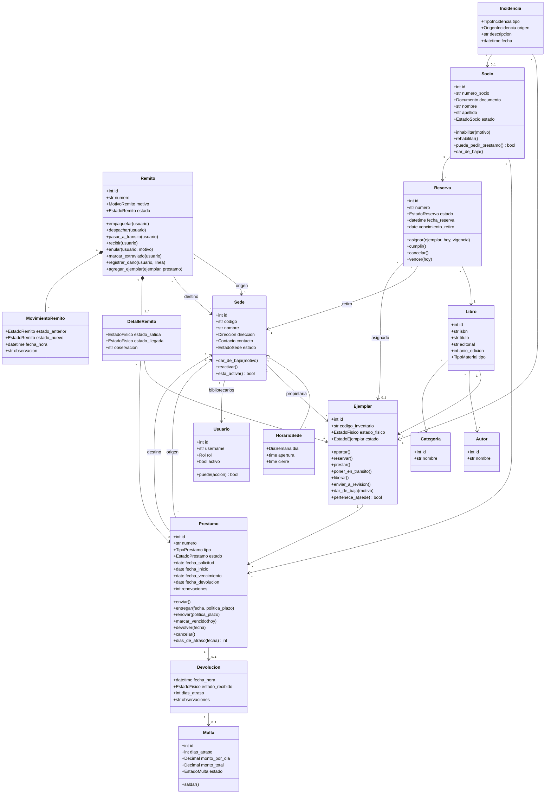
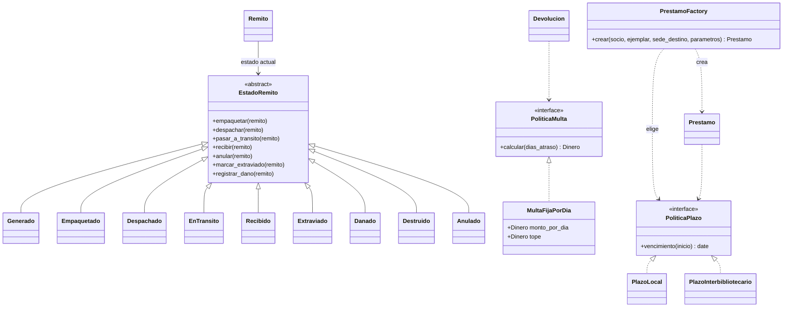
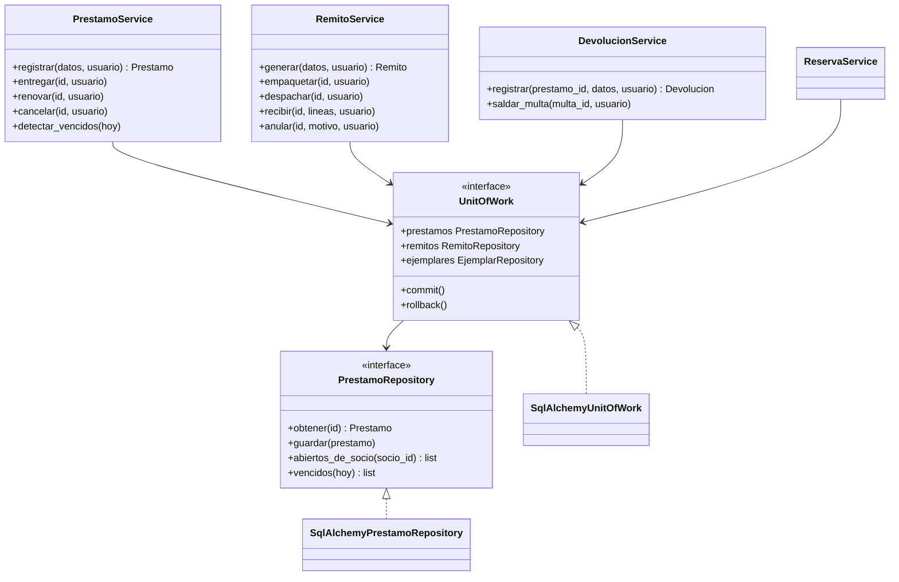

# 02. Modelo de clases

Diagramas UML en Mermaid (se visualizan en GitHub). Muestran el dominio; los nombres siguen la convención T2 (dominio en español sin tildes). Los patrones se detallan en [Patrones de diseño](05-patrones-de-diseno.md).

## Entidades del dominio

### Notas del modelo

- **Libro y ejemplar son clases distintas.** El libro es la obra; el ejemplar es la copia física con sede, estado físico y estado de disponibilidad.
- **Un préstamo tiene un solo ejemplar** y dos sedes: origen (donde está el ejemplar) y destino (donde lo retira el socio). En el préstamo local coinciden.
- **El remito agrupa ejemplares** mediante `DetalleRemito`; todos comparten origen y destino. Cada línea referencia su préstamo, salvo los traslados.
- **`MovimientoRemito`** es el historial que da la trazabilidad y alimenta los reportes de tránsito. Préstamo y ejemplar tienen historiales equivalentes (`MovimientoPrestamo`, `MovimientoEjemplar`).
- **`Multa`** nace al registrar una devolución fuera de término.
- Los **objetos de valor** (`Direccion`, `Contacto`, `Documento`, `Dinero`) son inmutables y se validan al construirlos.

## Estados, políticas y fábrica (patrones)

Los estados de préstamo, ejemplar y reserva siguen la misma estructura que `EstadoRemito` (una clase por estado que define qué operaciones admite). Ver [Máquinas de estado](03-maquinas-de-estado.md).

## Capa de aplicación y persistencia

Los servicios dependen de interfaces (`UnitOfWork`, repositorios) definidas en el dominio. Las implementaciones con SQLAlchemy viven en `infrastructure` y se inyectan, lo que permite probar los servicios con repositorios en memoria.
