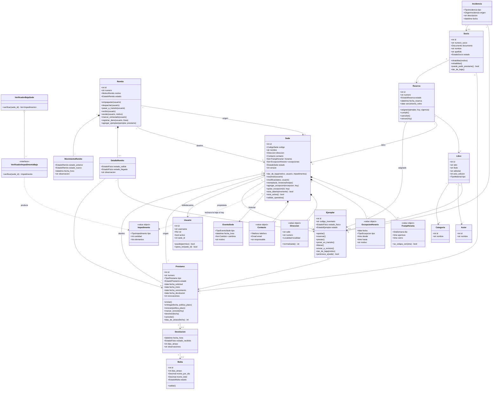
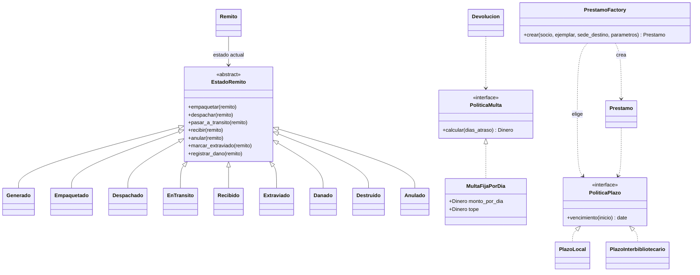
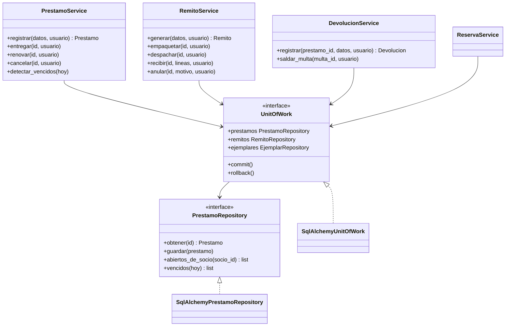

# 02. Modelo de clases

Diagramas UML en Mermaid (se visualizan en GitHub). Muestran el dominio; los nombres siguen la convención T2 (dominio en español sin tildes). Los patrones se detallan en [Patrones de diseño](05-patrones-de-diseno.md).

## Entidades del dominio

### Notas del modelo

- **La sede decide.** `Sede.dar_de_baja(...)` recibe los impedimentos ya calculados y lanza `SedeConActividadPendiente` si hay alguno; `Sede.validar_operativa()` lanza `SedeEnBaja` y es la guarda que usan los demás módulos antes de operar con una sede. `Sede.modificar`, `reemplazar_horarios`, `agregar_excepcion` y `quitar_excepcion` rechazan con `SedeEnBaja` si la sede está dada de baja.
- **Permisos.** `Permiso` es una enumeración y `ROL_PERMISOS` el mapa rol → permisos; `Usuario.puede(permiso)` consulta el mapa. Los roles son tres y fijos.
- **`esta_abierta(momento)`** combina horario semanal y excepciones en la zona de negocio; el reloj se inyecta.

- **Libro y ejemplar son clases distintas.** El libro es la obra; el ejemplar es la copia física con sede, estado físico y estado de disponibilidad.
- **Un préstamo tiene un solo ejemplar** y dos sedes: origen (donde está el ejemplar) y destino (donde lo retira el socio). En el préstamo local coinciden.
- **El remito agrupa ejemplares** mediante `DetalleRemito`; todos comparten origen y destino. Cada línea referencia su préstamo, salvo los traslados.
- **`MovimientoRemito`** es el historial que da la trazabilidad y alimenta los reportes de tránsito. Préstamo y ejemplar tienen historiales equivalentes (`MovimientoPrestamo`, `MovimientoEjemplar`).
- **`Multa`** nace al registrar una devolución fuera de término.
- Los **objetos de valor** (`Direccion`, `Contacto`, `Documento`, `Dinero`) son inmutables y se validan al construirlos.

## Estados, políticas y fábrica (patrones)

Los estados de préstamo, ejemplar y reserva siguen la misma estructura que `EstadoRemito` (una clase por estado que define qué operaciones admite). Ver [Máquinas de estado](03-maquinas-de-estado.md). La sede no usa State: su estado es el enum `EstadoSede` ([por qué](05-patrones-de-diseno.md#por-qué-la-sede-no-usa-state)).

La verificación de baja de sede (Strategy + Composite: `VerificadorImpedimentoBaja`, sus seis verificadores concretos y el compuesto `VerificadorBajaSede`) tiene su diagrama y la tabla de roles en [Patrones de diseño](05-patrones-de-diseno.md#10-strategy--composite-verificación-de-baja-de-sede).

## Capa de aplicación y persistencia

Los servicios dependen de interfaces (`UnitOfWork`, repositorios) definidas en el dominio. Las implementaciones con SQLAlchemy viven en `repositories/impl` y se inyectan, lo que permite probar los servicios con repositorios en memoria.
