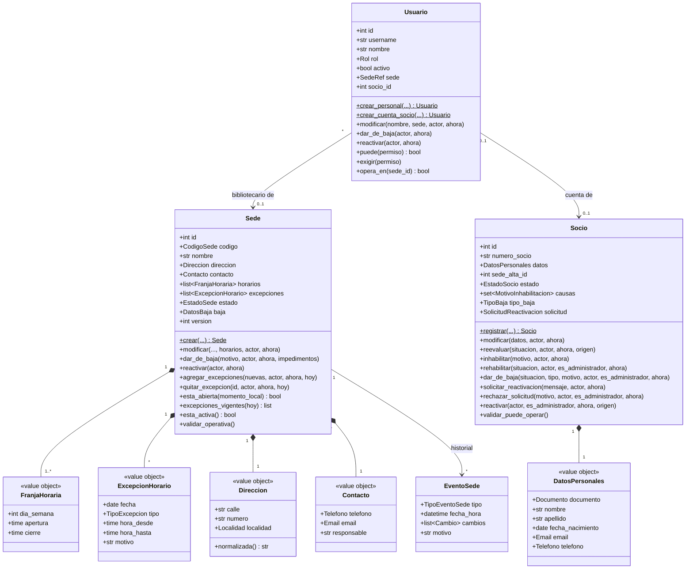
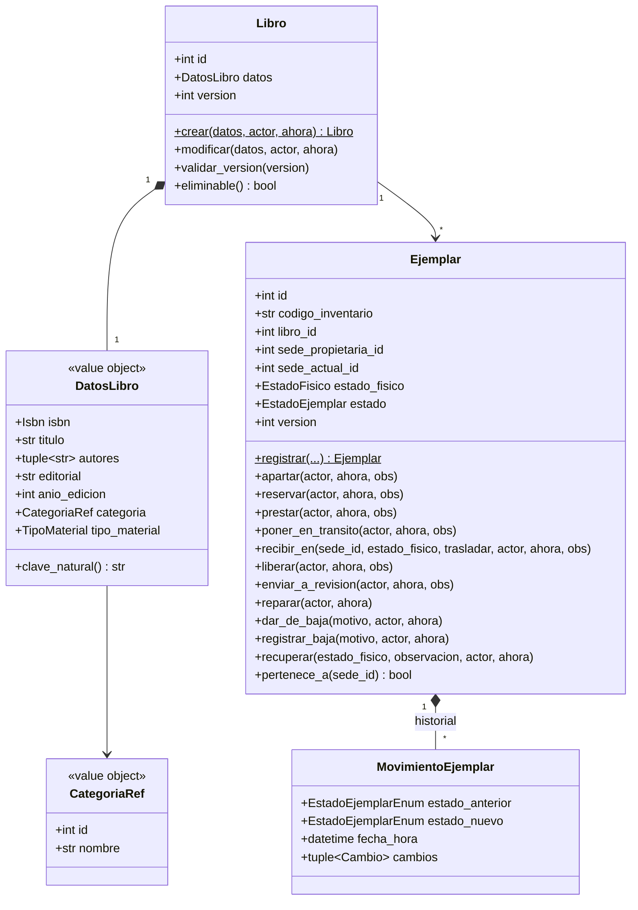
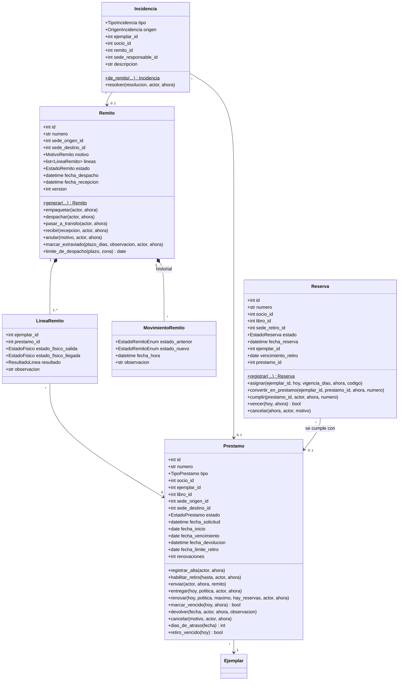
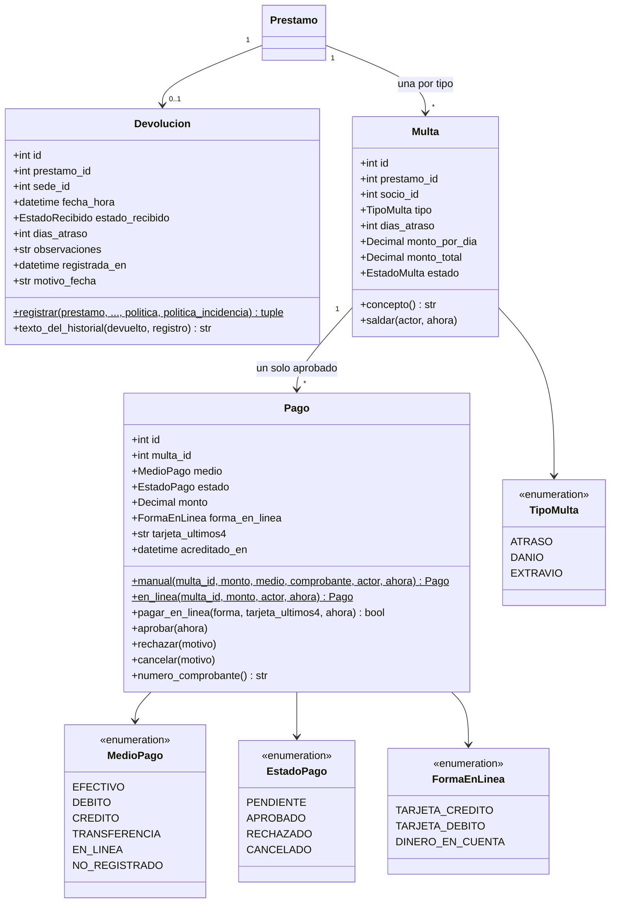
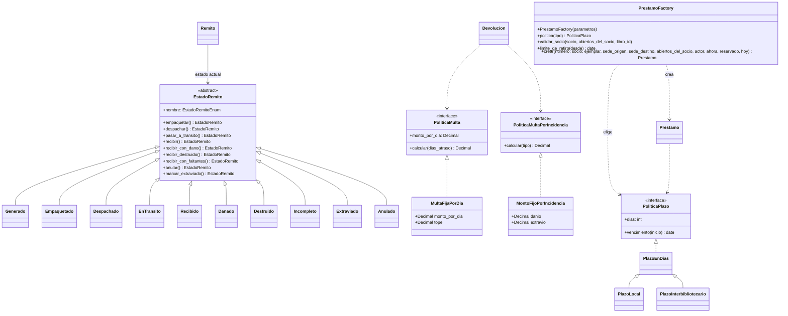
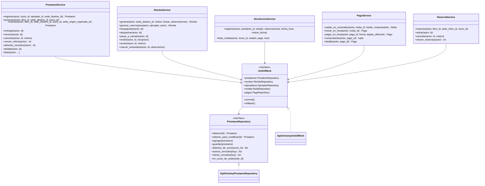

# 02. Modelo de clases

Diagramas UML en Mermaid (se visualizan en GitHub) de las clases reales de `backend/app/models/`, `services/` y `repositories/`. Muestran los atributos y operaciones públicos más relevantes; los nombres siguen la convención T2 (dominio en español sin tildes). Los patrones se detallan en [Patrones de diseño](05-patrones-de-diseno.md) y las tablas, en el [diccionario de datos](../../database/diccionario-de-datos.md).

## Sedes, usuarios y socios

## Catálogo

Los autores son una lista de nombres dentro de `DatosLibro`; en la base son las tablas `autor` y `libro_autor`, y la categoría sale del catálogo cerrado `categoria`.

## Préstamos, remitos y reservas

## Devoluciones, multas y pagos

### Notas del modelo

- **La sede decide.** `Sede.dar_de_baja(...)` recibe los impedimentos ya calculados y lanza `SedeConActividadPendiente` si hay alguno; `Sede.validar_operativa()` lanza `SedeEnBaja` y es la guarda que usan los demás módulos antes de operar con una sede. Los horarios se reemplazan con `Sede.modificar(..., horarios=...)`; `modificar`, `agregar_excepciones` y `quitar_excepcion` rechazan con `SedeEnBaja` si la sede está dada de baja.
- **Permisos.** `Permiso` es una enumeración y `ROL_PERMISOS` el mapa rol → permisos (`models/usuario.py`); `Usuario.puede(permiso)` consulta el mapa y `exigir` lanza `PermisoDenegado`. Los roles son tres y fijos; el rol y el usuario no cambian después del alta.
- **`esta_abierta(momento_local)`** combina horario semanal y excepciones en la zona de negocio; el reloj se inyecta.
- **El socio se reevalúa.** `Socio.reevaluar(situacion, ...)` recalcula las causas automáticas (préstamo vencido, multa impaga) a partir de una `SituacionSocio`; la inhabilitación administrativa solo la decide el administrador.
- **Libro y ejemplar son clases distintas.** El libro es la obra; el ejemplar es la copia física con sede propietaria, sede actual, estado físico y estado de disponibilidad.
- **Un préstamo tiene un solo ejemplar** y dos sedes: origen (donde está el ejemplar) y destino (donde lo retira el socio). En el préstamo local coinciden.
- **El remito agrupa ejemplares** con `LineaRemito`; todos comparten origen y destino. Cada línea referencia su préstamo, salvo los traslados. La recepción llega como una lista de `RecepcionLinea` (estado físico, destruido o faltante).
- **Historiales.** Remito, préstamo, ejemplar y reserva acumulan `movimientos_pendientes` (`MovimientoRemito`, `MovimientoPrestamo`, `MovimientoEjemplar`, `MovimientoReserva`) y sede y socio, `eventos_pendientes`; el repositorio los guarda en tablas de solo inserción.
- **`Multa`** cuelga del préstamo: nace al registrar la devolución, por atraso (con días y monto por día) o por daño o extravío (monto fijo); un préstamo tiene a lo sumo una de cada tipo. Se salda con un `Pago` aprobado, del mostrador (`Pago.manual`) o en línea simulado (`Pago.en_linea` y `pagar_en_linea`).
- Los **objetos de valor** (`CodigoSede`, `Direccion`, `Contacto`, `Telefono`, `Email`, `FranjaHoraria`, `ExcepcionHorario`, `Documento`, `DatosPersonales`, `Isbn`, `DatosLibro`) son inmutables y se validan al construirlos. Los montos son `Decimal`.

## Estados, políticas y fábrica (patrones)

Los estados de préstamo, ejemplar y reserva siguen la misma estructura que `EstadoRemito`: una clase por estado que define qué operaciones admite y devuelve el estado siguiente. Ver [Máquinas de estado](03-maquinas-de-estado.md). La sede no usa State: su estado es el enum `EstadoSede` ([por qué](05-patrones-de-diseno.md#por-qué-la-sede-no-usa-state)).

La verificación de baja de sede (Strategy + Composite: `VerificadorImpedimentoBaja`, sus seis verificadores concretos y el compuesto `VerificadorBajaSede`) tiene su diagrama y la tabla de roles en [Patrones de diseño](05-patrones-de-diseno.md#4-strategy--composite-verificación-de-baja-de-sede).

## Capa de aplicación y persistencia

Los servicios dependen de interfaces (`Protocol`): la `UnitOfWork` (`repositories/unit_of_work.py`) y los repositorios (`repositories/interfaces/`). Las implementaciones con SQLAlchemy viven en `repositories/impl/` y se inyectan, lo que permite probar los servicios con repositorios en memoria (`tests/fakes/`). El resto de los servicios (sedes, socios, usuarios, catálogo, parámetros, reportes) sigue la misma estructura.
