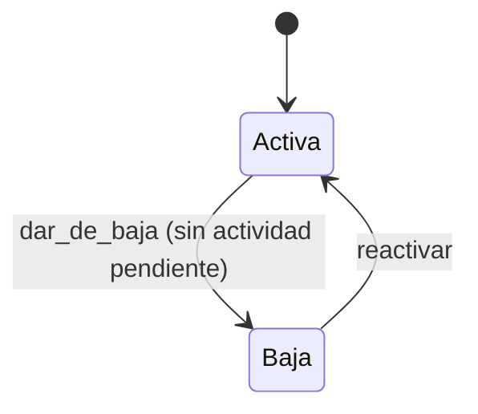
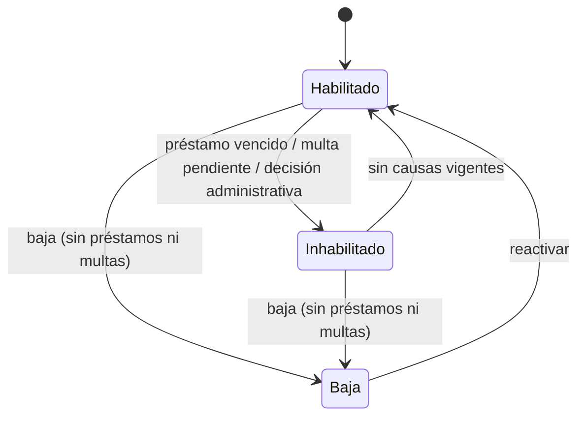
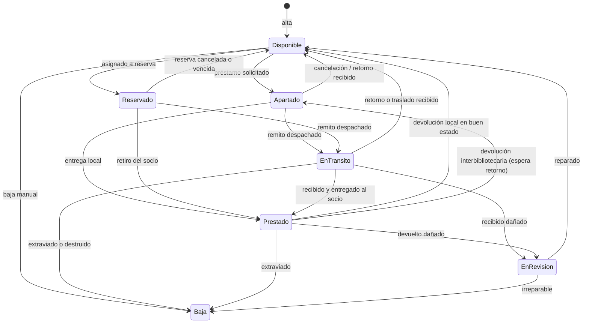
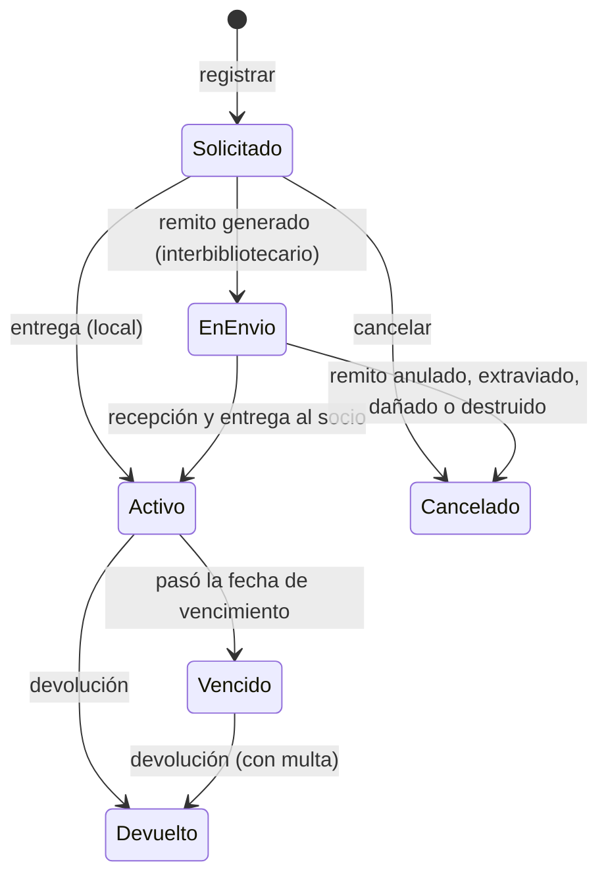
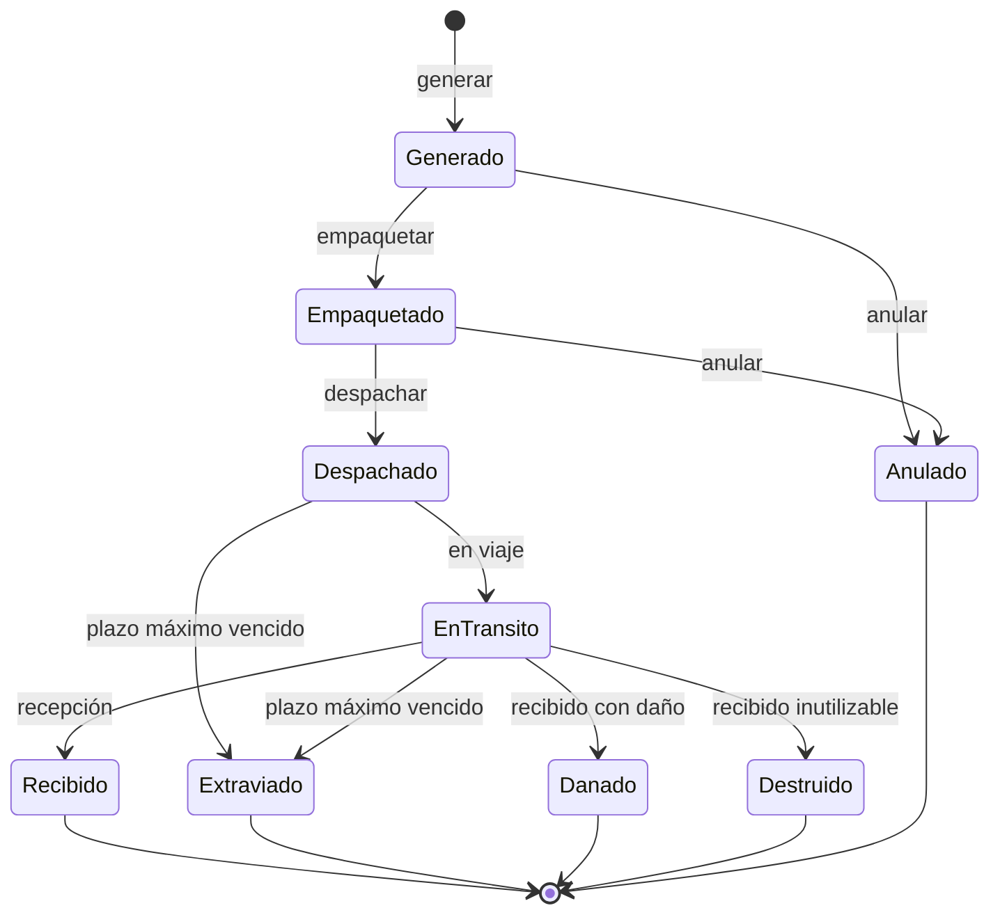
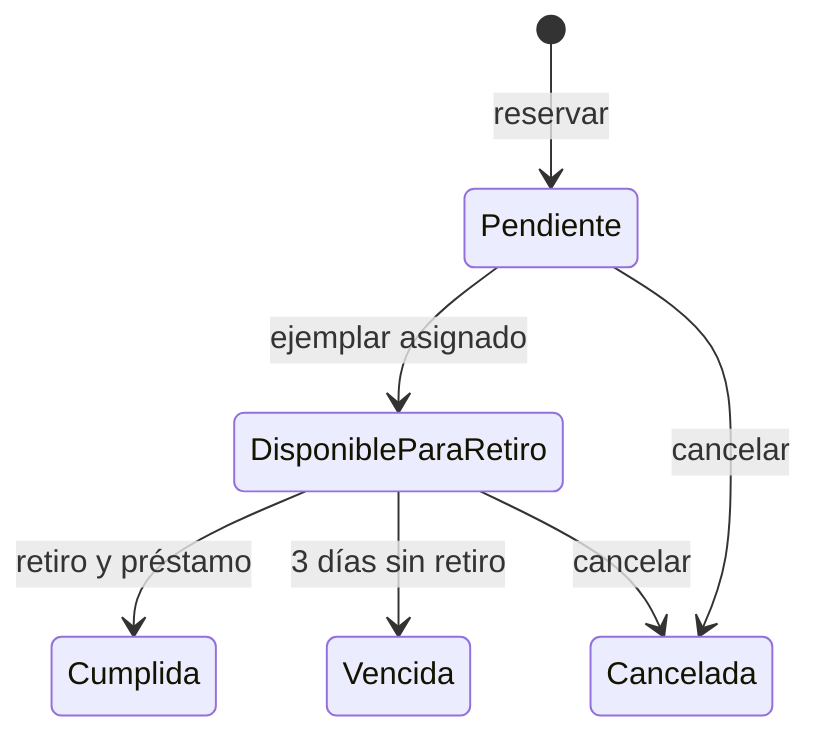
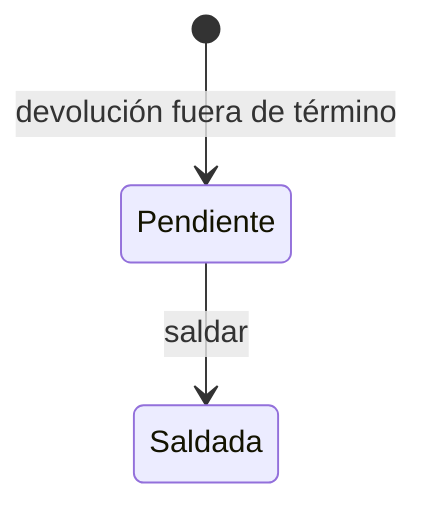

# 03. Máquinas de estado

Estados y transiciones válidas de cada entidad. Cualquier transición que no figure es **inválida** y el dominio la rechaza con `TransicionInvalida`. Cada transición registra un movimiento con estado anterior, estado nuevo, fecha y hora, usuario y observación.

Estados de partida: [Remitos](../negocio/05-remitos.md), [Préstamos](../negocio/04-prestamos.md), [Reservas](../negocio/06-reservas.md) y [Catálogo](../negocio/03-catalogo.md).

## Sede

Guarda: la baja se rechaza si hay préstamos activos o vencidos, remitos no cerrados, reservas pendientes o ejemplares propios fuera de la sede.

## Socio

El estado `Inhabilitado` se reevalúa en cada evento relevante: préstamo que vence, devolución, multa generada o saldada. Una inhabilitación administrativa solo la levanta el administrador.

## Ejemplar

Estados de disponibilidad. Los de negocio son `Disponible`, `Reservado`, `Prestado`, `En tránsito` y `Baja`. Se proponen dos más (**T4**):

- **`Apartado`**: retenido para un movimiento pendiente (préstamo solicitado antes de entregarse, o ejemplar devuelto en una sede distinta de la propietaria esperando el retorno). Sin este estado habría que marcarlo `Reservado`, que significa otra cosa.
- **`En revisión`**: devuelto o recibido dañado, a la espera de decidir reparación o baja. Negocio ya menciona «pasa a revisión» sin darle estado.

`EnTransito` aparece sin tilde en el diagrama por limitación de Mermaid; en el código es `EN_TRANSITO`.

Efecto al volver a `Disponible`: el sistema revisa la cola de reservas del libro y, si hay una elegible, pasa a `Reservado` (ver [Reservas](../funcional/06-reservas.md)).

## Préstamo

| Transición | Guardas | Efectos |
|------------|---------|---------|
| `Solicitado → Activo` | Ejemplar `Apartado` en la sede | Calcula vencimiento, ejemplar `Prestado` |
| `EnEnvio → Activo` | Remito `Recibido` en la sede destino | Vencimiento desde la entrega al socio |
| `Activo → Vencido` | `hoy > fecha_vencimiento` | Socio `Inhabilitado` por préstamo vencido |
| `Activo → Devuelto` | Devolución en la sede destino | Ejemplar según estado recibido; reevalúa socio y reservas |
| `Vencido → Devuelto` | Ídem | Genera multa por los días de atraso |

El día de vencimiento es el último día válido: `Vencido` solo se alcanza al día siguiente.

## Remito

`EnTransito`, `Danado` y `Extraviado` mantienen la grafía de código del diagrama.

| Transición | Quién | Efectos sobre otras entidades |
|------------|-------|-------------------------------|
| `Generado` | Bibliotecario sede origen | Préstamos asociados pasan a `EnEnvio` |
| `Despachado` | Sede origen | Ejemplares `EnTransito` |
| `Recibido` | Sede destino | Ejemplares `Prestado` (entrega al socio, préstamo `Activo`) o `Disponible` (retorno o traslado); en traslado cambia la sede propietaria |
| `Anulado` | Sede origen, solo antes del despacho | Ejemplares `Disponible`, préstamos `Cancelado` |
| `Extraviado` | Origen, destino o administrador, plazo vencido (7 días) | Ejemplares `Baja` con incidencia, préstamos `Cancelado` |
| `Danado` | Sede destino | Ejemplar `EnRevision`, incidencia, préstamo `Cancelado` |
| `Destruido` | Sede destino | Ejemplar `Baja`, incidencia, préstamo `Cancelado` |

La recepción desde `Despachado` se admite completando el estado `EnTransito` en el mismo acto, de modo que el historial muestre ambos movimientos.

**Críticas al ciclo (la cátedra lo evaluará):**

- `Despachado` y `EnTransito` se distinguen porque permiten medir el tiempo entre «sale de la sede» y «está viajando». Si no se necesitara esa granularidad, pueden fusionarse.
- `Recibido`, `Danado` y `Destruido` son resultados de la revisión de recepción; el daño parcial (una línea sí, otra no) se registra por línea en `DetalleRemito` y el estado del remito sigue la peor condición.
- No existe `Devuelto` ni retroceso: un remito extraviado que aparece después no se reabre, se corrige con un ajuste administrativo.

## Reserva

Al pasar a `Vencida` o `Cancelada` desde `DisponibleParaRetiro`, el ejemplar vuelve a `Disponible` y se reasigna a la siguiente reserva de la cola (FIFO).

## Multa

## Acoplamiento entre máquinas

| Evento | Sede | Socio | Ejemplar | Préstamo | Remito | Reserva |
|--------|:----:|:-----:|:--------:|:--------:|:------:|:-------:|
| Registrar préstamo | valida activa | valida habilitado | → Apartado | → Solicitado | | |
| Generar remito | valida activas | | | → EnEnvio | → Generado | |
| Despachar | | | → EnTransito | | → Despachado | |
| Recibir y entregar | | | → Prestado | → Activo | → Recibido | |
| Vence el plazo | | → Inhabilitado | | → Vencido | | |
| Devolver | | reevalúa | → Disponible / Apartado / EnRevision / Baja | → Devuelto | retorno: → Generado | asigna a la primera |
| Saldar multa | | reevalúa | | | | |
| Baja de sede | → Baja (si no hay pendientes) | | | | | |

## Implementación

El patrón State se aplica a remito, préstamo, ejemplar y reserva: cada estado es una clase que define qué operaciones admite; una operación no permitida lanza `TransicionInvalida`. Los efectos entre entidades los orquesta el servicio de aplicación, no los estados, para que cada máquina siga siendo simple. Detalle en [Patrones de diseño](05-patrones-de-diseno.md#1-state-estado).
