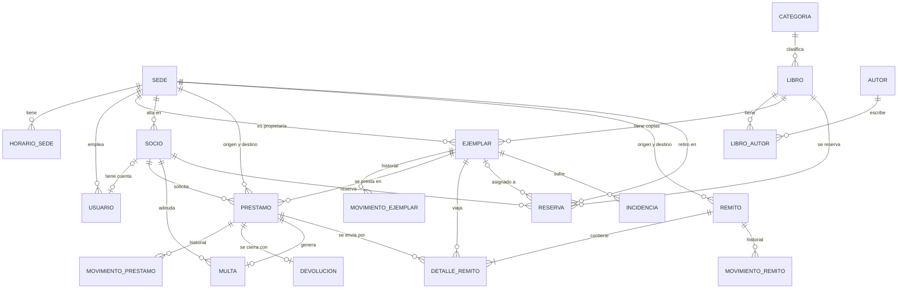

# 04. Modelo de datos

Esquema relacional para PostgreSQL 16, gestionado con Alembic. Los nombres de tablas y columnas van en español, minúsculas y con guion bajo.

## Diagrama entidad-relación



## Tablas

Convenciones: todas las tablas tienen `id` (clave primaria `BIGINT` generada) y `creado_en` y `actualizado_en` (`TIMESTAMPTZ`). Los estados se guardan como `VARCHAR` con restricción `CHECK` (o enumerado de PostgreSQL). Los montos son `NUMERIC(10,2)`.

### sede

| Columna | Tipo | Restricciones |
|---------|------|---------------|
| codigo | VARCHAR(10) | NOT NULL, UNIQUE |
| nombre | VARCHAR(100) | NOT NULL |
| nombre_normalizado | VARCHAR(100) | UNIQUE; el dominio lo calcula sin mayúsculas ni tildes, para evitar sedes duplicadas |
| calle, numero, localidad, provincia | VARCHAR | NOT NULL |
| telefono, email, responsable | VARCHAR | |
| estado | VARCHAR(10) | `ACTIVA` o `BAJA`, NOT NULL |
| fecha_baja, motivo_baja | TIMESTAMPTZ, TEXT | NOT NULL si `estado = 'BAJA'` |

### horario_sede

| Columna | Tipo | Restricciones |
|---------|------|---------------|
| sede_id | FK sede | NOT NULL |
| dia_semana | SMALLINT | 1 a 7 |
| hora_apertura, hora_cierre | TIME | `CHECK (hora_cierre > hora_apertura)` |

El solapamiento de franjas del mismo día lo valida el dominio; en PostgreSQL se refuerza con una restricción de exclusión (`EXCLUDE USING gist`).

### usuario

| Columna | Tipo | Restricciones |
|---------|------|---------------|
| username | VARCHAR(50) | NOT NULL, UNIQUE |
| password_hash | VARCHAR | NOT NULL |
| nombre | VARCHAR(100) | NOT NULL |
| rol | VARCHAR(15) | `ADMIN`, `BIBLIOTECARIO` o `SOCIO` |
| sede_id | FK sede | `CHECK (rol <> 'BIBLIOTECARIO' OR sede_id IS NOT NULL)` |
| socio_id | FK socio | UNIQUE, obligatorio si `rol = 'SOCIO'` |
| activo | BOOLEAN | NOT NULL, por defecto verdadero |

### socio

| Columna | Tipo | Restricciones |
|---------|------|---------------|
| numero_socio | VARCHAR(15) | NOT NULL, UNIQUE |
| tipo_documento, nro_documento | VARCHAR | NOT NULL, **UNIQUE (tipo, número)** |
| nombre, apellido | VARCHAR(100) | NOT NULL |
| fecha_nacimiento | DATE | informativa |
| email, telefono, domicilio | VARCHAR | |
| sede_alta_id | FK sede | NOT NULL |
| estado | VARCHAR(15) | `HABILITADO` o `INHABILITADO` |
| motivo_inhabilitacion | VARCHAR(30) | `PRESTAMO_VENCIDO`, `MULTA_IMPAGA`, `ADMINISTRATIVA`; NOT NULL si inhabilitado |
| fecha_baja | TIMESTAMPTZ | NULL si está dado de alta; la baja es lógica |

### categoria, autor, libro, libro_autor

| Tabla | Columnas clave | Restricciones |
|-------|----------------|---------------|
| categoria | nombre | UNIQUE |
| autor | nombre | |
| libro | isbn, titulo, editorial, anio_edicion, categoria_id, tipo_material, clave_natural | `isbn` UNIQUE (admite NULL); `clave_natural` UNIQUE, calculada como título + autor + editorial + año cuando no hay ISBN |
| libro_autor | libro_id, autor_id, orden | PK compuesta (libro_id, autor_id) |

### ejemplar

| Columna | Tipo | Restricciones |
|---------|------|---------------|
| codigo_inventario | VARCHAR(30) | NOT NULL, **UNIQUE en toda la red** |
| libro_id | FK libro | NOT NULL |
| sede_propietaria_id | FK sede | NOT NULL |
| sede_actual_id | FK sede | NOT NULL |
| estado_fisico | VARCHAR(10) | `NUEVO`, `BUENO`, `REGULAR`, `DANADO` |
| estado | VARCHAR(15) | `DISPONIBLE`, `RESERVADO`, `APARTADO`, `PRESTADO`, `EN_TRANSITO`, `EN_REVISION`, `BAJA` |
| fecha_baja, motivo_baja | | NOT NULL si `estado = 'BAJA'` |
| version | INT | control de concurrencia optimista |

### movimiento_ejemplar, movimiento_prestamo, movimiento_remito

Historiales de solo inserción (nunca se modifican ni borran). Misma estructura:

| Columna | Tipo |
|---------|------|
| ejemplar_id / prestamo_id / remito_id | FK, NOT NULL |
| estado_anterior | VARCHAR (NULL en el primer movimiento) |
| estado_nuevo | VARCHAR, NOT NULL |
| fecha_hora | TIMESTAMPTZ, NOT NULL, por defecto `now()` |
| usuario_id | FK usuario |
| observacion | TEXT |

Índice en `(remito_id, fecha_hora)` para el seguimiento y los reportes de tránsito.

### prestamo

| Columna | Tipo | Restricciones |
|---------|------|---------------|
| numero | VARCHAR(20) | NOT NULL, UNIQUE |
| socio_id, ejemplar_id | FK | NOT NULL |
| tipo | VARCHAR(20) | `LOCAL` o `INTERBIBLIOTECARIO` |
| sede_origen_id, sede_destino_id | FK sede | NOT NULL |
| estado | VARCHAR(15) | `SOLICITADO`, `EN_ENVIO`, `ACTIVO`, `VENCIDO`, `DEVUELTO`, `CANCELADO` |
| fecha_solicitud | TIMESTAMPTZ | NOT NULL |
| fecha_inicio, fecha_vencimiento, fecha_devolucion | DATE / TIMESTAMPTZ | |
| renovaciones | SMALLINT | NOT NULL, por defecto 0 |
| registrado_por_id | FK usuario | NOT NULL |

Restricciones que garantizan reglas de negocio en la base:

```sql
-- origen = destino solo en préstamos locales
CHECK ((tipo = 'LOCAL' AND sede_origen_id = sede_destino_id)
    OR (tipo = 'INTERBIBLIOTECARIO' AND sede_origen_id <> sede_destino_id))

-- un ejemplar no puede tener dos préstamos abiertos a la vez
CREATE UNIQUE INDEX uq_prestamo_abierto_por_ejemplar
    ON prestamo (ejemplar_id)
    WHERE estado IN ('SOLICITADO', 'EN_ENVIO', 'ACTIVO', 'VENCIDO');
```

### remito y detalle_remito

**remito**

| Columna | Tipo | Restricciones |
|---------|------|---------------|
| numero | VARCHAR(20) | NOT NULL, UNIQUE (secuencia) |
| sede_origen_id, sede_destino_id | FK sede | `CHECK (sede_origen_id <> sede_destino_id)` |
| motivo | VARCHAR(15) | `ENVIO`, `RETORNO` o `TRASLADO` |
| estado | VARCHAR(15) | `GENERADO`, `EMPAQUETADO`, `DESPACHADO`, `EN_TRANSITO`, `RECIBIDO`, `EXTRAVIADO`, `DANADO`, `DESTRUIDO`, `ANULADO` |
| fecha_despacho, fecha_recepcion | TIMESTAMPTZ | denormalizadas para consultas rápidas; la fuente es `movimiento_remito` |
| observaciones | TEXT | |
| version | INT | concurrencia optimista |

**detalle_remito**

| Columna | Tipo | Restricciones |
|---------|------|---------------|
| remito_id | FK remito | NOT NULL |
| ejemplar_id | FK ejemplar | NOT NULL, **UNIQUE (remito_id, ejemplar_id)** |
| prestamo_id | FK prestamo | NULL en los traslados |
| estado_fisico_salida, estado_fisico_llegada | VARCHAR | |
| observacion | TEXT | |

Que un ejemplar no esté en dos remitos abiertos a la vez no se expresa con un índice simple porque el estado vive en `remito`; lo garantizan el estado `Apartado`, `Reservado` o `EnTransito` del ejemplar y el bloqueo de fila al armar el remito.

### reserva

| Columna | Tipo | Restricciones |
|---------|------|---------------|
| numero | VARCHAR(20) | NOT NULL, UNIQUE |
| socio_id, libro_id, sede_retiro_id | FK | NOT NULL |
| ejemplar_id | FK ejemplar | asignado; NULL mientras está pendiente |
| estado | VARCHAR(25) | `PENDIENTE`, `DISPONIBLE_PARA_RETIRO`, `CUMPLIDA`, `CANCELADA`, `VENCIDA` |
| fecha_reserva | TIMESTAMPTZ | NOT NULL; define el orden FIFO |
| vencimiento_retiro | DATE | |

```sql
-- un socio no puede tener dos reservas activas del mismo libro
CREATE UNIQUE INDEX uq_reserva_activa
    ON reserva (socio_id, libro_id)
    WHERE estado IN ('PENDIENTE', 'DISPONIBLE_PARA_RETIRO');
```

### devolucion, multa, incidencia, parametro

| Tabla | Columnas clave | Restricciones |
|-------|----------------|---------------|
| devolucion | prestamo_id, sede_id, fecha_hora, estado_fisico_recibido, dias_atraso, observaciones, registrada_por_id | `prestamo_id` UNIQUE |
| multa | prestamo_id, socio_id, dias_atraso, monto_por_dia, monto_total, estado (`PENDIENTE`, `SALDADA`), fecha_saldada | `prestamo_id` UNIQUE; `monto_total >= 0` |
| incidencia | tipo (`EXTRAVIO`, `DANIO`, `DESTRUCCION`), origen (`DEVOLUCION`, `REMITO`), ejemplar_id, socio_id, prestamo_id, remito_id, descripcion, fecha, usuario_id | descripción NOT NULL |
| parametro | clave (PK), valor, descripcion | ver abajo |

`multa` guarda el `monto_por_dia` vigente al generarla: un cambio posterior de la configuración no altera multas ya emitidas.

Parámetros iniciales (`parametro`):

| Clave | Valor |
|-------|-------|
| `plazo_prestamo_local_dias` | 14 |
| `plazo_prestamo_inter_dias` | 21 |
| `renovaciones_maximas` | 1 |
| `prestamos_maximos_por_socio` | 3 |
| `reservas_maximas_por_socio` | 3 |
| `vigencia_retiro_reserva_dias` | 3 |
| `multa_por_dia` | 200.00 |
| `transito_maximo_dias` | 7 |

## Índices

Además de claves primarias, únicas y los índices parciales anteriores:

| Índice | Para qué |
|--------|----------|
| `ejemplar (libro_id, sede_actual_id, estado)` | Disponibilidad por libro y sede (R5) |
| `prestamo (socio_id, estado)` | Préstamos abiertos del socio y límite de 3 |
| `prestamo (estado, fecha_vencimiento)` | Detección de vencidos (R4) |
| `prestamo (tipo, fecha_solicitud)` | Libros más pedidos entre sedes (R3) |
| `reserva (libro_id, estado, fecha_reserva)` | Cola FIFO por libro |
| `remito (estado, sede_origen_id, sede_destino_id)` | Remitos abiertos por sede (R6) |
| `movimiento_remito (remito_id, fecha_hora)` | Trazabilidad y tiempos de tránsito (R1, R2) |
| `socio (apellido, nombre)` | Búsqueda por apellido |

## Reportes sobre el modelo

| Reporte | Fuente principal |
|---------|------------------|
| R1 Movimiento y tiempo de tránsito | `remito`, `detalle_remito`, `movimiento_remito` (despacho y recepción) |
| R2 Envíos exitosos e incidencias | `remito` (estado final), `incidencia` |
| R3 Libros más solicitados entre sedes | `prestamo` (tipo interbibliotecario) → `ejemplar` → `libro` |
| R4 Vencidos y multas | `prestamo`, `multa`, `parametro` |
| R5 Disponibilidad por sede | `ejemplar` agrupado por libro, sede y estado |
| R6 Activos y en tránsito | `prestamo`, `remito` |

Los reportes son consultas de solo lectura en `application/reports/`, con SQL agregado (`GROUP BY`) y no recorren entidades una por una.

## Migraciones y datos de ejemplo

- Alembic genera una migración por cambio de modelo; se revisan en el PR.
- Un script de carga (`seed`) crea parámetros, sedes, usuarios de cada rol, socios, libros y ejemplares de demostración.
- La extensión `btree_gist` (restricción de exclusión de horarios) se habilita en la primera migración.
