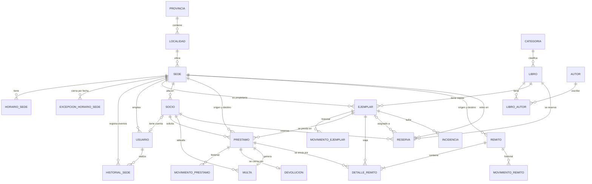

# 04. Modelo de datos

Esquema relacional para PostgreSQL 16, gestionado con Alembic. Los nombres de tablas y columnas van en español, minúsculas y con guion bajo.

## Diagrama entidad-relación



## Tablas

Convenciones: todas las tablas tienen `id` (clave primaria `BIGINT` generada) y `creado_en` y `actualizado_en` (`TIMESTAMPTZ`). Los estados se guardan como `VARCHAR` con restricción `CHECK` (o enumerado de PostgreSQL). Los montos son `NUMERIC(10,2)`.

### provincia y localidad (catálogo cerrado)

| Tabla | Columna | Tipo | Restricciones |
|-------|---------|------|---------------|
| provincia | nombre | VARCHAR(60) | NOT NULL, UNIQUE |
| localidad | provincia_id | FK provincia | NOT NULL |
| | nombre | VARCHAR(100) | NOT NULL |
| | departamento | VARCHAR(60) | NOT NULL (en Córdoba, el departamento de la localidad) |
| | | | `UNIQUE (provincia_id, nombre, departamento)` |

Son tablas de referencia de solo lectura para la aplicación: se cargan con una migración de datos y se amplían con otra. La sede referencia `localidad_id`; la provincia se obtiene por la localidad. Hoy contienen solo la provincia de Córdoba (ver [Seed](#migraciones-y-datos-de-ejemplo)).

### sede

| Columna | Tipo | Restricciones |
|---------|------|---------------|
| codigo | VARCHAR(15) | NOT NULL, UNIQUE, `CHECK (codigo ~ '^[A-Z0-9_]{3,15}$')`. **Inmutable**: el repositorio no lo actualiza |
| nombre | VARCHAR(100) | NOT NULL |
| nombre_normalizado | VARCHAR(100) | NOT NULL, UNIQUE; el dominio lo calcula sin mayúsculas ni tildes, para evitar sedes duplicadas |
| calle | VARCHAR(100) | NOT NULL |
| numero | VARCHAR(10) | NOT NULL (`1250`, `1250B` o `S/N`) |
| localidad_id | FK localidad | NOT NULL |
| direccion_normalizada | VARCHAR(200) | NOT NULL; localidad + calle + número normalizados. **Índice no único**, porque un duplicado confirmado es válido |
| telefono | VARCHAR(16) | NOT NULL, `CHECK (telefono ~ '^\+[1-9][0-9]{7,14}$')` (E.164) |
| email | VARCHAR(120) | NOT NULL, en minúsculas |
| responsable | VARCHAR(100) | NOT NULL |
| estado | VARCHAR(10) | `ACTIVA` o `BAJA`, NOT NULL, por defecto `ACTIVA` |
| fecha_baja | TIMESTAMPTZ | |
| motivo_baja | VARCHAR(300) | |
| baja_por_id | FK usuario | |
| version | INT | NOT NULL, por defecto 1; concurrencia optimista |
| creado_por_id, actualizado_por_id | FK usuario | NOT NULL (`RF-ACC-07`) |

```sql
-- los datos de baja existen si y solo si la sede está en baja
CHECK ((estado = 'BAJA' AND fecha_baja IS NOT NULL AND motivo_baja IS NOT NULL AND baja_por_id IS NOT NULL)
    OR (estado = 'ACTIVA' AND fecha_baja IS NULL AND motivo_baja IS NULL AND baja_por_id IS NULL))
```

Índices: `sede (estado, nombre)` para el listado y `sede (direccion_normalizada)` para la advertencia de dirección repetida.

### horario_sede

| Columna | Tipo | Restricciones |
|---------|------|---------------|
| sede_id | FK sede | NOT NULL |
| dia_semana | SMALLINT | `CHECK (dia_semana BETWEEN 1 AND 7)`; 1 = lunes, 7 = domingo (ISO 8601) |
| hora_apertura, hora_cierre | TIME | NOT NULL, `CHECK (hora_cierre > hora_apertura)`, segundos en cero |

El solapamiento de franjas del mismo día lo valida el dominio; en PostgreSQL se refuerza con una restricción de exclusión sobre el rango semiabierto `[apertura, cierre)` (así dos franjas contiguas son válidas):

```sql
EXCLUDE USING gist (
    sede_id WITH =,
    dia_semana WITH =,
    tsrange(DATE '2000-01-01' + hora_apertura, DATE '2000-01-01' + hora_cierre, '[)') WITH &&
)
```

«Cerrado» es la ausencia de franjas para un día. Que la sede tenga al menos una franja y no más de 4 por día lo garantiza el dominio. La modificación **reemplaza** las franjas: se borran las existentes y se insertan las nuevas dentro de la misma transacción. Las horas se interpretan en la zona `America/Argentina/Cordoba` (`TZ_NEGOCIO`).

### excepcion_horario_sede

| Columna | Tipo | Restricciones |
|---------|------|---------------|
| sede_id | FK sede | NOT NULL |
| fecha | DATE | NOT NULL |
| tipo | VARCHAR(15) | `CIERRE_TOTAL` o `CIERRE_PARCIAL` |
| hora_desde, hora_hasta | TIME | NULL en el cierre total; en el parcial, NOT NULL y `hora_desde < hora_hasta` |
| motivo | VARCHAR(150) | NULL permitido |
| creado_por_id | FK usuario | NOT NULL |

```sql
CHECK ((tipo = 'CIERRE_TOTAL'   AND hora_desde IS NULL AND hora_hasta IS NULL)
    OR (tipo = 'CIERRE_PARCIAL' AND hora_desde IS NOT NULL AND hora_hasta IS NOT NULL AND hora_desde < hora_hasta))

-- dos excepciones de la misma sede no se solapan; el cierre total ocupa todo el día
EXCLUDE USING gist (
    sede_id WITH =,
    tsrange(fecha + COALESCE(hora_desde, TIME '00:00'),
            CASE WHEN tipo = 'CIERRE_TOTAL' THEN fecha + 1 ELSE fecha + hora_hasta END, '[)') WITH &&
)
```

Una excepción es de un solo día; el rango de fechas lo expande el servicio a una fila por día (máximo 31). Índice en `(sede_id, fecha)`. Las excepciones de fecha pasada son inmutables (regla del dominio); las de hoy y futuras se pueden eliminar.

### historial_sede

Registro de auditoría de solo inserción. Es la **tabla de auditoría de las sedes**.

| Columna | Tipo | Restricciones |
|---------|------|---------------|
| sede_id | FK sede | NOT NULL |
| tipo_evento | VARCHAR(25) | `ALTA`, `MODIFICACION`, `BAJA`, `REACTIVACION`, `EXCEPCION_AGREGADA`, `EXCEPCION_ELIMINADA` |
| fecha_hora | TIMESTAMPTZ | NOT NULL, por defecto `now()` |
| usuario_id | FK usuario | NOT NULL |
| estado_anterior, estado_nuevo | VARCHAR(10) | `ACTIVA` / `BAJA`; solo en `BAJA` y `REACTIVACION` (en `ALTA`, solo el nuevo) |
| motivo | VARCHAR(300) | el motivo de la baja; NULL en el resto |
| cambios | JSONB | NOT NULL; ver formato abajo |
| version_resultante | INT | versión de la sede tras el evento |

Formato de `cambios` (siempre una lista, vacía si no aplica):

```json
[
  { "campo": "telefono", "antes": "+543514221234", "despues": "+543514225678" },
  { "campo": "horarios", "antes": [{"dia_semana": 1, "apertura": "09:00", "cierre": "13:00"}],
                          "despues": [{"dia_semana": 1, "apertura": "09:00", "cierre": "18:00"}] },
  { "campo": "direccion_duplicada_confirmada", "antes": null, "despues": {"sede_id": 3, "codigo": "NORTE"} }
]
```

En el `ALTA` la lista contiene todos los campos con `antes: null`. En `EXCEPCION_AGREGADA`, un elemento `excepcion` por cada día cargado (un rango de varios días es un solo evento con varios elementos); en `EXCEPCION_ELIMINADA`, el elemento del cierre quitado. Cada uno lleva fecha, tipo, horas y motivo.

Protección de solo inserción: un disparador (`BEFORE UPDATE OR DELETE`) lanza error, y la aplicación no define métodos de actualización ni borrado. Índice `(sede_id, fecha_hora DESC)`. No almacena préstamos, remitos ni reservas: esos procesos tienen sus propios `movimiento_*`.

### usuario

| Columna | Tipo | Restricciones |
|---------|------|---------------|
| username | VARCHAR(50) | NOT NULL, UNIQUE, `CHECK (username ~ '^[a-z0-9._-]{3,50}$')` (siempre en minúsculas) |
| password_hash | VARCHAR | NOT NULL (Argon2id) |
| nombre | VARCHAR(100) | NOT NULL |
| rol | VARCHAR(15) | `ADMIN`, `BIBLIOTECARIO` o `SOCIO` |
| sede_id | FK sede | `CHECK (rol <> 'BIBLIOTECARIO' OR sede_id IS NOT NULL)` y `CHECK (rol <> 'ADMIN' OR sede_id IS NULL)` |
| socio_id | FK socio | UNIQUE, obligatorio si `rol = 'SOCIO'` y nulo en los demás |
| activo | BOOLEAN | NOT NULL, por defecto verdadero |
| creado_por_id, actualizado_por_id | FK usuario | NULL solo para el usuario inicial del seed |

Un bibliotecario **dado de baja** (`activo = false`) conserva su `sede_id` como dato histórico y **no cuenta** como asignado a la sede. Índice `usuario (sede_id) WHERE rol = 'BIBLIOTECARIO' AND activo` para la verificación de baja de sede. Que la sede de un bibliotecario activo sea `ACTIVA` lo garantiza el dominio y la transacción de asignación (bloquea la sede con `FOR SHARE`).

### socio

| Columna | Tipo | Restricciones |
|---------|------|---------------|
| numero_socio | VARCHAR(15) | NOT NULL, UNIQUE; sale de la secuencia `socio_numero_seq` con 5 dígitos (`00045`) |
| tipo_documento, nro_documento | VARCHAR | NOT NULL, **UNIQUE (tipo, número)**; tipo `DNI`, `LE`, `LC` o `PASAPORTE`; el número se guarda sin puntos |
| nombre, apellido | VARCHAR(100) | NOT NULL |
| fecha_nacimiento | DATE | informativa; junto con nombre y apellido detecta posibles duplicados |
| email, telefono, domicilio | VARCHAR | al menos correo o teléfono (lo valida el dominio); teléfono en E.164 |
| sede_alta_id | FK sede | NOT NULL; sede activa al registrarlo (dato de registro, no limita dónde opera) |
| estado | VARCHAR(15) | `HABILITADO`, `INHABILITADO` o `BAJA` |
| motivo_inhabilitacion | VARCHAR(30) | `ADMINISTRATIVA`, `PRESTAMO_VENCIDO` o `MULTA_IMPAGA`: la causa vigente de mayor prioridad. NOT NULL si y solo si está inhabilitado |
| inhabilitacion_administrativa | BOOLEAN | NOT NULL, por defecto falso; la decisión del administrador, que solo él levanta |
| motivo_administrativo | VARCHAR(300) | texto del administrador; NOT NULL si y solo si hay inhabilitación administrativa |
| causa_prestamo_vencido, causa_multa_impaga | BOOLEAN | NOT NULL, por defecto falso; causas automáticas vigentes en la última evaluación |
| tipo_baja | VARCHAR(15) | `A_PEDIDO`, `ADMINISTRATIVA` o `FALLECIMIENTO`; decide quién puede reactivar |
| fecha_baja, motivo_baja | TIMESTAMPTZ, VARCHAR(300) | junto con `tipo_baja`, NOT NULL si y solo si `estado = 'BAJA'`; la baja es lógica |
| reactivacion_solicitada_en, mensaje_solicitud | TIMESTAMPTZ, VARCHAR(300) | solicitud de reactivación pendiente del socio; solo en baja y no por fallecimiento |
| creado_por_id, actualizado_por_id | FK usuario | auditoría (`RF-ACC-07`) |

Las causas automáticas (préstamo vencido, multa impaga) **no son una decisión**: el servicio las recalcula con los préstamos y multas del socio en cada evento (`Socio.reevaluar`). Igual se guarda el resultado de la última evaluación, una columna por causa, para que el socio vuelva de la base con **todas** sus causas (la ficha las muestra y `reevaluar` no informa cambios que no hubo). La administrativa se guarda porque no surge de otros datos. Si hay varias causas, `motivo_inhabilitacion` muestra la de mayor prioridad (administrativa, préstamo vencido, multa impaga).

La inhabilitación administrativa **se conserva en la baja** (al reactivarse, el socio vuelve inhabilitado); las causas automáticas no, porque la baja exige no tener préstamos ni multas.

```sql
-- causas = inhabilitacion_administrativa OR causa_prestamo_vencido OR causa_multa_impaga
CHECK ((motivo_inhabilitacion IS NOT NULL) = causas)
CHECK (inhabilitacion_administrativa = (motivo_administrativo IS NOT NULL))
CHECK (NOT inhabilitacion_administrativa OR motivo_inhabilitacion = 'ADMINISTRATIVA')
CHECK (CASE estado WHEN 'HABILITADO' THEN NOT causas
                   WHEN 'INHABILITADO' THEN causas
                   ELSE NOT (causa_prestamo_vencido OR causa_multa_impaga) END)
CHECK ((estado = 'BAJA' AND fecha_baja IS NOT NULL AND motivo_baja IS NOT NULL AND tipo_baja IS NOT NULL)
    OR (estado <> 'BAJA' AND fecha_baja IS NULL AND motivo_baja IS NULL AND tipo_baja IS NULL))
CHECK ((reactivacion_solicitada_en IS NULL OR (estado = 'BAJA' AND tipo_baja <> 'FALLECIMIENTO'))
   AND (mensaje_solicitud IS NULL OR reactivacion_solicitada_en IS NOT NULL))
```

La cuenta de acceso del socio es una fila de `usuario` con `rol = 'SOCIO'` y `socio_id`; la crea el personal desde la ficha del socio. Sigue activa aunque el socio esté inhabilitado o dado de baja (puede entrar a ver su situación y pedir la reactivación); solo la baja por fallecimiento la desactiva.

### historial_socio

Historial de solo inserción del socio (un disparador impide `UPDATE` y `DELETE`). Registra los eventos **de la entidad socio**; los préstamos, multas y reservas no se copian: tienen sus propios movimientos y la ficha los muestra desde ahí.

| Columna | Tipo | Restricciones |
|---------|------|---------------|
| socio_id | FK socio | NOT NULL |
| tipo_evento | VARCHAR(25) | `ALTA`, `MODIFICACION`, `INHABILITACION`, `REHABILITACION`, `CAMBIO_AUTOMATICO`, `BAJA`, `SOLICITUD_REACTIVACION`, `SOLICITUD_RECHAZADA`, `REACTIVACION`, `CUENTA_CREADA` |
| fecha_hora | TIMESTAMPTZ | NOT NULL |
| usuario_id | FK usuario | NULL cuando el cambio lo hizo el sistema (inhabilitación automática) |
| estado_anterior, estado_nuevo | VARCHAR(15) | solo en los eventos que pueden cambiar el estado |
| motivo | VARCHAR(300) | motivo de la inhabilitación, la baja, el rechazo o el mensaje de la solicitud |
| origen | VARCHAR(200) | qué provocó un cambio automático (`Préstamo P-2026-0012 vencido`) o cómo se reactivó |
| cambios | JSONB | NOT NULL; lista de `{campo, antes, despues}` (datos personales, `causas`, `tipo_baja`, `cuenta`) |

Los socios que ya existían antes de la migración `0010` empiezan su historial vacío.

### categoria, autor, libro, libro_autor

| Tabla | Columnas clave | Restricciones |
|-------|----------------|---------------|
| categoria | nombre | UNIQUE; catálogo cerrado que carga la migración `0005` |
| autor | nombre, nombre_normalizado | `nombre_normalizado` UNIQUE: el mismo autor escrito con o sin tildes es uno solo |
| libro | isbn, titulo, titulo_normalizado, editorial, anio_edicion, categoria_id, tipo_material, clave_natural, version | `isbn` UNIQUE (admite NULL, sin guiones); `clave_natural` UNIQUE, calculada como título + primer autor + editorial + año **solo cuando no hay ISBN**: `CHECK ((isbn IS NULL) = (clave_natural IS NOT NULL))`. `tipo_material`: `LIBRO`, `REVISTA`, `OBRA_DE_REFERENCIA` u `OTRO`. `version` (INT, por defecto 1): concurrencia optimista al modificar |
| libro_autor | libro_id, autor_id, orden | PK compuesta (libro_id, autor_id); se borra con el libro |

Un libro solo se elimina si no tiene ejemplares (ni siquiera dados de baja, que son historial).

### ejemplar

| Columna | Tipo | Restricciones |
|---------|------|---------------|
| codigo_inventario | VARCHAR(30) | NOT NULL, **UNIQUE en toda la red**, `CHECK (codigo_inventario ~ '^[A-Z0-9][A-Z0-9-]{2,29}$')` |
| libro_id | FK libro | NOT NULL |
| sede_propietaria_id | FK sede | NOT NULL; la sede dueña (cambia solo con un traslado) |
| sede_actual_id | FK sede | NOT NULL; dónde está físicamente |
| estado_fisico | VARCHAR(10) | `NUEVO`, `BUENO`, `REGULAR`, `DANADO` |
| estado | VARCHAR(15) | `DISPONIBLE`, `RESERVADO`, `APARTADO`, `PRESTADO`, `EN_TRANSITO`, `EN_REVISION`, `BAJA` |
| observaciones | VARCHAR(300) | |
| fecha_baja, motivo_baja | | NOT NULL si y solo si `estado = 'BAJA'` |
| version | INT | control de concurrencia optimista |

### movimiento_ejemplar, movimiento_prestamo, movimiento_remito

Historiales de solo inserción (nunca se modifican ni borran). Misma estructura:

| Columna | Tipo |
|---------|------|
| ejemplar_id / prestamo_id / remito_id | FK, NOT NULL |
| estado_anterior | VARCHAR (NULL en el primer movimiento) |
| estado_nuevo | VARCHAR, NOT NULL |
| fecha_hora | TIMESTAMPTZ, NOT NULL, por defecto `now()` |
| usuario_id | FK usuario |
| observacion | TEXT |

`movimiento_ejemplar` tiene además `cambios` (JSONB, NOT NULL, por defecto `[]`): los cambios que no son de disponibilidad, como `[{campo, antes, despues}]`. Los campos posibles son `estado_fisico`, `observaciones`, `sede_actual` y `sede_propietaria`; las sedes se guardan por id y la API las devuelve con su nombre. Un movimiento que solo cambia esos datos repite el estado (`estado_anterior = estado_nuevo`). Se agregó en `0011`; los movimientos anteriores quedan con la lista vacía.

Índice en `(remito_id, fecha_hora)` para el seguimiento y los reportes de tránsito. Un disparador (`historial_solo_insercion`, creado en `0005`) rechaza cualquier `UPDATE` o `DELETE` sobre estas tablas.

### prestamo

| Columna | Tipo | Restricciones |
|---------|------|---------------|
| numero | VARCHAR(20) | NOT NULL, UNIQUE |
| socio_id, ejemplar_id | FK | NOT NULL |
| tipo | VARCHAR(20) | `LOCAL` o `INTERBIBLIOTECARIO` |
| sede_origen_id, sede_destino_id | FK sede | NOT NULL |
| estado | VARCHAR(15) | `SOLICITADO`, `EN_ENVIO`, `ACTIVO`, `VENCIDO`, `DEVUELTO`, `CANCELADO` |
| fecha_solicitud | TIMESTAMPTZ | NOT NULL |
| fecha_inicio, fecha_vencimiento, fecha_devolucion | DATE / TIMESTAMPTZ | |
| renovaciones | SMALLINT | NOT NULL, por defecto 0 |
| fecha_limite_retiro | DATE | último día para retirarlo en la sede destino; NULL mientras un interbibliotecario no llegó |
| registrado_por_id | FK usuario | quien lo pidió: el personal o el propio socio; NULL si lo generó el sistema al asignar una reserva |

Restricciones que garantizan reglas de negocio en la base:

```sql
-- origen = destino solo en préstamos locales
CHECK ((tipo = 'LOCAL' AND sede_origen_id = sede_destino_id)
    OR (tipo = 'INTERBIBLIOTECARIO' AND sede_origen_id <> sede_destino_id))

-- fechas coherentes con el estado (0012)
CHECK ((estado IN ('ACTIVO','VENCIDO','DEVUELTO'))
       = (fecha_inicio IS NOT NULL AND fecha_vencimiento IS NOT NULL))
CHECK ((estado = 'DEVUELTO') = (fecha_devolucion IS NOT NULL))

-- un ejemplar no puede tener dos préstamos abiertos a la vez
CREATE UNIQUE INDEX uq_prestamo_abierto_por_ejemplar
    ON prestamo (ejemplar_id)
    WHERE estado IN ('SOLICITADO', 'EN_ENVIO', 'ACTIVO', 'VENCIDO');
```

### remito y detalle_remito

**remito**

| Columna | Tipo | Restricciones |
|---------|------|---------------|
| numero | VARCHAR(20) | NOT NULL, UNIQUE (secuencia) |
| sede_origen_id, sede_destino_id | FK sede | `CHECK (sede_origen_id <> sede_destino_id)` |
| motivo | VARCHAR(15) | `ENVIO`, `RETORNO` o `TRASLADO` |
| estado | VARCHAR(15) | `GENERADO`, `EMPAQUETADO`, `DESPACHADO`, `EN_TRANSITO`, `RECIBIDO`, `EXTRAVIADO`, `DANADO`, `DESTRUIDO`, `ANULADO` |
| fecha_despacho, fecha_recepcion | TIMESTAMPTZ | denormalizadas para consultas rápidas; la fuente es `movimiento_remito` |
| observaciones | TEXT | |
| version | INT | concurrencia optimista |

**detalle_remito**

| Columna | Tipo | Restricciones |
|---------|------|---------------|
| remito_id | FK remito | NOT NULL |
| ejemplar_id | FK ejemplar | NOT NULL, **UNIQUE (remito_id, ejemplar_id)** |
| prestamo_id | FK prestamo | NULL en los traslados |
| estado_fisico_salida, estado_fisico_llegada | VARCHAR | |
| observacion | TEXT | |

Que un ejemplar no esté en dos remitos abiertos a la vez no se expresa con un índice simple porque el estado vive en `remito`; lo garantizan el estado `Apartado`, `Reservado` o `EnTransito` del ejemplar y el bloqueo de fila al armar el remito.

### reserva

| Columna | Tipo | Restricciones |
|---------|------|---------------|
| numero | VARCHAR(20) | NOT NULL, UNIQUE |
| socio_id, libro_id, sede_retiro_id | FK | NOT NULL |
| ejemplar_id | FK ejemplar | asignado; NULL mientras está pendiente |
| estado | VARCHAR(25) | `PENDIENTE`, `DISPONIBLE_PARA_RETIRO`, `CUMPLIDA`, `CANCELADA`, `VENCIDA` |
| fecha_reserva | TIMESTAMPTZ | NOT NULL; define el orden FIFO |
| vencimiento_retiro | DATE | |

```sql
-- un socio no puede tener dos reservas activas del mismo libro
CREATE UNIQUE INDEX uq_reserva_activa
    ON reserva (socio_id, libro_id)
    WHERE estado IN ('PENDIENTE', 'DISPONIBLE_PARA_RETIRO');
```

### devolucion, multa, incidencia, parametro

| Tabla | Columnas clave | Restricciones |
|-------|----------------|---------------|
| devolucion | prestamo_id, sede_id, fecha_hora, estado_fisico_recibido, dias_atraso, observaciones, registrada_por_id | `prestamo_id` UNIQUE |
| multa | prestamo_id, socio_id, dias_atraso, monto_por_dia, monto_total, estado (`PENDIENTE`, `SALDADA`), fecha_saldada | `prestamo_id` UNIQUE; `monto_total >= 0` |
| incidencia | tipo (`EXTRAVIO`, `DANIO`, `DESTRUCCION`), origen (`DEVOLUCION`, `REMITO`), ejemplar_id, socio_id, prestamo_id, remito_id, descripcion, fecha, usuario_id | descripción NOT NULL |
| parametro | clave (PK), valor, descripcion | ver abajo |

`multa` guarda el `monto_por_dia` vigente al generarla: un cambio posterior de la configuración no altera multas ya emitidas.

Parámetros iniciales (`parametro`):

| Clave | Valor |
|-------|-------|
| `plazo_prestamo_local_dias` | 14 |
| `plazo_prestamo_inter_dias` | 21 |
| `renovaciones_maximas` | 1 |
| `prestamos_maximos_por_socio` | 3 |
| `reservas_maximas_por_socio` | 3 |
| `vigencia_retiro_reserva_dias` | 3 |
| `vigencia_retiro_prestamo_dias` | 3 |
| `multa_por_dia` | 200.00 |
| `transito_maximo_dias` | 7 |

## Índices

Además de claves primarias, únicas y los índices parciales anteriores:

| Índice | Para qué |
|--------|----------|
| `ejemplar (libro_id, sede_actual_id, estado)` | Disponibilidad por libro y sede (R5) |
| `prestamo (socio_id, estado)` | Préstamos abiertos del socio y límite de 3 |
| `prestamo (estado, fecha_vencimiento)` | Detección de vencidos (R4) |
| `prestamo (tipo, fecha_solicitud)` | Libros más pedidos entre sedes (R3) |
| `reserva (libro_id, estado, fecha_reserva)` | Cola FIFO por libro |
| `remito (estado, sede_origen_id, sede_destino_id)` | Remitos abiertos por sede (R6) |
| `movimiento_remito (remito_id, fecha_hora)` | Trazabilidad y tiempos de tránsito (R1, R2) |
| `socio (apellido, nombre)` | Búsqueda por apellido |
| `sede (estado, nombre)` | Listado de sedes filtrado por estado |
| `sede (direccion_normalizada)` | Advertencia de dirección repetida |
| `horario_sede (sede_id, dia_semana)` | Horario semanal y cálculo de «abierta ahora» |
| `excepcion_horario_sede (sede_id, fecha)` | Excepciones vigentes de una sede |
| `historial_sede (sede_id, fecha_hora DESC)` | Historial de la sede |
| `historial_socio (socio_id, fecha_hora DESC)` | Historial del socio |
| `usuario (sede_id)` parcial para bibliotecarios activos | Impedimento de baja de sede |

## Reportes sobre el modelo

| Reporte | Fuente principal |
|---------|------------------|
| R1 Movimiento y tiempo de tránsito | `remito`, `detalle_remito`, `movimiento_remito` (despacho y recepción) |
| R2 Envíos exitosos e incidencias | `remito` (estado final), `incidencia` |
| R3 Libros más solicitados entre sedes | `prestamo` (tipo interbibliotecario) → `ejemplar` → `libro` |
| R4 Vencidos y multas | `prestamo`, `multa`, `parametro` |
| R5 Disponibilidad por sede | `ejemplar` agrupado por libro, sede y estado |
| R6 Activos y en tránsito | `prestamo`, `remito` |

Los reportes son consultas de solo lectura en `services/reports/`, con SQL agregado (`GROUP BY`) y no recorren entidades una por una.

## Migraciones y datos de ejemplo

- Alembic genera una migración por cambio de modelo; se revisan en el PR. Nunca se edita una migración mergeada.
- La extensión `btree_gist` se habilita en `database/init/01-extensiones.sql` para el entorno local; **además**, la primera migración ejecuta `CREATE EXTENSION IF NOT EXISTS btree_gist` para que CI y cualquier base vacía funcionen sin el script de `init`.

### Migraciones de esta iteración

| Migración | Contenido |
|-----------|-----------|
| `0001_catalogos_geograficos` | `btree_gist`, `provincia`, `localidad` |
| `0002_sedes_y_acceso` | `usuario`, `socio` (solo estructura; su módulo llega después), `sede`, `horario_sede`, `excepcion_horario_sede`, `historial_sede` con sus restricciones, exclusiones, índices y disparador de solo inserción. Las claves foráneas circulares (`usuario.sede_id` ↔ `sede.creado_por_id`) se resuelven creando las tablas y agregando las claves en la misma migración |
| `0003_seed_localidades` (datos) | Provincia de Córdoba y su lista de localidades |
| `0007_reservas` | `reserva` (índice único parcial de reserva activa por socio y libro, cola por `(libro_id, estado, fecha_reserva)`), su secuencia, y `prestamo.registrado_por_id` admite NULL: el sistema genera el préstamo entre sedes al asignar una reserva |
| `0006_prestamos_y_remitos` | `parametro` (con los valores iniciales), `prestamo` (índice único parcial por ejemplar abierto), `remito`, `detalle_remito` (con `resultado` de la recepción: `RECIBIDO`, `DANADO`, `DESTRUIDO`), `movimiento_prestamo` y `movimiento_remito` (solo inserción), `incidencia` y las secuencias de números de préstamo y remito |
| `0005_catalogo` | `categoria` (con las categorías iniciales), `autor`, `libro`, `libro_autor`, `ejemplar` y `movimiento_ejemplar` con su disparador de solo inserción |
| `0004_socios` | Completa `socio`: estado `BAJA`, causas y motivo de inhabilitación, motivo de baja, auditoría, índice `(apellido, nombre)` y la secuencia `socio_numero_seq` |
| `0009_causas_de_inhabilitacion` | `socio.causa_prestamo_vencido` y `causa_multa_impaga` (todas las causas automáticas, no solo la principal), completadas con los préstamos y multas reales |
| `0010_bajas_y_historial_de_socios` | `socio.tipo_baja` y la solicitud de reactivación; restricciones para conservar la inhabilitación administrativa en la baja; `historial_socio` con su disparador de solo inserción. Las bajas existentes quedan como `A_PEDIDO` |
| `0011_trazabilidad_del_catalogo` | `movimiento_ejemplar.cambios` (estado físico, observaciones y sedes en el historial del ejemplar) y `libro.version` (concurrencia optimista) |
| `0012_autogestion_de_prestamos` | `prestamo.fecha_limite_retiro`, el parámetro `vigencia_retiro_prestamo_dias` y los `CHECK` de fechas según el estado. Los préstamos que esperaban retiro reciben 3 días desde la migración |

### Seed de demostración

Un comando (`python -m app.db.seed`) carga datos de ejemplo de forma **idempotente** (se puede ejecutar varias veces). Solo corre con `ENTORNO=desarrollo` o `test`; en cualquier otro valor se niega, para que nadie cargue usuarios con contraseñas conocidas en producción.

| Dato | Contenido |
|------|-----------|
| Provincia y localidades | Provincia de Córdoba con la ciudad de Córdoba (capital) y las principales localidades de la provincia. La carga completa del catálogo oficial es una migración de datos posterior |
| Sedes | 4: `CEN` Sede Central y `NORTE` Sede Norte (Córdoba capital), `SUR_RC` Sede Río Cuarto (activas) y `OESTE_VCP` Sede Villa Carlos Paz (en `BAJA`, con motivo, para mostrar el estado) |
| Usuarios | `admin` (administrador), `bibliotecario.cen`, `bibliotecario.norte` y `bibliotecario.rc` (uno por sede activa) y `socio.demo` (socio) |
| Catálogo | Ocho libros (con ISBN) y 14 ejemplares repartidos entre `CEN`, `NORTE` y `SUR_RC` |
| Socios | Siete: Carla Soto (enlazada con `socio.demo`, sede `CEN`), Martín Ríos (`NORTE`), Sofía Herrera (inhabilitada por decisión administrativa), Diego Luna (dado de baja), Julián Ortiz (`SUR_RC`), Valentina Paz (`NORTE`) y Camila Ferreyra (`CEN`) |
| Actividad | 45 días de historia generada con los casos de uso reales (`app/db/seed_actividad.py`) y un reloj que avanza hasta hoy: préstamos locales y entre sedes, remitos de envío, retorno y traslado (uno recibido dañado y otro extraviado), devoluciones en término y tardías, una multa saldada y otra pendiente, un préstamo vencido y una reserva en espera. Así los reportes R1 a R6 tienen datos. Solo se carga si todavía no hay préstamos |
| Contraseña | La define `SEED_PASSWORD` en `.env` (sin valor por defecto en el repositorio; `.env.example` tiene un marcador) |

Los datos del seed son distintos de los fixtures de los tests y los tests no los usan.
