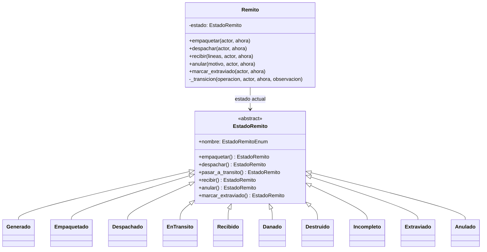
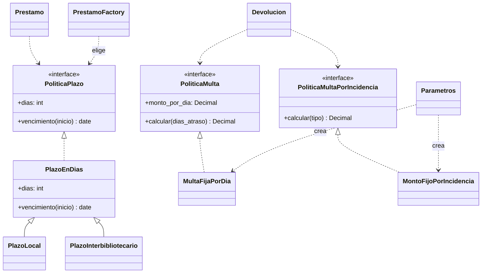
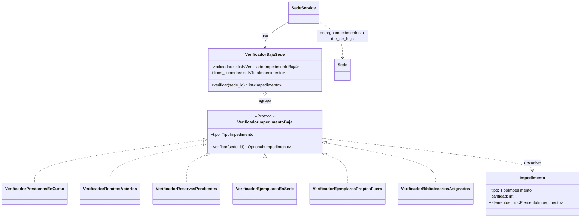
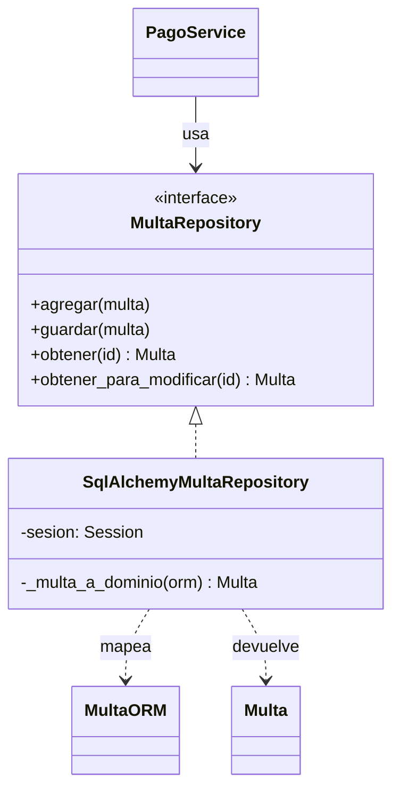

# 05. Patrones de diseño

El enunciado exige **al menos dos patrones de diseño**. El sistema implementa varios, y cada uno responde a un problema concreto del dominio; ninguno se agregó por cumplir. Este documento explica, para cada patrón, el problema, cómo está implementado (con el código real y su ubicación), sus participantes, sus ventajas y costos, y qué pruebas lo cubren. Al final se listan los patrones que se evaluaron y se descartaron, con el motivo.

Las rutas son relativas a `backend/app/` salvo que se indique otra cosa. Cada patrón está nombrado también en el código: en el docstring del paquete (`models/states/`, `models/policies/`, `models/factories/`, `repositories/`, `services/`, `dtos/`) o del módulo donde vive (`unit_of_work.py`, `controllers/dependencies.py`, `models/valores.py`, `utils/pdf.py`, `utils/reloj.py`), con un enlace a este documento.

## Resumen

| # | Patrón | Familia | Dónde | Problema que resuelve |
|---|--------|---------|-------|-----------------------|
| 1 | [State](#1-state) | GoF, comportamiento | `models/states/`: remito, préstamo, ejemplar y reserva | Ciclos de vida con transiciones estrictas, sin saltos ni retrocesos |
| 2 | [Strategy](#2-strategy) | GoF, comportamiento | `models/policies/`: plazo de préstamo, multa por atraso, multa por daño o extravío | Reglas de negocio configurables que cambian sin tocar las entidades |
| 3 | [Factory](#3-factory) | GoF, creacional | `models/factories/prestamo_factory.py` y constructores con nombre (`Pago.manual`, `Sede.crear`…) | Crear préstamos locales o entre sedes con sus reglas en un solo lugar |
| 4 | [Strategy + Composite](#4-strategy--composite-verificación-de-baja-de-sede) | GoF, comportamiento y estructural | `models/policies/verificacion_baja_sede.py`, `services/verificadores_baja_sede.py` | Seis causas de bloqueo de la baja de una sede, repartidas en cinco módulos |
| 5 | [Repository y Data Mapper](#5-repository-y-data-mapper) | Empresarial (Fowler) | `repositories/interfaces/` e `impl/` | Dominio sin SQL; servicios probables sin base |
| 6 | [Unit of Work](#6-unit-of-work) | Empresarial (Fowler) | `repositories/unit_of_work.py` | Un caso de uso que toca varias entidades se confirma o se deshace entero |
| 7 | [Bloqueo pesimista y optimista](#7-bloqueo-pesimista-y-optimista) | Empresarial (Fowler) | Repositorios (`FOR UPDATE`, `FOR SHARE`, `SKIP LOCKED`) y `version` | Operaciones simultáneas sobre el mismo ejemplar, sede o multa |
| 8 | [Inyección de dependencias](#8-inyección-de-dependencias) | Arquitectura | `controllers/dependencies.py`, `utils/reloj.py` | Servicios desacoplados de sus dependencias concretas, incluida la hora |
| 9 | [Service Layer (Facade)](#9-service-layer-facade) | Empresarial / GoF estructural | `services/` | Un punto de entrada por caso de uso, que coordina dominio y repositorios |
| 10 | [Value Object](#10-value-object) | DDD | `models/valores.py`, `models/horario.py`, `models/usuario.py` | Datos que se validan juntos y no tienen identidad |
| 11 | [DTO con esquema por rol](#11-dto-con-esquema-por-rol) | Empresarial (Fowler) | `dtos/request/`, `dtos/response/` | Contrato de la API separado del dominio; cada rol recibe solo sus campos |
| 12 | [Builder](#12-builder) | GoF, creacional | `utils/pdf.py` | Armar el comprobante PDF por partes sin conocer su formato interno |

**Para la cátedra:** State (con el ciclo de vida del remito, que se evalúa críticamente) y Strategy cumplen solos el mínimo de dos; los demás refuerzan la arquitectura.

---

## 1. State

**Problema.** El remito pasa por diez estados con transiciones estrictas («sin saltos ni retrocesos»), y el préstamo, el ejemplar y la reserva también tienen su ciclo de vida. Con `if estado == ...` repartidos por los servicios, cada regla nueva obliga a revisar todo, y es fácil permitir una transición inválida.

**Solución.** Cada estado es una clase que implementa solo las operaciones que admite y devuelve el **estado siguiente**; las demás las hereda de la clase base, que las rechaza con `TransicionInvalida`. La entidad (el contexto) delega en su estado actual, lo reemplaza por el que este devuelve y registra el movimiento en su historial.

| Contexto | Estados (clases) | Archivo |
|----------|------------------|---------|
| `Remito` | `Generado`, `Empaquetado`, `Despachado`, `EnTransito`, `Recibido`, `Danado`, `Destruido`, `Incompleto`, `Extraviado`, `Anulado` | `models/states/remito.py` |
| `Prestamo` | `Solicitado`, `EnEnvio`, `Activo`, `Vencido`, `Devuelto`, `Cancelado` | `models/states/prestamo.py` |
| `Ejemplar` | `Disponible`, `Apartado`, `Reservado`, `EnTransito`, `Prestado`, `EnRevision`, `Baja` | `models/states/ejemplar.py` |
| `Reserva` | `Pendiente`, `DisponibleParaRetiro`, `Cumplida`, `Cancelada`, `Vencida` | `models/states/reserva.py` |

**Implementación (remito).**

```python
# models/states/remito.py
class EstadoRemito:
    """Estado base: rechaza todo lo que el estado concreto no admite."""
    nombre: ClassVar[EstadoRemitoEnum]

    def empaquetar(self) -> "EstadoRemito":
        raise self._invalida("empaquetar")
    def despachar(self) -> "EstadoRemito":
        raise self._invalida("despachar")
    # ... pasar_a_transito, recibir, recibir_con_dano, recibir_destruido,
    #     recibir_con_faltantes, anular y marcar_extraviado también rechazan

class Generado(EstadoRemito):
    nombre = EstadoRemitoEnum.GENERADO
    def empaquetar(self) -> EstadoRemito:
        return Empaquetado()
    def anular(self) -> EstadoRemito:
        return Anulado()

class Empaquetado(EstadoRemito):
    nombre = EstadoRemitoEnum.EMPAQUETADO
    def despachar(self) -> EstadoRemito:
        return Despachado()
    def anular(self) -> EstadoRemito:
        return Anulado()

# models/remito.py: el contexto delega y registra el movimiento
def empaquetar(self, actor: UsuarioRef, ahora: datetime) -> None:
    self._transicion(self.estado.empaquetar, actor, ahora, "Empaquetado")

def _transicion(self, operacion, actor, ahora, observacion) -> None:
    anterior = self.estado_nombre
    self.estado = operacion()             # el estado decide: el siguiente o TransicionInvalida
    self.version += 1
    self.movimientos_pendientes.append(   # el repositorio lo guarda en movimiento_remito
        MovimientoRemito(anterior, self.estado_nombre, ahora, actor, observacion)
    )
```



**Detalles de la implementación.**

- La transición **valida antes de modificar**: si el estado rechaza la operación, la entidad queda igual (ni estado, ni versión, ni movimiento). En la recepción, `Remito.recibir` llama primero a `self.estado.recibir()` para validar antes de tocar las líneas.
- La **recepción** elige la operación según la peor línea (`recibir`, `recibir_con_dano`, `recibir_destruido` o `recibir_con_faltantes`), y desde `Despachado` pasa antes por `EnTransito` para que el historial muestre los dos movimientos.
- El **repositorio** convierte entre el valor guardado y la clase con una función de fábrica por máquina (`estado_remito(nombre)`, `estado_prestamo`, `estado_ejemplar`, `estado_reserva`), y guarda los `movimientos_pendientes` en la tabla de historial, que la base protege contra modificaciones.
- Los estados no tienen datos propios: dos instancias del mismo estado son iguales (`__eq__` por `nombre`).

### El ejemplar en detalle

**Contexto del problema.** La disponibilidad del ejemplar cambia por cinco procesos distintos (préstamo, envío, reserva, devolución y baja), y cada estado admite operaciones diferentes. Por ejemplo, un ejemplar `Prestado` se puede devolver, pero no reservar; uno `En revisión` solo se repara o se da de baja. Sin State, cada servicio tendría que preguntar en qué estado está antes de actuar, y esas preguntas se repetirían en préstamos, remitos, reservas y devoluciones.

**Roles.**

| Rol | Clase | Archivo | Qué hace |
|-----|-------|---------|----------|
| **Contexto** | `Ejemplar` | `models/ejemplar.py` | Guarda su estado actual y expone las operaciones (`apartar`, `reservar`, `prestar`, `poner_en_transito`, `liberar`, `enviar_a_revision`, `reparar`, `registrar_baja`). Cada una delega en el estado (`_transicion`), lo reemplaza por el que este devuelve y registra el movimiento en el historial. |
| **Estado abstracto** | `EstadoEjemplar` | `models/states/ejemplar.py` | Declara todas las operaciones; por defecto las rechaza con `TransicionInvalida`. También declara `validar_edicion`, que por defecto admite editar los datos. |
| **Estados concretos** | `Disponible`, `Apartado`, `Reservado`, `EnTransito`, `Prestado`, `EnRevision`, `Baja` | `models/states/ejemplar.py` | Cada uno sobrescribe solo lo que admite y devuelve el estado siguiente: `Disponible.apartar()` devuelve `Apartado()`. `Baja` sobrescribe `validar_edicion` para rechazar y su única salida es `recuperar` (un extravío que apareció; el servicio controla que la baja haya sido por extravío). |
| **Clientes** | `CatalogoService`, `PrestamoService`, `RemitoService`, `ReservaService`, `DevolucionService`, `ColaDeReservas` | `services/` | Piden la operación al ejemplar (`ejemplar.liberar(...)`) sin preguntar en qué estado está; si no corresponde, el estado la rechaza. |

El repositorio convierte entre el valor guardado y la clase con `estado_ejemplar(nombre)`.

**Una transición, paso a paso** (`Ejemplar._transicion`):

```python
def _transicion(self, operacion, actor, ahora, observacion, estado_fisico=None):
    anterior = self.estado_nombre
    self.estado = operacion()        # el estado decide: devuelve el siguiente o lanza TransicionInvalida
    ...                              # recién si se aceptó, aplica el estado físico (p. ej. DANADO)
    self._registrar(actor, ahora, observacion, cambios, anterior)   # movimiento del historial
```

Si el estado rechaza la operación, el ejemplar queda igual: no cambia ni el estado físico ni la versión, y no se registra ningún movimiento.

**Cómo se aplica en el catálogo.**

- La **baja manual** (`dar_de_baja`) agrega una regla de negocio por encima del State: solo desde `Disponible` o `En revisión`. Los demás estados también admiten la baja, pero solo como resultado de una incidencia (extravío o destrucción) que registra otro proceso.
- **Editar el estado físico o las observaciones** no es una transición, pero el estado decide si se permite (`validar_edicion`): en `Baja` se rechaza.
- **El historial** registra también los cambios que no son de disponibilidad (estado físico, sede donde está, sede propietaria) como movimientos con el mismo estado anterior y nuevo, y la lista de `cambios`. Así la trazabilidad del ejemplar queda completa en un único historial.

El diagrama de cada máquina y las reglas de cada transición están en [Máquinas de estado](03-maquinas-de-estado.md).

### Por qué la sede no usa State

La sede tiene un ciclo de vida que State no mejora:

- **Dos estados y dos transiciones** (`Activa → Baja` con `dar_de_baja`, `Baja → Activa` con `reactivar`), sin estados intermedios ni ramas.
- **El estado no cambia el comportamiento, solo lo habilita o lo bloquea.** En `Baja` todas las operaciones se rechazan con el mismo error (`SedeEnBaja`), y lo resuelve una sola guarda, `Sede.validar_operativa()`. Con State habría dos clases cuyos métodos serían, en una, «hacer lo de siempre» y, en la otra, «rechazar».
- **La regla difícil no depende del estado.** La guarda de la baja (los seis impedimentos) consulta otros módulos y se resuelve con Strategy + Composite ([sección 10](#4-strategy--composite-verificación-de-baja-de-sede)), no con una clase de estado.

Por eso la sede usa un enum (`EstadoSede`) y dos métodos con guardas explícitas (`dar_de_baja`, `reactivar`) en `models/sede.py`. Si en el futuro aparecieran estados con comportamiento propio (por ejemplo, una «baja temporal» con reapertura programada que admita algunas operaciones y otras no), conviene migrar a State como en el remito.

**Ventajas.**

- Las transiciones válidas quedan explícitas en un solo lugar por estado; las inválidas se rechazan por defecto.
- Agregar un estado no obliga a tocar los demás ni a los servicios.
- Cada estado se prueba aislado, sin base de datos.
- Responde directamente al requisito que la cátedra evalúa críticamente: el ciclo de vida del remito.

**Costos.** Una clase por estado y la conversión entre la clase y el valor guardado. **Alternativa descartada:** una tabla de transiciones (`dict`) con un enum es más corta, pero deja el comportamiento por estado repartido en condicionales; conviene solo si los estados no tienen lógica propia, que no es el caso.

**Pruebas.** `tests/unit/prestamos/test_remito.py`, `test_prestamo.py`, `test_reserva.py` y `tests/unit/catalogo/test_ejemplar.py` recorren cada transición válida y verifican que las inválidas se rechacen; criterios `CA-REM-04` a `CA-REM-07`, `CA-PRE-*`, `CA-CAT-*` y `CA-RES-*`.

---

## 2. Strategy

**Problema.** El plazo del préstamo y el cálculo de las multas son políticas que el negocio declaró configurables y que pueden cambiar (un monto por día hoy, uno escalonado mañana; 14 o 21 días según el tipo; un monto fijo por daño hoy, uno según el valor del libro mañana). Si el cálculo vive dentro de `Prestamo` o `Devolucion`, cada cambio de política obliga a modificar esas clases.

**Solución.** Una interfaz por política (un `Protocol`) y una implementación por variante. Los valores salen de la tabla `parametro` (`Parametros`), así el administrador los ajusta sin cambiar código.

| Política (interfaz) | Implementaciones | Quién la elige | Quién la usa |
|---------------------|------------------|----------------|--------------|
| `PoliticaPlazo` (`models/policies/plazo.py`) | `PlazoLocal`, `PlazoInterbibliotecario` (ambas `PlazoEnDias`) | `PrestamoFactory.politica(tipo)` | `Prestamo` al entregarse y renovarse |
| `PoliticaMulta` (`models/policies/multa.py`) | `MultaFijaPorDia` (monto por día con tope opcional) | `Parametros.politica_multa()` | `Devolucion.registrar` (multa por atraso) y el reporte R4 (multa acumulada) |
| `PoliticaMultaPorIncidencia` (`models/policies/multa.py`) | `MontoFijoPorIncidencia` (monto por daño y por extravío; 0 = no se cobra) | `Parametros.politica_multa_por_incidencia()` | `Devolucion.registrar` (multa por daño o extravío) |

```python
# models/policies/multa.py
class PoliticaMulta(Protocol):
    @property
    def monto_por_dia(self) -> Decimal: ...
    def calcular(self, dias_atraso: int) -> Decimal: ...

class MultaFijaPorDia:
    def __init__(self, monto_por_dia: Decimal, tope: Decimal | None = None) -> None: ...
    def calcular(self, dias_atraso: int) -> Decimal:
        total = self._monto_por_dia * max(dias_atraso, 0)
        if self._tope is not None:
            total = min(total, self._tope)
        return total.quantize(Decimal("0.01"))

class PoliticaMultaPorIncidencia(Protocol):
    def calcular(self, tipo: TipoMulta) -> Decimal: ...

class MontoFijoPorIncidencia:
    def __init__(self, danio: Decimal, extravio: Decimal) -> None: ...

# models/devolucion.py: la entidad solo conoce las interfaces
devolucion, multas = Devolucion.registrar(
    ..., politica=parametros.politica_multa(),
    politica_incidencia=parametros.politica_multa_por_incidencia(),
)
```



**Política sin interfaz.** La elección de la sede origen cuando el socio pide un libro por autogestión es una función pura, `elegir_sede_origen` (`models/policies/asignacion_prestamo.py`): la sede destino si tiene disponibles; si no, la de más disponibles, con la de menor id para desempatar. Hoy hay una sola regla; si aparecieran otras, se convierte en una estrategia más.

**Ventajas.**

- Cambiar o sumar una política no toca el dominio existente (principio abierto/cerrado). La multa por daño o extravío se agregó así: una segunda política que `Devolucion.registrar` recibe junto a la de atraso.
- Cada política se prueba sin base ni préstamo.
- Las entidades no dependen de `Parametros`: reciben la política ya construida.

**Costos.** Una abstracción más por política; se justifica porque el negocio ya declaró que estas reglas son configurables.

**Pruebas.** `tests/unit/prestamos/test_devolucion.py` (multa por atraso con y sin tope, por daño y por extravío, `CA-DEV-06`, `CA-DEV-18`, `CA-DEV-29` a `CA-DEV-32`) y las pruebas de préstamo (plazos de 14 y 21 días).

---

## 3. Factory

**Problema.** Un préstamo local y uno interbibliotecario se crean con reglas distintas: el local exige que el ejemplar esté en la sede del socio y usa el plazo local; el interbibliotecario exige sedes distintas, genera un envío y usa otro plazo. Además hay que validar al socio (habilitado, tope de préstamos, sin otro préstamo del mismo libro), las sedes (activas) y el ejemplar (disponible, de la sede origen). Repetir esa decisión en cada camino que crea préstamos (mostrador, autogestión, reserva que se cumple, reserva asignada entre sedes) duplicaría las reglas.

**Solución.** `PrestamoFactory.crear(...)` es el único lugar que decide el tipo según las sedes, valida todas las reglas del enunciado, aparta el ejemplar y devuelve el préstamo en estado `Solicitado`. También expone la política de plazo de cada tipo (`politica(tipo)`), el plazo de retiro (`limite_de_retiro`) y la validación del socio por separado (`validar_socio`), que la autogestión usa antes de buscar un ejemplar.

```python
# models/factories/prestamo_factory.py
class PrestamoFactory:
    def __init__(self, parametros: Parametros) -> None: ...

    def politica(self, tipo: TipoPrestamo) -> PoliticaPlazo:
        if tipo == TipoPrestamo.LOCAL:
            return PlazoLocal(self._parametros.plazo_prestamo_local_dias)
        return PlazoInterbibliotecario(self._parametros.plazo_prestamo_inter_dias)

    def crear(self, *, numero, socio, ejemplar, sede_origen, sede_destino,
              abiertos_del_socio, actor, ahora, reservado=False, hoy=None) -> Prestamo:
        sede_origen.validar_operativa()
        sede_destino.validar_operativa()
        socio.validar_puede_operar()
        ...  # el ejemplar es de la sede origen y está Disponible (o Reservado, si es una reserva)
        self.validar_socio(socio, abiertos_del_socio, ejemplar.libro_id)
        tipo = (TipoPrestamo.LOCAL if sede_origen.id == sede_destino.id
                else TipoPrestamo.INTERBIBLIOTECARIO)
        prestamo = Prestamo(id=None, numero=numero, tipo=tipo, ...)
        prestamo.registrar_alta(actor, ahora)
        if not reservado:
            ejemplar.apartar(actor, ahora, f"Apartado para el préstamo {numero}")
        return prestamo
```

**Clientes.** `PrestamoService` (mostrador y autogestión), `ReservaService` (retiro de una reserva) y `ColaDeReservas` (préstamo entre sedes que genera el sistema al asignar una reserva). Ninguno decide el tipo ni repite las validaciones.

**Constructores con nombre.** Las entidades que nacen de formas distintas tienen métodos de fábrica que garantizan sus invariantes desde el inicio: `Pago.manual` (cobro en el mostrador, nace aprobado) y `Pago.en_linea` (nace pendiente), `Sede.crear`, `Libro.crear`, `Reserva.registrar`, `Devolucion.registrar`, y los objetos de valor (`CodigoSede.crear`, `Direccion.crear`).

**Ventajas.** Las reglas de creación viven en un solo lugar y se prueban sin base (`CA-PRE-01` a `CA-PRE-10`); los cuatro caminos que crean préstamos aplican exactamente las mismas reglas.

**Costos.** Mínimos: una clase con una responsabilidad.

---

## 4. Strategy + Composite: verificación de baja de sede

**Problema.** La baja de una sede se bloquea por seis tipos de actividad pendiente, que viven en módulos distintos: usuarios, ejemplares, préstamos, remitos y reservas. Si `SedeService` consultara cada tabla directamente, quedaría acoplado a todos esos módulos, y cada causa nueva obligaría a modificarlo (viola abierto/cerrado).

**Solución.** Cada causa de bloqueo es una **estrategia** de verificación detrás de una misma interfaz que define el dominio, y un **compuesto** las agrupa para que el servicio las use como si fueran una sola. Los dos patrones comparten la interfaz y las clases concretas: Strategy explica por qué cada verificación es intercambiable, y Composite explica cómo se aplican todas juntas.



### Strategy: roles

| Rol | Clase | Archivo | Qué hace |
|-----|-------|---------|----------|
| **Estrategia abstracta** | `VerificadorImpedimentoBaja` | `models/policies/verificacion_baja_sede.py` | Interfaz común: `tipo` y `verificar(sede_id) -> Impedimento \| None`. Es un `Protocol` (interfaz abstracta con tipado estructural): las estrategias la cumplen sin heredar, y así el dominio no importa nada de los módulos que las implementan. |
| **Estrategias concretas** | `VerificadorPrestamosEnCurso`, `VerificadorRemitosAbiertos`, `VerificadorReservasPendientes`, `VerificadorEjemplaresEnSede`, `VerificadorEjemplaresPropiosFuera`, `VerificadorBibliotecariosAsignados` | `services/verificadores_baja_sede.py` | Cada una resuelve una causa con el repositorio de su módulo (por ejemplo, `PrestamoRepository.en_curso_de_sede`). Devuelve la cantidad y una muestra de hasta 10 elementos, o `None` si no bloquea. En las pruebas, `VerificadorFalso` (`tests/fakes/verificadores.py`) es otra estrategia concreta. |
| **Contexto** | `VerificadorBajaSede` | `models/policies/verificacion_baja_sede.py` | Guarda las estrategias y les delega la verificación. No sabe cómo verifica cada una. |
| **Cliente** | `get_verificador_baja_sede` | `controllers/dependencies.py` | Raíz de composición: elige las estrategias concretas, les inyecta su repositorio y se las entrega al contexto. Es el único lugar que conoce las clases concretas. |

**Diferencia con el Strategy clásico.** En el ejemplo de manual, el contexto usa *una* estrategia elegida entre varias, como la multa o el plazo de la [sección 2](#2-strategy). Acá el contexto aplica *todas* las estrategias registradas, porque la baja se bloquea por cualquiera de las causas. Por eso se combina con Composite.

### Composite: roles

| Rol | Clase | Qué hace |
|-----|-------|----------|
| **Componente** | `VerificadorImpedimentoBaja` | La operación común `verificar(sede_id)`. |
| **Hoja** | cada verificador concreto | Verifica una sola causa y no contiene otros verificadores. |
| **Contenedor (Composite)** | `VerificadorBajaSede` | Contiene la lista de verificadores. Su `verificar` recorre los hijos, junta los impedimentos y descarta los `None`. `tipos_cubiertos` informa qué causas están registradas. |
| **Cliente** | `SedeService.dar_de_baja` | Trata el conjunto como un único verificador: hace una sola llamada, `verificar(sede.id)`, y pasa el resultado a la entidad. No sabe cuántas hojas hay. |

**Simplificaciones respecto del Composite clásico.** El contenedor no es intercambiable con una hoja: devuelve `list[Impedimento]` en lugar de `Impedimento | None` y no tiene `tipo`, porque la baja necesita el detalle *por tipo* de impedimento y no un único resultado. Tampoco se anidan contenedores: hay un solo nivel, porque las seis causas son independientes y no se agrupan en subcategorías.

### Flujo de una baja

```python
# controllers/dependencies.py — el cliente arma las estrategias
VerificadorBajaSede([
    VerificadorBibliotecariosAsignados(uow.usuarios),
    VerificadorEjemplaresEnSede(uow.ejemplares),
    VerificadorEjemplaresPropiosFuera(uow.ejemplares),
    VerificadorPrestamosEnCurso(uow.prestamos),
    VerificadorRemitosAbiertos(uow.remitos),
    VerificadorReservasPendientes(uow.reservas),
])

# services/sede_service.py — el cliente del compuesto obtiene la lista y la entrega al dominio
sede.dar_de_baja(motivo=motivo, actor=..., ahora=..., impedimentos=self._verificador.verificar(sede.id))

# models/sede.py — la entidad decide: si hay impedimentos lanza SedeConActividadPendiente
# con el resumen ("3 préstamos en curso, 1 remito abierto") y el detalle por tipo; si no, pasa a BAJA.
```

La **decisión** (bloquear si la lista no está vacía) queda en un único lugar del dominio, `Sede.dar_de_baja`. Las estrategias solo **informan**.

**Cómo se suma una causa nueva.** Se agrega el valor a `TipoImpedimento` y su etiqueta en `ETIQUETAS`, se crea la estrategia concreta y se registra en `get_verificador_baja_sede`. No cambian ni `SedeService` ni `Sede`.

**Garantía de cobertura.** Una prueba de contrato (`tests/contract/test_verificadores_baja_sede.py`) falla si algún `TipoImpedimento` no tiene un verificador registrado, salvo los anotados en `TIPOS_PENDIENTES_DE_MODULO`. Esa lista solo puede achicarse y hoy está vacía: los seis tipos están cubiertos.

**Contrato para los demás módulos (concurrencia).** Toda operación que tome una sede como origen, destino, retiro o alta debe obtenerla con `SedeRepository.obtener_para_operar(id)`. Ese método la bloquea con `FOR SHARE` y llama a `sede.validar_operativa()`, que lanza `SedeEnBaja` si no está activa. La baja bloquea con `FOR UPDATE`, así que las dos se serializan: si la baja llega primero, la operación se rechaza; si la operación llega primero, la baja espera y después la ve.

**Ventajas.**

- `SedeService` y `Sede` no cambian cuando aparece una causa nueva (abierto/cerrado).
- Cada estrategia se prueba sola, con sus propios datos.
- Las pruebas del servicio inyectan estrategias falsas (`verificador_con(PRESTAMOS_EN_CURSO=2)`) y simulan cada causa sin armar préstamos ni remitos reales.

**Costos.** Una abstracción más y una prueba de contrato que mantener. Se justifica porque son seis causas en cinco módulos que se construyeron por separado.

**Alternativas descartadas.** (a) Consultas SQL directas en `SedeService`: acoplamiento fuerte con todos los módulos. (b) Eventos de dominio: la verificación tiene que ser síncrona y en la misma transacción que la baja. (c) Una vista SQL de «actividad por sede»: esconde reglas de negocio en la base y hay que actualizarla con cada módulo.

---

## 5. Repository y Data Mapper

**Problema.** El dominio no debe conocer SQL ni SQLAlchemy, y los servicios deben poder probarse sin base de datos.

**Solución.** Cada agregado tiene una **interfaz de repositorio** (`Protocol`) en `repositories/interfaces/` con las operaciones que el dominio necesita (`obtener`, `obtener_para_modificar`, `agregar`, `guardar`, `listar`, consultas propias como `PrestamoRepository.en_curso_de_sede` o `EjemplarRepository.disponibles_por_sede`). La implementación con SQLAlchemy vive en `repositories/impl/` y hace de **Data Mapper**: convierte entre el modelo del ORM (`db/models/`) y la entidad de dominio (`models/`) con funciones como `_multa_a_dominio`, y nunca expone objetos del ORM a los servicios.

```python
# repositories/interfaces/devolucion_repository.py
class MultaRepository(Protocol):
    def agregar(self, multa: Multa) -> None: ...
    def guardar(self, multa: Multa) -> None: ...
    def obtener(self, multa_id: int) -> Multa | None: ...
    def obtener_para_modificar(self, multa_id: int) -> Multa | None: ...  # con FOR UPDATE
    def de_prestamo(self, prestamo_id: int) -> list[Multa]: ...
    def listar(self, filtro: FiltroMultas, page: int, size: int) -> tuple[list[Multa], int]: ...
```



**Implementaciones en memoria.** `tests/fakes/` tiene repositorios en memoria (`SedeRepositorioEnMemoria`, `EjemplarRepositorioEnMemoria`, `PrestamoRepositorioEnMemoria`…) y una `UnitOfWorkEnMemoria`, que las pruebas de servicios (`tests/services/`, por ejemplo `test_sede_service.py` y `test_cola_reservas.py`) usan para correr sin PostgreSQL.

**Excepción deliberada: los reportes.** `ReporteService` consulta el ORM directamente con una `Session`, sin repositorio: son consultas de solo lectura con SQL agregado (`GROUP BY`) que no devuelven entidades de dominio, y pasarlas por repositorios agregaría una capa sin beneficio.

**Ventajas.** Dominio independiente de la persistencia; servicios probables sin base; las consultas complejas (bloqueos, joins, paginación) quedan encapsuladas.

**Costos.** Una capa y un mapeo más por entidad: el costo de la arquitectura por capas que se eligió (ver [arquitectura](01-arquitectura-backend.md)).

---

## 6. Unit of Work

**Problema.** Un caso de uso toca varias entidades a la vez. Registrar una devolución cierra el préstamo, guarda la devolución, genera hasta dos multas, reevalúa al socio, cambia el estado del ejemplar y genera el remito de retorno o asigna la reserva. Todo eso se confirma o se deshace **en conjunto**.

**Solución.** La `UnitOfWork` (`repositories/unit_of_work.py`) agrupa los repositorios de una misma sesión y expone `commit()` y `rollback()`. Hay una por solicitud HTTP (`get_uow`), y cada servicio envuelve su caso de uso en `_transaccion()`: si algo falla, se revierte todo.

```python
# repositories/unit_of_work.py
class UnitOfWork(Protocol):
    usuarios: UsuarioRepository
    sedes: SedeRepository
    prestamos: PrestamoRepository
    multas: MultaRepository
    pagos: PagoRepository
    # ... un atributo por repositorio
    def commit(self) -> None: ...
    def rollback(self) -> None: ...

# services/pago_service.py (igual en todos los servicios)
@contextmanager
def _transaccion(self) -> Iterator[None]:
    try:
        yield
    except BaseException:
        self._uow.rollback()
        raise
    else:
        self._uow.commit()
```

**Ventajas.** Atomicidad real: si falla la asignación a la reserva, no queda una devolución a medias. El control de transacciones queda en la capa de aplicación, no en los repositorios ni en los controllers.

**Costos.** Los servicios deben recordar envolver cada caso de uso de escritura; lo controla la revisión de código y las pruebas de integración.

---

## 7. Bloqueo pesimista y optimista

**Problema.** Dos solicitudes simultáneas pueden pisarse: dos bibliotecarios prestan el mismo ejemplar, el socio paga en línea mientras el bibliotecario cobra en el mostrador, o se da de baja una sede mientras otra operación la usa como destino.

**Solución.** Se combinan dos patrones de concurrencia (Fowler):

| Patrón | Cómo | Dónde |
|--------|------|-------|
| **Bloqueo pesimista** | `obtener_para_modificar` lee con `SELECT … FOR UPDATE` dentro de la transacción: la segunda solicitud espera a que termine la primera y ve el estado nuevo | Préstamo, ejemplar, remito, reserva, multa, pago, sede, socio |
| Bloqueo compartido | `FOR SHARE` al usar una sede como origen, destino o retiro (`obtener_para_operar`); la baja la bloquea con `FOR UPDATE`, así las dos se serializan | `SedeRepository` |
| Saltear bloqueados | `FOR UPDATE SKIP LOCKED` al elegir un ejemplar disponible en la autogestión: dos socios que piden el mismo libro reciben ejemplares distintos | `EjemplarRepository.tomar_disponible` |
| **Bloqueo optimista** | Columna `version`: la edición manda la versión que leyó y, si cambió, responde `409 CONFLICTO_DE_VERSION` en lugar de pisar el cambio ajeno | `sede`, `libro`, `ejemplar` |
| Restricción en la base | Índices únicos parciales como red final (un solo préstamo abierto por ejemplar, un solo pago aprobado por multa) | Ver [base de datos](../../database/README.md#integridad-garantizada-por-la-base) |

**Orden de bloqueo.** Para evitar interbloqueos, los casos de uso que bloquean varias filas lo hacen siempre en el mismo orden; por ejemplo, el pago en línea y el cobro en el mostrador bloquean primero la multa y después el pago.

---

## 8. Inyección de dependencias

**Problema.** Los servicios dependen de repositorios, de otros servicios, de los parámetros y de la hora actual. Si los crean ellos mismos, quedan atados a la base real y al reloj del sistema, y no se pueden probar.

**Solución.** Cada servicio recibe sus dependencias por constructor. La **raíz de composición** es `controllers/dependencies.py`, que arma el grafo con `Depends` de FastAPI: una sesión y una `UnitOfWork` por solicitud, el reloj, el verificador de baja de sede con sus estrategias, y un `get_<servicio>` por servicio. Los permisos también se inyectan: `requiere(Permiso.X)` devuelve el usuario autenticado o responde `403`.

**El reloj.** El dominio y los servicios nunca llaman a `datetime.now()`: usan un `Reloj` (`utils/reloj.py`) con `ahora()` (UTC), `hoy()` y `ahora_local()` (zona de negocio). En producción es `RelojSistema`; las pruebas lo reemplazan por `RelojDePruebas` o `RelojFijo` (`tests/fakes/reloj.py`) con `app.dependency_overrides`, así los vencimientos, atrasos y multas se prueban en fechas fijas.

**Ventajas.** Servicios probables con dobles de prueba; el armado de dependencias concretas está en un solo lugar.

---

## 9. Service Layer (Facade)

**Problema.** Un caso de uso coordina varias entidades, repositorios y reglas. Si los controllers lo hicieran, la lógica quedaría atada a HTTP y repartida.

**Solución.** Un servicio de aplicación por módulo (`SedeService`, `SocioService`, `CatalogoService`, `PrestamoService`, `RemitoService`, `ReservaService`, `DevolucionService`, `PagoService`, `ReporteService`…) ofrece **un método por caso de uso** y oculta la coordinación: controla el permiso, abre la transacción, obtiene y bloquea las entidades, delega las reglas en el dominio y guarda. Es una fachada sobre el dominio y los repositorios. Los controllers solo traducen HTTP ↔ DTO.

Algunas reacciones que comparten varios casos de uso son **servicios de dominio** reutilizables: `ColaDeReservas` (ofrece un ejemplar liberado a la cola de reservas del libro) y `reevaluar_socio` (recalcula la habilitación del socio después de un vencimiento, una devolución o un pago).

---

## 10. Value Object

Los datos que se validan juntos y no tienen identidad propia son objetos de valor inmutables (`@dataclass(frozen=True)`) que se validan al construirse:

| Objeto de valor | Archivo | Qué garantiza |
|-----------------|---------|---------------|
| `CodigoSede` | `models/valores.py` | Formato `^[A-Z0-9_]{3,15}$`, en mayúsculas |
| `Telefono` | `models/valores.py` | Formato E.164 |
| `Email` | `models/valores.py` | Formato válido, en minúsculas |
| `Localidad`, `Direccion` | `models/valores.py` | Calle, número y localidad, con su forma normalizada para detectar direcciones repetidas |
| `Contacto` | `models/valores.py` | Teléfono y correo de la sede |
| `FranjaHoraria` | `models/valores.py` | Día, apertura y cierre, con el cierre posterior a la apertura |
| `ExcepcionHorario` | `models/horario.py` | Cierre total o parcial de una fecha, con sus horas coherentes |
| `UsuarioRef`, `SedeRef` | `models/usuario.py` | Referencia liviana (id y nombre) para la autoría de cada cambio |

Así la regla vive en un solo lugar, el dominio nunca maneja cadenas sin validar y todo se prueba sin base de datos.

---

## 11. DTO con esquema por rol

**Problema.** La API no debe exponer las entidades de dominio tal cual: algunos campos no son para todos (quién registró una devolución, el comprobante de un cobro, la auditoría de un libro), y el contrato de la API no debería cambiar cada vez que cambia el dominio.

**Solución.** Los **DTO** de entrada (`dtos/request/`) validan la forma de cada solicitud con Pydantic. Los de salida (`dtos/response/`) se arman desde la entidad con una función (`multa_a_response(multa, lector)`) que elige el **esquema según el rol** de quien consulta. Cada recurso se declara como una unión de esquemas, y OpenAPI documenta las variantes.

```python
# dtos/response/devolucion_response.py
MultaResponse = MultaPersonalResponse | MultaPropiaResponse

def multa_a_response(m: Multa, lector: Usuario) -> MultaResponse:
    campos = {...}                      # lo que ven todos
    if not lector.puede(Permiso.MULTA_LEER):
        return MultaPropiaResponse(**campos)          # el socio: sin saldada_por
    return MultaPersonalResponse(**campos, saldada_por=...)
```

Recursos con esquema por rol: sede (administrador, básico, público), socio (administrador, personal, propio), libro (administrador, público), préstamo, reserva, devolución, multa y pago (personal, propio). La autoría que ve el socio se resume como «Vos», «Personal de la biblioteca» o «Sistema» (`dtos/response/autoria.py`).

**Ventajas.** Nada sale por la API sin decidirlo explícitamente; el dominio puede cambiar sin romper el contrato.

---

## 12. Builder

**Problema.** El comprobante de pago es un PDF. Armarlo exige calcular los desplazamientos de cada objeto y la tabla de referencias del formato, algo que no tiene que ver con qué dice el comprobante.

**Solución.** `DocumentoPdf` (`utils/pdf.py`) se construye por partes (`texto(x, y, contenido, tamano, negrita)` y `linea(...)`) y produce el archivo al final con `a_bytes()`, que arma los objetos, las fuentes, la tabla `xref` y el trailer. `services/comprobante_pago.py` es el director: decide qué va en el comprobante y dónde, sin conocer el formato.

**Ventajas.** El contenido del comprobante y el formato PDF evolucionan por separado; no hace falta una dependencia externa para un documento de una página.

---

## Patrones evaluados y descartados

| Patrón | Para qué se consideró | Por qué no se usa |
|--------|------------------------|-------------------|
| Observer (eventos de dominio) | Reaccionar a hechos: ejemplar liberado → cola de reservas; multa generada → reevaluar al socio | Las reacciones tienen que ser síncronas y en la misma transacción, y son pocas. Se dejaron explícitas en el servicio (`ColaDeReservas.ofrecer`, `reevaluar_socio`), que es más fácil de seguir. Si se implementan las notificaciones (proceso opcional del enunciado), conviene introducirlo para ese caso |
| Specification / Chain of Responsibility | Encadenar las validaciones de un préstamo | Son pocas reglas y están todas en `PrestamoFactory` con guardas claras; un objeto por regla agregaría estructura sin beneficio |
| Singleton | Compartir la configuración o la sesión | Las dependencias se inyectan; un singleton oculta el estado y complica las pruebas |
| Abstract Factory | Familias de objetos relacionados | No hay familias de objetos que crear |
| Decorator, Adapter | — | No hay un problema concreto que resuelvan en este dominio. (La integración con Mercado Pago, que se evaluó y se descartó, habría sido un Adapter sobre una interfaz de pasarela) |

## Relación con los requisitos de la cátedra

- **Mínimo de dos patrones:** State y Strategy cumplen solos; Factory, Composite, Repository y Unit of Work los refuerzan.
- **Ciclo de vida del remito evaluado críticamente:** State lo modela de forma explícita y verificable, y la base protege su historial (disparador de solo inserción y `CHECK` de fechas según el estado).
- **Lógica en el dominio:** los patrones de negocio viven en `models/` (State, Strategy, Factory, Value Object); la persistencia en `repositories/` (Repository, Unit of Work); la interfaz no decide reglas.
