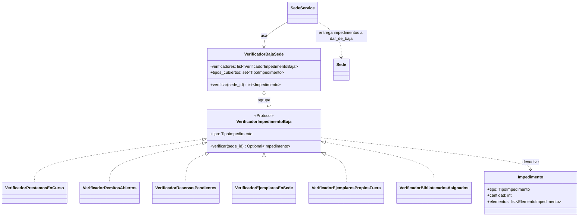

# 05. Patrones de diseño

El enunciado exige **al menos dos patrones**. Este documento analiza los que encajan en el dominio, qué problema resuelve cada uno, su ventaja y su costo, y cuáles se implementan.

## Resumen

| # | Patrón | Dónde | Prioridad | Implementar |
|---|--------|-------|-----------|-------------|
| 1 | State | Ciclo de vida de remito, préstamo, ejemplar y reserva (no en sede: [por qué](#por-qué-la-sede-no-usa-state)) | Alta | Sí |
| 2 | Strategy | Cálculo de multa y plazo de préstamo | Alta | Sí |
| 3 | Factory | Creación de préstamo local o interbibliotecario | Alta | Sí |
| 4 | Repository | Acceso a datos | Alta | Sí |
| 5 | Unit of Work | Transacción por caso de uso | Media | Sí |
| 6 | Observer (eventos de dominio) | Notificaciones | Media | Opcional |
| 7 | Chain of Responsibility / Specification | Validaciones de préstamo | Baja | Opcional |
| 8 | Dependency Injection | Servicios y repositorios | Alta | Sí (FastAPI lo trae) |
| 9 | Facade | Servicios de aplicación | Media | Sí, de forma natural |
| 10 | Strategy + Composite | Verificación de impedimentos de baja de sede | Alta | Sí |
| 11 | Value Object | Dirección, contacto, código de sede, franja horaria | Media | Sí |

**Propuesta:** los cuatro primeros más Unit of Work. Superan el mínimo de dos con holgura, y cada uno responde a un problema real del dominio y no se agrega por cumplir.

---

## 1. State (Estado)

**Problema.** El remito pasa por nueve estados con transiciones estrictas («sin saltos ni retrocesos»), y el préstamo, el ejemplar y la reserva también. Con `if estado == ...` repartidos por el código, cada regla nueva obliga a revisar todo, y es fácil permitir una transición inválida.

**Solución.** Cada estado es una clase que implementa solo las operaciones que admite; las demás lanzan `TransicionInvalida`. La entidad delega en su estado actual.

```python
class EstadoRemito(ABC):
    nombre: EstadoRemitoEnum

    def empaquetar(self, remito): raise TransicionInvalida(self.nombre, "empaquetar")
    def despachar(self, remito):  raise TransicionInvalida(self.nombre, "despachar")
    def recibir(self, remito):    raise TransicionInvalida(self.nombre, "recibir")
    # ...el resto por defecto también rechaza

class Generado(EstadoRemito):
    def empaquetar(self, remito):
        remito._cambiar_a(Empaquetado())

class Empaquetado(EstadoRemito):
    def despachar(self, remito):
        remito._cambiar_a(Despachado())
```

**Ventajas.**

- Las transiciones válidas quedan explícitas y verificables en un solo lugar por estado; las inválidas se rechazan por defecto.
- Agregar un estado no obliga a tocar los demás ni los clientes.
- Cada estado se prueba aislado, que se alinea con los criterios `CA-REM-04` a `CA-REM-06`.
- Responde directamente al requisito que la cátedra evalúa críticamente: el ciclo de vida del remito.

**Costos.** Más clases (una por estado) y hace falta convertir entre la clase y el valor guardado en la base (el repositorio mapea `EstadoRemitoEnum ↔ clase`).

**Alternativa.** Una tabla de transiciones permitidas (`dict`) con un enum. Es más corta, pero deja el comportamiento por estado repartido en condicionales; conviene solo si los estados no tienen lógica propia, que no es el caso del remito.

### State en el ejemplar (módulo de catálogo)

**Contexto del problema.** La disponibilidad del ejemplar cambia por cinco procesos distintos (préstamo, envío, reserva, devolución y baja), y cada estado admite operaciones diferentes. Por ejemplo, un ejemplar `Prestado` se puede devolver, pero no reservar; uno `En revisión` solo se repara o se da de baja. Sin State, cada servicio tendría que preguntar en qué estado está antes de actuar, y esas preguntas se repetirían en préstamos, remitos, reservas y devoluciones.

**Roles.**

| Rol | Clase | Archivo | Qué hace |
|-----|-------|---------|----------|
| **Contexto** | `Ejemplar` | `models/ejemplar.py` | Guarda su estado actual y expone las operaciones (`apartar`, `reservar`, `prestar`, `poner_en_transito`, `liberar`, `enviar_a_revision`, `reparar`, `registrar_baja`). Cada una delega en el estado (`_transicion`), lo reemplaza por el que este devuelve y registra el movimiento en el historial. |
| **Estado abstracto** | `EstadoEjemplar` | `models/states/ejemplar.py` | Declara todas las operaciones; por defecto las rechaza con `TransicionInvalida`. También declara `validar_edicion`, que por defecto admite editar los datos. |
| **Estados concretos** | `Disponible`, `Apartado`, `Reservado`, `EnTransito`, `Prestado`, `EnRevision`, `Baja` | `models/states/ejemplar.py` | Cada uno sobrescribe solo lo que admite y devuelve el estado siguiente: `Disponible.apartar()` devuelve `Apartado()`. `Baja` no admite ninguna transición y sobrescribe `validar_edicion` para rechazar. |
| **Clientes** | `CatalogoService`, `PrestamoService`, `RemitoService`, `ReservaService`, `DevolucionService`, `ColaDeReservas` | `services/` | Piden la operación al ejemplar (`ejemplar.liberar(...)`) sin preguntar en qué estado está; si no corresponde, el estado la rechaza. |

El repositorio convierte entre el valor guardado y la clase con `estado_ejemplar(nombre)`.

**Una transición, paso a paso** (`Ejemplar._transicion`):

```python
def _transicion(self, operacion, actor, ahora, observacion, estado_fisico=None):
    anterior = self.estado_nombre
    self.estado = operacion()        # el estado decide: devuelve el siguiente o lanza TransicionInvalida
    ...                              # recién si se aceptó, aplica el estado físico (p. ej. DANADO)
    self._registrar(actor, ahora, observacion, cambios, anterior)   # movimiento del historial
```

Si el estado rechaza la operación, el ejemplar queda igual: no cambia ni el estado físico ni la versión, y no se registra ningún movimiento.

**Cómo se aplica en el catálogo.**

- La **baja manual** (`dar_de_baja`) agrega una regla de negocio por encima del State: solo desde `Disponible` o `En revisión`. Los demás estados también admiten la baja, pero solo como resultado de una incidencia (extravío o destrucción) que registra otro proceso.
- **Editar el estado físico o las observaciones** no es una transición, pero el estado decide si se permite (`validar_edicion`): en `Baja` se rechaza.
- **El historial** registra también los cambios que no son de disponibilidad (estado físico, sede donde está, sede propietaria) como movimientos con el mismo estado anterior y nuevo, y la lista de `cambios`. Así la trazabilidad del ejemplar queda completa en un único historial.

El diagrama de estados y las reglas de cada transición están en [Máquinas de estado](03-maquinas-de-estado.md#ejemplar).


La sede tiene un ciclo de vida que State no mejora:

- **Dos estados y dos transiciones** (`Activa → Baja` con `dar_de_baja`, `Baja → Activa` con `reactivar`), sin estados intermedios ni ramas.
- **El estado no cambia el comportamiento, solo lo habilita o lo bloquea.** En `Baja` todas las operaciones se rechazan con el mismo error (`SedeEnBaja`), y lo resuelve una sola guarda, `Sede.validar_operativa()`. Con State habría dos clases cuyos métodos serían, en una, «hacer lo de siempre» y, en la otra, «rechazar».
- **La regla difícil no depende del estado.** La guarda de la baja (los seis impedimentos) consulta otros módulos y se resuelve con Strategy + Composite ([sección 10](#10-strategy--composite-verificación-de-baja-de-sede)), no con una clase de estado.

Por eso la sede usa un enum (`EstadoSede`) y dos métodos con guardas explícitas (`dar_de_baja`, `reactivar`) en `models/sede.py`. Si en el futuro aparecieran estados con comportamiento propio (por ejemplo, una «baja temporal» con reapertura programada que admita algunas operaciones y otras no), conviene migrar a State como en el remito.

---

## 2. Strategy (Estrategia)

**Problema.** El monto de la multa y el plazo de préstamo son políticas que cambian (monto por día hoy, escalonado mañana; 14 o 21 días según el tipo). Si el cálculo está dentro de `Devolucion` o `Prestamo`, cada cambio de política obliga a modificar esas clases.

**Solución.** Una interfaz por política y una implementación por variante, elegidas por configuración.

```python
class PoliticaMulta(Protocol):
    def calcular(self, dias_atraso: int) -> Decimal: ...

class MultaFijaPorDia:
    def __init__(self, monto_por_dia: Decimal, tope: Decimal | None = None): ...
    def calcular(self, dias_atraso: int) -> Decimal:
        total = self.monto_por_dia * dias_atraso
        return min(total, self.tope) if self.tope else total

class PoliticaPlazo(Protocol):
    def vencimiento(self, inicio: date) -> date: ...
# PlazoLocal (14 días) y PlazoInterbibliotecario (21 días)
```

**Ventajas.**

- Cambiar o sumar una política (multa escalonada, plazo por categoría de libro) no toca el dominio existente (principio abierto/cerrado).
- Se prueba cada política sin base ni préstamo: `CA-DEV-06` y `CA-DEV-07`.
- Los valores salen de la tabla `parametro`, así el administrador los ajusta sin cambiar código.

**Costos.** Una abstracción más; se justifica porque el negocio ya declaró que estas reglas son configurables.

---

## 3. Factory (Fábrica)

**Problema.** Un préstamo local y uno interbibliotecario se crean con reglas distintas: el local exige origen igual a destino, no genera remito y usa el plazo local; el interbibliotecario exige sedes distintas, genera envío y usa otro plazo. Repetir esa decisión en cada servicio duplica las reglas.

**Solución.** `PrestamoFactory.crear(...)` decide el tipo según las sedes, construye el préstamo en estado `Solicitado` con la `PoliticaPlazo` correspondiente y garantiza sus invariantes.

**Ventajas.**

- Un único punto donde se decide «local o interbibliotecario», que respalda `CA-PRE-10`.
- El resto del código trata a todos los préstamos igual.
- Facilita sumar un tercer tipo (por ejemplo, préstamo a domicilio) sin tocar los llamadores.

**Costos.** Mínimos; es una clase o función con una responsabilidad.

**Autogestión del socio.** Cuando el socio pide un libro, la sede origen la elige una función pura, `elegir_sede_origen` (`models/policies/asignacion_prestamo.py`): la sede destino si tiene disponibles; si no, la de más disponibles, con la de menor id para desempatar. El servicio bloquea un ejemplar de esa sede (`FOR UPDATE SKIP LOCKED`) y se lo pasa a la fábrica, que aplica las mismas reglas que en el mostrador. `PrestamoFactory.validar_socio` permite controlar al socio antes de buscar ejemplares.

---

## 4. Repository (Repositorio)

**Problema.** El dominio no debe conocer SQL ni SQLAlchemy, y los servicios deben poder probarse sin base de datos.

**Solución.** Interfaces de repositorio en el dominio (`PrestamoRepository`, `EjemplarRepository`…) y su implementación con SQLAlchemy en infraestructura. Existe también una implementación en memoria para los tests de servicios.

**Ventajas.**

- El dominio queda libre de la tecnología de persistencia y se prueba rápido.
- Las consultas complejas (vencidos, cola de reservas) quedan nombradas y reutilizables.
- Cambiar el motor de base de datos afecta solo a infraestructura.

**Costos.** Una capa más; es el costo de la arquitectura por capas que ya se decidió.

---

## 5. Unit of Work

**Problema.** Un caso de uso toca varias entidades (por ejemplo, devolver: préstamo, ejemplar, multa, socio, reserva) y debe confirmarse o deshacerse **en conjunto**.

**Solución.** La Unit of Work agrupa los repositorios de una sesión y expone `commit()` y `rollback()`. El servicio abre una por caso de uso.

**Ventajas.** Atomicidad real: si falla la asignación a la reserva, no queda una devolución a medias. Concentra el control de transacciones en la capa de aplicación.

---

## 6. Observer (eventos de dominio), opcional

**Problema.** Varios procesos reaccionan a un mismo hecho: al recibir un remito hay que avisar al socio, al liberar un ejemplar hay que revisar la cola de reservas, al generar una multa hay que reevaluar al socio.

**Solución.** El dominio emite eventos (`RemitoRecibido`, `EjemplarLiberado`, `MultaGenerada`, `PrestamoVencido`) y los observadores se suscriben. Las notificaciones al socio (proceso opcional del enunciado) son otro observador.

**Ventajas.**

- Desacopla: `Remito` no sabe de notificaciones ni de reservas.
- Agregar una reacción nueva (aviso por correo) es suscribir un observador, sin tocar el emisor.

**Costos.** El flujo es menos obvio de leer; se mitiga con eventos sincrónicos dentro de la misma transacción y un único despachador.

**Propuesta.** Incluirlo si se implementa el proceso opcional de notificaciones; las reacciones críticas (reasignar reservas, reevaluar socio) se mantienen explícitas en el servicio para que sean fáciles de seguir.

---

## 7. Specification / Chain of Responsibility, opcional

**Problema.** Registrar un préstamo aplica ocho validaciones (socio habilitado, ejemplar disponible, ejemplar de la sede origen, ambas sedes activas, tope de préstamos, libro repetido…), y no siempre el mismo conjunto.

**Solución.** Cada regla es un objeto con `verificar(contexto)`; una lista ordenada las aplica. Cada regla lanza su propia excepción de negocio.

**Ventajas.** Reglas pequeñas, probables una a una, que se pueden reordenar o reutilizar (por ejemplo, la misma regla «socio habilitado» sirve para reservas). Facilita trazar los criterios `CA-PRE-01` a `CA-PRE-06`.

**Costos.** Para ocho reglas simples, un método con guardas claras puede ser suficiente. Se recomienda solo si la lista crece o se reutiliza entre préstamos y reservas.

---

## 10. Strategy + Composite: verificación de baja de sede

**Problema.** La baja de una sede se bloquea por seis tipos de actividad pendiente, que viven en módulos distintos: usuarios, ejemplares, préstamos, remitos y reservas. Si `SedeService` consultara cada tabla directamente, quedaría acoplado a todos esos módulos, y cada causa nueva obligaría a modificarlo (viola abierto/cerrado).

**Solución.** Cada causa de bloqueo es una **estrategia** de verificación detrás de una misma interfaz que define el dominio, y un **compuesto** las agrupa para que el servicio las use como si fueran una sola. Los dos patrones comparten la interfaz y las clases concretas: Strategy explica por qué cada verificación es intercambiable, y Composite explica cómo se aplican todas juntas.



### Strategy: roles

| Rol | Clase | Archivo | Qué hace |
|-----|-------|---------|----------|
| **Estrategia abstracta** | `VerificadorImpedimentoBaja` | `models/policies/verificacion_baja_sede.py` | Interfaz común: `tipo` y `verificar(sede_id) -> Impedimento \| None`. Es un `Protocol` (interfaz abstracta con tipado estructural): las estrategias la cumplen sin heredar, y así el dominio no importa nada de los módulos que las implementan. |
| **Estrategias concretas** | `VerificadorPrestamosEnCurso`, `VerificadorRemitosAbiertos`, `VerificadorReservasPendientes`, `VerificadorEjemplaresEnSede`, `VerificadorEjemplaresPropiosFuera`, `VerificadorBibliotecariosAsignados` | `services/verificadores_baja_sede.py` | Cada una resuelve una causa con el repositorio de su módulo (por ejemplo, `PrestamoRepository.en_curso_de_sede`). Devuelve la cantidad y una muestra de hasta 10 elementos, o `None` si no bloquea. En las pruebas, `VerificadorFalso` (`tests/fakes/verificadores.py`) es otra estrategia concreta. |
| **Contexto** | `VerificadorBajaSede` | `models/policies/verificacion_baja_sede.py` | Guarda las estrategias y les delega la verificación. No sabe cómo verifica cada una. |
| **Cliente** | `get_verificador_baja_sede` | `controllers/dependencies.py` | Raíz de composición: elige las estrategias concretas, les inyecta su repositorio y se las entrega al contexto. Es el único lugar que conoce las clases concretas. |

**Diferencia con el Strategy clásico.** En el ejemplo de manual, el contexto usa *una* estrategia elegida entre varias, como la multa o el plazo de la [sección 2](#2-strategy-estrategia). Acá el contexto aplica *todas* las estrategias registradas, porque la baja se bloquea por cualquiera de las causas. Por eso se combina con Composite.

### Composite: roles

| Rol | Clase | Qué hace |
|-----|-------|----------|
| **Componente** | `VerificadorImpedimentoBaja` | La operación común `verificar(sede_id)`. |
| **Hoja** | cada verificador concreto | Verifica una sola causa y no contiene otros verificadores. |
| **Contenedor (Composite)** | `VerificadorBajaSede` | Contiene la lista de verificadores. Su `verificar` recorre los hijos, junta los impedimentos y descarta los `None`. `tipos_cubiertos` informa qué causas están registradas. |
| **Cliente** | `SedeService.dar_de_baja` | Trata el conjunto como un único verificador: hace una sola llamada, `verificar(sede.id)`, y pasa el resultado a la entidad. No sabe cuántas hojas hay. |

**Simplificaciones respecto del Composite clásico.** El contenedor no es intercambiable con una hoja: devuelve `list[Impedimento]` en lugar de `Impedimento | None` y no tiene `tipo`, porque la baja necesita el detalle *por tipo* de impedimento y no un único resultado. Tampoco se anidan contenedores: hay un solo nivel, porque las seis causas son independientes y no se agrupan en subcategorías.

### Flujo de una baja

```python
# controllers/dependencies.py — el cliente arma las estrategias
VerificadorBajaSede([
    VerificadorBibliotecariosAsignados(uow.usuarios),
    VerificadorEjemplaresEnSede(uow.ejemplares),
    VerificadorEjemplaresPropiosFuera(uow.ejemplares),
    VerificadorPrestamosEnCurso(uow.prestamos),
    VerificadorRemitosAbiertos(uow.remitos),
    VerificadorReservasPendientes(uow.reservas),
])

# services/sede_service.py — el cliente del compuesto obtiene la lista y la entrega al dominio
sede.dar_de_baja(motivo=motivo, actor=..., ahora=..., impedimentos=self._verificador.verificar(sede.id))

# models/sede.py — la entidad decide: si hay impedimentos lanza SedeConActividadPendiente
# con el resumen ("3 préstamos en curso, 1 remito abierto") y el detalle por tipo; si no, pasa a BAJA.
```

La **decisión** (bloquear si la lista no está vacía) queda en un único lugar del dominio, `Sede.dar_de_baja`. Las estrategias solo **informan**.

**Cómo se suma una causa nueva.** Se agrega el valor a `TipoImpedimento` y su etiqueta en `ETIQUETAS`, se crea la estrategia concreta y se registra en `get_verificador_baja_sede`. No cambian ni `SedeService` ni `Sede`.

**Garantía de cobertura.** Una prueba de contrato (`tests/contract/test_verificadores_baja_sede.py`) falla si algún `TipoImpedimento` no tiene un verificador registrado, salvo los anotados en `TIPOS_PENDIENTES_DE_MODULO`. Esa lista solo puede achicarse y hoy está vacía: los seis tipos están cubiertos.

**Contrato para los demás módulos (concurrencia).** Toda operación que tome una sede como origen, destino, retiro o alta debe obtenerla con `SedeRepository.obtener_para_operar(id)`. Ese método la bloquea con `FOR SHARE` y llama a `sede.validar_operativa()`, que lanza `SedeEnBaja` si no está activa. La baja bloquea con `FOR UPDATE`, así que las dos se serializan: si la baja llega primero, la operación se rechaza; si la operación llega primero, la baja espera y después la ve.

**Ventajas.**

- `SedeService` y `Sede` no cambian cuando aparece una causa nueva (abierto/cerrado).
- Cada estrategia se prueba sola, con sus propios datos.
- Las pruebas del servicio inyectan estrategias falsas (`verificador_con(PRESTAMOS_EN_CURSO=2)`) y simulan cada causa sin armar préstamos ni remitos reales.

**Costos.** Una abstracción más y una prueba de contrato que mantener. Se justifica porque son seis causas en cinco módulos que se construyeron por separado.

**Alternativas descartadas.** (a) Consultas SQL directas en `SedeService`: acoplamiento fuerte con todos los módulos. (b) Eventos de dominio: la verificación tiene que ser síncrona y en la misma transacción que la baja. (c) Una vista SQL de «actividad por sede»: esconde reglas de negocio en la base y hay que actualizarla con cada módulo.

---

## 11. Value Object

Los datos que se validan juntos y no tienen identidad propia son objetos de valor inmutables que se validan al construirse: `CodigoSede` (formato y mayúsculas), `Telefono` (E.164), `Email`, `Direccion` (calle, número, localidad y su forma normalizada para comparar), `FranjaHoraria` (día, apertura y cierre, con la regla de cierre posterior) y `ExcepcionHorario`. Así la regla vive en un solo lugar, el dominio nunca maneja cadenas sin validar y se prueba sin base de datos.

---

## Patrones que no se recomiendan

| Patrón | Motivo |
|--------|--------|
| Singleton | Las dependencias se inyectan; un singleton oculta el estado y complica los tests |
| Abstract Factory | No hay familias de objetos que crear |
| Decorator, Adapter | No hay un problema concreto que resuelvan en este dominio |

## Relación con los requisitos de la cátedra

- **Mínimo de dos patrones:** State y Strategy cumplen solos, con Factory, Repository y Unit of Work como refuerzo.
- **Ciclo de vida del remito evaluado críticamente:** State lo modela de forma explícita y verificable.
- **Lógica en el dominio:** los patrones viven en `models/` (State, Strategy, Factory) y en `repositories/` (Unit of Work); la interfaz no decide reglas.
