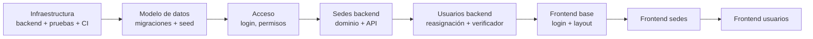

# 11. Plan de implementación: sedes y acceso

Primera iteración de código. Entrega el **módulo completo de sedes** y las bases de las que depende: persistencia, acceso (login, usuarios, roles y permisos), pruebas y frontend base. Las reglas están en [negocio](../negocio/01-sedes.md) y [funcional](../funcional/01-sedes.md); acá se fija el **alcance técnico**, el **orden** y la **cadena de ramas y PR**.

## Alcance

### Incluido

| Área | Contenido |
|------|-----------|
| Infraestructura backend | Configuración (`pydantic-settings`), SQLAlchemy 2.0 y sesión por solicitud, Unit of Work, Alembic, formato de errores único, manejadores de excepciones, reloj inyectable |
| Base de datos | Migraciones `0001` a `0003` ([Modelo de datos](04-modelo-de-datos.md#migraciones-y-datos-de-ejemplo)): catálogo geográfico, usuarios, socios (solo estructura), sedes, horarios, excepciones, historial |
| Seed | Provincia y localidades de Córdoba, 4 sedes, usuarios administrador, dos bibliotecarios y socio, un socio de demostración |
| Acceso | Login, `GET /auth/me`, JWT, Argon2id, roles y permisos, dependencia `requiere(Permiso.X)`; usuarios del personal (alta, listado, modificación y reasignación, baja y reactivación) |
| Sedes | Dominio, servicio, repositorios, API completa (ver [API](06-api.md#sedes)), excepciones de horario, historial, catálogos de provincias y localidades |
| Verificación de baja | Puerto, compuesto y verificador de **bibliotecarios** (el único que hoy tiene datos); verificadores falsos para el resto en las pruebas |
| Pruebas | Estructura completa de [Testing](07-testing-y-calidad.md), fábricas, fakes, contrato, script de trazabilidad de criterios |
| CI | Workflow de GitHub Actions: backend, frontend, migraciones y trazabilidad |
| Frontend | Base (design system mínimo, cliente HTTP, sesión, rutas protegidas, layout con menú lateral y AppBar, login, inicio por rol), módulo de sedes (listado, detalle, formulario, excepciones, historial, diálogos) y **pantalla de usuarios del personal** (listado, alta, edición con reasignación de sede, baja y reactivación) |

### Fuera de alcance (a propósito)

| Tema | Por qué / cuándo |
|------|------------------|
| Verificadores de ejemplares, préstamos, remitos y reservas | Los módulos aún no existen; cada uno aporta el suyo en su PR (contrato en [Patrones](05-patrones-de-diseno.md#10-strategy--composite-verificación-de-baja-de-sede)). Mientras tanto la baja solo se bloquea por bibliotecarios |
| Aplicar `validar_operativa()` en préstamos, reservas, remitos, ejemplares y socios | Lo hará cada módulo; hoy queda el método, la excepción y la regla en el dominio, con pruebas de contrato |
| Módulo de socios | Solo se crea la estructura de la tabla (necesaria para el usuario socio y su clave foránea) |
| Refresh token, bloqueo por intentos, recuperación de contraseña, doble factor | Ver [D6](00-stack-y-decisiones.md#d6-autenticación-y-permisos) |
| Historial de usuarios | Se registra quién modificó cada usuario (`actualizado_por`), sin tabla de eventos |
| Barrios y código postal, catálogo completo de localidades | Carga posterior por migración de datos |
| Aplicar excepciones de horario como bloqueo de operaciones | Hoy solo informan (`abierta_ahora`); los procesos de envío y retiro decidirán si las usan |
| Exportaciones y reportes de sedes | Los reportes se tratan en su iteración |

## Análisis de dependencias

- **Sedes necesita acceso:** todos sus endpoints exigen rol y la auditoría guarda el usuario que actúa.
- **Acceso necesita sedes y viceversa en el modelo** (`usuario.sede_id` y `sede.creado_por_id`): por eso las tablas se crean juntas, en una migración, y el dominio de acceso va antes que el de sedes.
- **El verificador de bibliotecarios depende de usuarios**, y por eso es el único real de esta iteración (llega en el PR 6, que depende del repositorio de sedes del PR 5).
- **El frontend base** solo necesita el contrato de la API (`/auth/login`, `/auth/me`); puede desarrollarse contra MSW sin esperar al backend, pero se integra al final de la cadena.

## Cadena de ramas y PR

PR **encadenados** (*stacked*): cada rama sale de la anterior y su PR apunta a la rama previa, no a `main`. Cada PR es chico y revisable por separado y el conjunto entrega el alcance completo. Se respeta `CONTRIBUTING.md`: prefijos, commits convencionales en español, PR en borrador hasta que esté listo, una aprobación, squash.

| # | Rama | Base | Contenido | Criterios cubiertos |
|---|------|------|-----------|---------------------|
| 1 | `docs/sedes-y-auth-base` | `main` | Esta documentación: negocio, funcional, técnica y plan | — |
| 2 | `chore/infra-backend-y-testing` | 1 | Dependencias, configuración, sesión y Unit of Work, Alembic vacío, manejo de errores y `ErrorDeValidacion`, reloj, estructura de `tests/` con fixtures, fábricas y fakes base, script de trazabilidad de CA, workflow de CI, actualización de `CLAUDE.md` con los comandos | — |
| 3 | `feature/modelo-datos-sedes-acceso` | 2 | Modelos ORM, migraciones `0001` a `0003`, seed (`python -m app.db.seed`), pruebas de integración de restricciones (códigos, CHECK, exclusión de horarios, disparador del historial) | `CA-SED-04` (parte de base) |
| 4 | `feature/auth-base` | 3 | `Usuario`, `Rol`, `Permiso`, seguridad (hash y JWT), `/auth/login` y `/auth/me`, dependencias de autenticación y autorización, pruebas rol × endpoint | `CA-ACC-01` a `07`, `11`, `12`, `13` |
| 5 | `feature/sedes-backend` | 4 | Dominio de sede (objetos de valor, excepciones de horario, eventos), `SedeService`, repositorios, puerto y compuesto de verificación, controladores y DTOs por rol, catálogos, historial, pruebas en todos los niveles | `CA-SED-01` a `47` (los que no dependen de módulos futuros) |
| 6 | `feature/usuarios-backend` | 5 | API de usuarios del personal (alta, listado, modificación y reasignación, baja y reactivación), verificador de bibliotecarios asignados, pruebas | `CA-ACC-08` a `10`, `14`, `CA-SED-16`, `22`, `25` |
| 7 | `feature/frontend-base` | 6 | Dependencias, tokens y componentes base, cliente HTTP y `ApiError`, sesión y rutas protegidas, `AppLayout`, login, inicio por rol, MSW y pruebas | — |
| 8 | `feature/frontend-sedes` | 7 | Pantallas y diálogos del módulo de sedes, hooks, mapa de errores, pruebas | `CA-SED-*` vistos por el usuario |
| 9 | `feature/frontend-usuarios` | 8 | Pantalla de usuarios del personal: listado con filtros, alta, edición con reasignación de sede, baja y reactivación; enlace desde el diálogo de baja de sede | `CA-ACC-08` a `10` vistos por el usuario |

Los criterios de sede que dependen de módulos futuros (`CA-SED-05` a `07`, `17` a `20`, `09`, `24`) se prueban en esta iteración con **verificadores falsos** y con el contrato; la prueba con datos reales llega en el PR de cada módulo.

### Qué lleva cada PR

Cada PR de código incluye sus pruebas, la actualización de la documentación afectada y la actualización de la tabla de trazabilidad. Los PR 3 y siguientes no se abren hasta que el anterior esté en borrador y pase la integración continua, para no apilar defectos.

### Mecánica de la cadena

1. Cada rama se crea desde la anterior: `git switch -c <rama> <rama-previa>`.
2. El PR de cada rama apunta (`base`) a la rama previa. El PR 1 apunta a `main`.
3. Los PR se abren como **borrador** y se marcan «listos» en orden.
4. Al mergear un PR con **squash**, GitHub reapunta el siguiente a `main` si la rama previa se borra. Las ramas siguientes quedan con commits «viejos» de la previa, así que se **rebasean** sobre `main` con `git rebase --onto main <rama-previa-original> <rama>` y `git push --force-with-lease` (solo en ramas propias, nunca en `main`).
5. Los cambios pedidos en revisión de un PR intermedio se hacen en su rama y se **propagan** rebaseando las siguientes.
6. En los commits no se agrega coautor de IA; el push usa el remote `github.com-personal` ya configurado. `gh` no está autenticado: el PR se abre desde el enlace que devuelve el push.

### Convención de commits y tamaño

- `docs:`, `chore:`, `feat:`, `test:` según corresponda; un commit por unidad lógica (por ejemplo, en el PR 5: dominio, repositorios, servicio, controladores, pruebas).
- Un PR no debería superar ~800 líneas de código sin contar migraciones, fábricas y documentación. Si lo supera, se parte.

## Orden interno del PR 5 (sedes backend)

1. Objetos de valor (`CodigoSede`, `Telefono`, `Email`, `Direccion`, `FranjaHoraria`, `ExcepcionHorario`) con sus pruebas unitarias.
2. Entidad `Sede` (estados, horarios, excepciones, `esta_abierta`, `validar_operativa`) y sus excepciones, guiada por `CA-SED-*` unitarios.
3. Puerto `VerificadorImpedimentoBaja`, compuesto y prueba de contrato.
4. Puerto `SedeRepository`, repositorio en memoria y repositorio SQLAlchemy con `obtener_para_operar` (`FOR SHARE`) y `obtener_para_modificar` (`FOR UPDATE`).
5. `SedeService`: alta, modificación (con versión y dirección duplicada), baja, reactivación, excepciones, historial; Unit of Work por caso de uso.
6. DTOs por rol, controladores, catálogos, registro en `main.py` y manejador de errores.
7. Pruebas de integración (restricciones y concurrencia) y de API (matriz rol × endpoint).
8. Ejemplos de [API](06-api.md) sincronizados con los esquemas y prueba de OpenAPI.

## Riesgos y mitigaciones

| Riesgo | Mitigación |
|--------|-----------|
| Las exclusiones `btree_gist` se comportan distinto según la versión de PostgreSQL o falta la extensión | La migración `0001` la crea con `IF NOT EXISTS`; CI usa PostgreSQL 16 igual que el entorno local |
| La baja se «completa» antes de tiempo por los verificadores que faltan | Prueba de contrato con lista de pendientes que solo puede achicarse; el [documento de negocio](../negocio/01-sedes.md) y este plan lo declaran |
| Carrera entre baja y alta de operaciones sobre la misma sede | Contrato `obtener_para_operar` (`FOR SHARE`) frente a `FOR UPDATE` de la baja y prueba de concurrencia |
| Un PR apilado hereda un defecto del anterior | Cada PR se abre en borrador y con CI verde antes de seguir |
| Catálogo de localidades incompleto | Lista inicial de las principales localidades y carga completa por migración posterior |
| Datos de demostración con contraseñas conocidas en un entorno real | El seed se niega fuera de `desarrollo` y `test`; la contraseña sale de `SEED_PASSWORD` |

## Definición de terminado de la iteración

- Los 9 PR mergeados, con CI en verde.
- `docker compose up` levanta la base, aplica migraciones y el seed deja entrar con los cuatro usuarios de demostración.
- Todos los criterios `CA-SED-*` y `CA-ACC-*` tienen prueba con su marcador (salvo los marcados como pendientes de módulo, listados en el contrato).
- Un administrador puede, desde la interfaz: ingresar, crear, editar y consultar sedes, cargar horarios y excepciones, dar de baja (con el diálogo de bloqueo) y reactivar, ver el historial, y administrar los usuarios del personal (alta, reasignación de sede, baja y reactivación). Un bibliotecario y un socio ven solo lo que su rol permite.
- Documentación al día y `CLAUDE.md` con los comandos de instalación, pruebas y lint.
