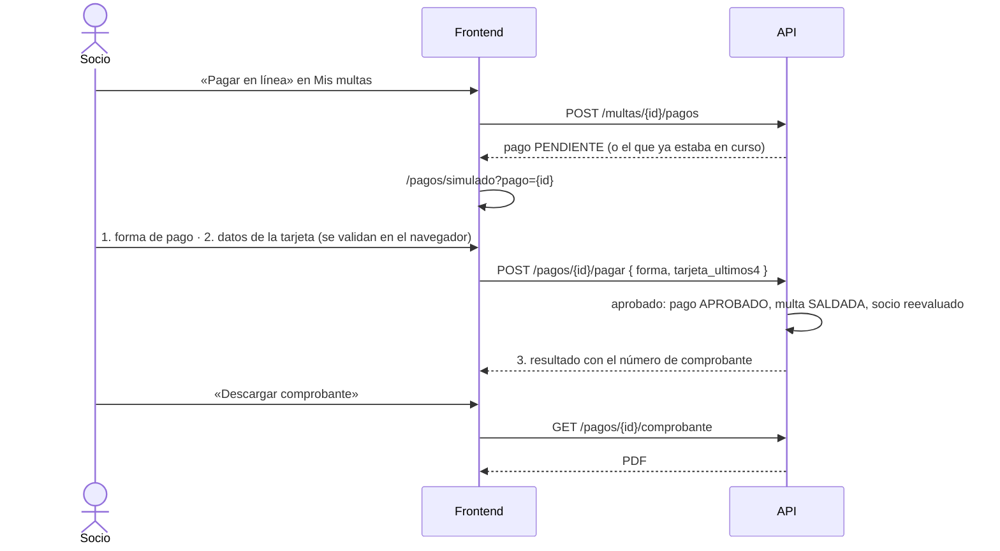

# 12. Pago de multas

Extensión del proceso 8 (devoluciones y multas): la multa se paga **en el mostrador** (el bibliotecario registra el medio) o **en línea** por el socio. El pago en línea es una **simulación** para la demo: no hay cobro real ni pasarela externa. Todo pago aprobado tiene su **comprobante en PDF**. Reglas de negocio en [negocio/07](../negocio/07-devoluciones.md#cómo-se-paga-una-multa); requerimientos RF-DEV-17 a 22 en [funcional/07](../funcional/07-devoluciones.md).

## Flujo del pago en línea

**Checkout simulado (`/pagos/simulado?pago=ID`)**, en tres pasos:

1. **Forma de pago:** tarjeta de crédito, tarjeta de débito o dinero en cuenta, con el resumen de la multa (préstamo, libro, concepto —atraso, daño o extravío— y total).
2. **Datos:** con tarjeta, número (validado con el algoritmo de Luhn y agrupado de a cuatro, con la marca), titular, vencimiento `MM/AA` no vencido y código de seguridad. **Solo los últimos 4 dígitos viajan al servidor**; el resto se valida en el navegador y se descarta al confirmar. Con dinero en cuenta no se pide nada más.
3. **Resultado:** aprobado (con el número de comprobante y «Descargar comprobante») o rechazado (con el motivo e «Intentar de nuevo», que inicia otro pago).

**Tarjetas de prueba:** la terminada en `0002` (por ejemplo `4000 0000 0000 0002`) se **rechaza**; cualquier otra válida (por ejemplo `4509 9535 6623 3704`) se **aprueba**. Dinero en cuenta siempre se aprueba. La regla vive en el dominio (`Pago.pagar_en_linea`).

## Comprobante

`GET /pagos/{id}/comprobante` devuelve un PDF A4 (`comprobante-PG-<año>-<id>.pdf`) para cualquier pago **aprobado**, de mostrador o en línea. Incluye el número `PG-<año>-<id>`, fecha y hora (zona de negocio), socio y número de socio, concepto (préstamo y por qué se cobra: «atraso de 5 días», «daño del ejemplar» o «extravío del ejemplar»), libro, medio de pago (con la tarjeta enmascarada, «terminada en 3704»), comprobante del cobro y quién cobró (mostrador), total y, si es en línea, la aclaración de que es un pago simulado. El socio descarga los de sus pagos (desde el resultado del checkout o desde «Mis multas»); el personal, cualquiera.

El PDF se genera sin dependencias (`app/utils/pdf.py`): una página con las fuentes estándar Helvetica en codificación WinAnsi, que admite acentos y «ñ». Un pago no aprobado responde `409`.

## Reglas

- **Mostrador:** `POST /multas/{id}/saldar` con el medio (efectivo, débito, crédito o transferencia) y un comprobante opcional. El pago nace `APROBADO` y cancela el pago en línea en curso.
- **Un solo cobro:** la base permite un solo pago `APROBADO` y uno `PENDIENTE` por multa. Si el mostrador cobra mientras hay un pago en línea en curso, ese pago queda `CANCELADO` y ya no se puede pagar.
- **Permisos:** el personal cobra en el mostrador (`MULTA_SALDAR`); el socio inicia y paga solo pagos de **sus** multas (`MULTA_PAGAR_PROPIA`).

## Integrar una pasarela real más adelante

El pago en línea ya separa «iniciar» (queda `PENDIENTE`) de «resultado» (`aprobar` o `rechazar`). Para cobrar de verdad habría que reemplazar el checkout simulado por el de un proveedor (que es quien recibe los datos de la tarjeta) y que el resultado lo informe el proveedor, consultado desde el servidor, sin cambiar el modelo de la multa ni del pago.
